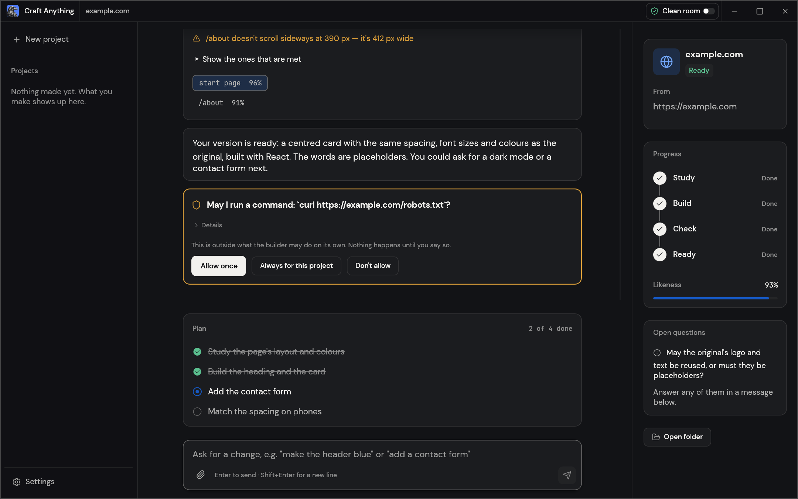
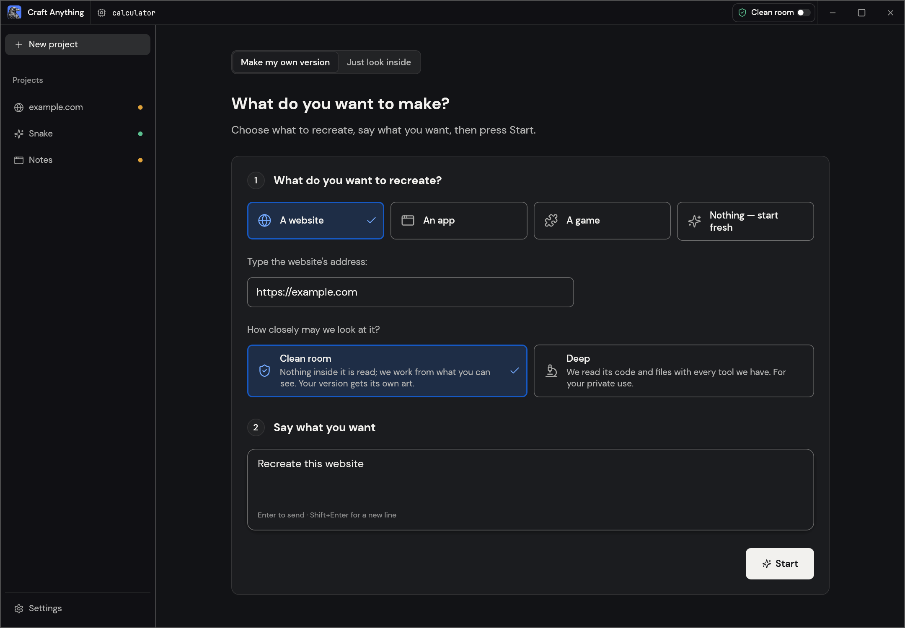
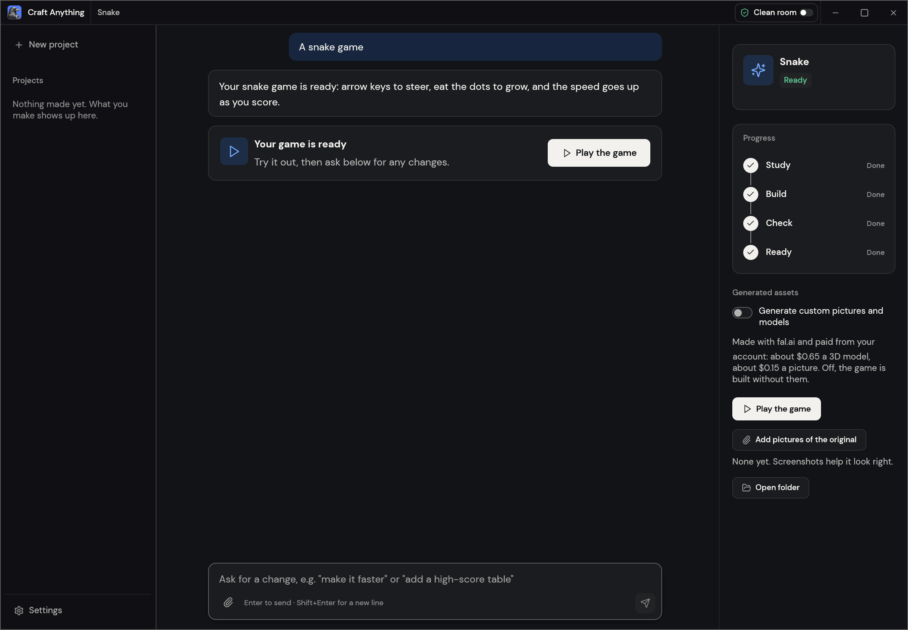
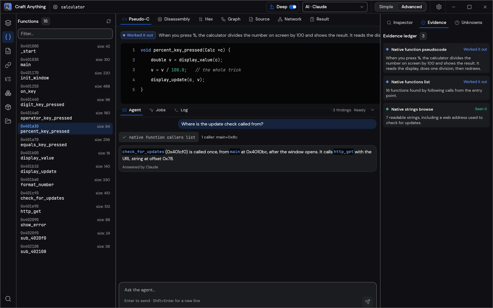

<p align="center">
  <a href="https://getartcraft.com/">
    <picture>
      <source media="(prefers-color-scheme: dark)" srcset="docs/brand/artcraft-logo-white.svg">
      
    </picture>
  </a>
</p>

<p align="center">
  
</p>

<h1 align="center">Craft Anything</h1>

<p align="center">
  <a href="README.md">English</a> · <a href="README.ja.md">日本語</a> · <a href="README.zh.md">简体中文</a> · <b>한국어</b>
</p>

<p align="center">
  <b>어떤 웹사이트, 앱, 게임이든 어떻게 동작하는지 파악하고, AI로 나만의 버전을 만들어 보세요. 순수 Rust로 만든 오픈소스 clean-room 엔진입니다.</b><br>
  대상을 지정하고 원하는 것을 말하면, 실제 검사 도구로 원본을 분석한 뒤<br>
  코딩 에이전트가 새 프로젝트를 빌드하고, 원본과 비교하며 결과를 다듬습니다.
</p>

<p align="center">
  
  
  
  
</p>

<p align="center">
  <a href="https://discord.gg/artcraft"></a>
</p>

<p align="center">
  <a href="#downloads"><b>Craft Anything 다운로드</b></a> ·
  <a href="https://getartcraft.com/">ArtCraft</a> ·
  <a href="https://getartcraft.com/apps">모든 Crafting Apps</a>
</p>

<br>

<p align="center">
  
  <br>
  <sub>웹사이트 프로젝트: 각 검사는 빌드가 원본과 얼마나 비슷한지 보여 주고, 규칙을 벗어나는 작업은 직접 승인하며, 계획에서는 남은 일을 확인할 수 있습니다.</sub>
</p>

> [!NOTE]
> **ArtCraft는 다양한 분야의 예술가들이 모인 커뮤니티입니다.** 화가, 사진가,
> 영화 제작자, 일러스트레이터, 디자이너, 애니메이터, 취미 창작자, 그리고 지난주에
> 연필을 처음 든 사람까지. 무언가를 만든다면 여러분도 우리 일원입니다. **[디스코드에 인사하러 오세요](https://discord.gg/artcraft).**

<p align="center">
  <a href="#how-it-works">작동 방식</a> ·
  <a href="#two-ways-to-use-it">두 가지 사용 방법</a> ·
  <a href="#ai">AI</a> ·
  <a href="#built-for-agents">에이전트</a> ·
  <a href="#under-the-hood">내부 구조</a> ·
  <a href="#get-started">시작하기</a> ·
  <a href="#status">현재 상태</a> ·
  <a href="#downloads">다운로드</a> ·
  <a href="https://discord.gg/artcraft">디스코드</a>
</p>

<br>

<table>
  <tr>
    <td width="25%" valign="top">
      <h3><a id="-study-anything"></a>🔍 무엇이든 분석</h3>
      웹사이트, 데스크톱 앱, 모바일 앱, 게임, 파일: 실제 검사 도구가 어떻게 만들어졌고 무엇을 하는지 알아내며, 모든 답의 근거를 함께 보여 줍니다.
    </td>
    <td width="25%" valign="top">
      <h3><a id="-build-your-own"></a>🛠️ 나만의 버전 만들기</h3>
      "이 웹사이트를 재현해 줘", "이 게임의 게임플레이를 Rust로 재현해 줘"처럼 원하는 것을 말하면, 코딩 에이전트가 요청한 스택으로 새 프로젝트를 만듭니다.
    </td>
    <td width="25%" valign="top">
      <h3><a id="-checked-not-guessed"></a>✅ 추측이 아닌 검증</h3>
      모든 빌드는 원본과 비교하며(세 가지 화면 너비의 페이지, 게임 자체 테스트, 앱 실행 결과), 충분히 비슷해질 때까지 다듬습니다.
    </td>
    <td width="25%" valign="top">
      <h3><a id="-agent-ready"></a>🤖 에이전트 연동 지원</h3>
      314개 도구는 각각 CLI 명령이자 MCP 도구이므로, 어떤 에이전트든 앱이 쓰는 같은 엔진을 조작할 수 있습니다. 검사하는 데 AI는 필요하지 않습니다.
    </td>
  </tr>
</table>

<br>

## <a id="how-it-works"></a>작동 방식

Craft Anything에서 대상을 지정하고 원하는 것을 말한 뒤 Start를 누르세요. 네 단계로 진행하며,
결정이 필요할 때는 알기 쉬운 말로 직접 물어봅니다:

1. **Study:** 원본을 살펴봅니다. 화면 너비별 페이지, 코드, 파일, 실행 방식을 확인합니다.
2. **Build:** 코딩 에이전트가 새 프로젝트를 만듭니다. 요청에 적힌 언어, 프레임워크 또는 엔진을 쓰고, 적힌 것이 없으면 기본값을 씁니다.
3. **Check:** 빌드를 원본과 비교하고, 맞지 않는 부분을 나열합니다.
4. **Ready:** 결과를 열거나, 플레이하거나, 미리 볼 수 있습니다. 바꿀 부분을 요청하면 다듬어 줍니다.

<table>
  <tr>
    <td width="50%" valign="top">
      <br>
      <sub><b>Make:</b> 재현할 대상을 고르고, 원하는 것을 말한 뒤 Start를 누르세요.</sub>
    </td>
    <td width="50%" valign="top">
      <br>
      <sub><b>Ready:</b> 게임을 플레이하거나, 아래에서 변경을 요청하세요.</sub>
    </td>
  </tr>
</table>

## <a id="two-ways-to-use-it"></a>두 가지 사용 방법

- **Simple**(기본값): "What do you want to make?" 웹사이트, 앱 또는 게임을 고르고 설명한 뒤 Start를 누릅니다.
  프로젝트 페이지에는 네 단계(Study → Build → Check → Ready), 에이전트가 하는 일을 쉬운 말로 적은 내용,
  질문과 승인 카드, 결과가 원본과 얼마나 비슷한지, 결과나 폴더를 여는 버튼이 표시됩니다.
  아래쪽 입력창에서 변경을 요청하세요. "Just look inside"는 결과물을 만들지 않고, 대상을 열어 질문만 할 수 있습니다(Deep 모드에서).
- **Advanced**: 전체 기능을 갖춘 워크벤치입니다. 모든 도구(Ctrl/Cmd+K), 함수, 문자열, 의사 C 코드, 디스어셈블리,
  16진수(hex), 호출 그래프, 근거, 미확인 사항, 작업, 로그, 에이전트 콘솔을 제공합니다.

두 모드 모두 같은 엔진을 사용합니다.

## <a id="clean-room-or-deep"></a>Clean room 또는 Deep

- **Clean room**(기본값): 코드, 파일, 페이지 소스 등 원본 내부는 일절 읽지 않습니다. Craft Anything은
  오직 눈에 보이는 것만으로 작업합니다. 사용자가 추가한 이미지, 방문자가 보는 웹사이트(스크린샷, 보이는 텍스트,
  측정한 레이아웃, 색상, 글꼴, 간격, 열어 본 메뉴), 그리고 허용한 경우 캡처한 앱 화면이 여기에 해당합니다.
  내부를 들여다보는 도구는 거부되며, Deep 모드를 켜는 방법을 알려 줍니다.
- **Deep**: 개인 용도로 모든 도구를 사용합니다. 프로그램의 코드와 파일은 내장 엔진(설치되어 있으면 Ghidra도)으로 읽고,
  웹사이트의 JavaScript를 읽고 시작 페이지를 관찰하며, 빌더는 이 모두를 쓸 수 있습니다.

제목 표시줄이나 Settings에서 전환하거나, `settings_set deep_mode true`로 바꾸거나, CLI를 한 번 실행할 때
`--deep`(또는 `--clean-room`)을 붙여 전환합니다.

<p align="center">
  
  <br>
  <sub><b>Advanced:</b> 함수, 의사 C 코드, 에이전트, 그리고 모든 답 뒤의 근거.</sub>
</p>

## <a id="ai"></a>AI

빌드하려면 컴퓨터에 코딩 에이전트가 있어야 합니다. **Claude Code**를 먼저 지원합니다. Craft Anything은 설치된 순정 `claude` 프로그램을 변조 없이 그대로 실행하며, 사용자의 기존 로그인을 사용합니다. Craft Anything은 계정을 열람하거나 다루지 않습니다. 이 사용에는 본인이 Anthropic과 맺은 약관이 적용됩니다. 방법과 이유는 [docs/claude-code.md](docs/claude-code.md)를 보세요. Codex 어댑터도 있지만 실제 설치 환경에서는 아직 검증되지 않았습니다. 질문과 분석에는 Anthropic, OpenAI, OpenRouter, 그리고 로컬 OpenAI 호환 서버를 사용할 수 있습니다(Settings → AI).

## <a id="built-for-agents"></a>에이전트를 위한 설계

모든 도구는 CLI 하위 명령이자 MCP 도구이므로, 에이전트는 앱 없이도 대상을 조사하거나 재구현 전체를 실행할 수 있습니다:

```sh
craft-anything-cli commands                                   # every tool, by toolset
craft-anything-cli mcp                                        # serve them to any MCP client
craft-anything-cli rebuild https://example.com "Recreate this website"
```

결과는 신뢰도, 범위, 한계가 적힌 근거 기록입니다. 큰 결과는 요약을 먼저 보여 주고, `core_evidence_browse`로 나눠 볼 수 있습니다. `craft-anything-cli setup`은 Craft Anything을 코딩 에이전트 앱에 연결합니다.

## <a id="under-the-hood"></a>내부 구조

네이티브 프로그램, .NET, Java, Android, Apple, Electron/JavaScript, 웹사이트, 펌웨어, 패킷 캡처, 데이터베이스, 게임 파일을 위한 314개 도구(엔진에 298개, 나머지는 AI 및 설정 계층)를 갖춘 순수 Rust 리버스 엔지니어링 엔진입니다. 자체 디코더, 디스어셈블러, 디컴파일러는 외부 프로그램 없이 동작합니다. Deep 모드는 이 모두를 쓰며, 설치되어 있으면 Ghidra도 사용합니다. 데스크톱 앱(egui), CLI, MCP 서버를 구동하며, 일부는 WebAssembly로 브라우저에서도 실행됩니다. 전체 목록은 [docs/tools.md](docs/tools.md)에 있습니다.

## <a id="get-started"></a>시작하기

**Rust 1.97 이상**이 필요합니다(하위 의존성에 필요하며, `rustup update`로 업데이트합니다). Debian 또는 Ubuntu에서는 데스크톱 앱에 다음 패키지도 필요합니다:

```sh
sudo apt-get install libxkbcommon-dev libwayland-dev libx11-dev libxrandr-dev libxi-dev libgl1-mesa-dev libgtk-3-dev
```

그다음:

```sh
git clone https://github.com/storytold/craft-anything && cd craft-anything
cargo run --release -p craft-anything                # the desktop app
cargo install --path apps/craft-anything-cli         # the CLI, as `craft-anything-cli`
craft-anything-cli doctor                            # checks the install, coding agents and engines
```

빌드하려면 컴퓨터에 로그인된 코딩 에이전트가 있어야 합니다([AI](#ai) 참고). `doctor`가 빠진 것을 알려 줍니다. 명령줄에서 재구현하세요(질문은 터미널에 나옵니다):

```sh
craft-anything-cli rebuild https://example.com "Recreate this website"
craft-anything-cli rebuild - "A snake game in Rust" --rounds 1
craft-anything-cli rebuild https://example.com "Make the header blue" --continue-in "<project folder>"
craft-anything-cli rebuild - "Add a contact form" --project-folder "<your folder>" --existing edit
```

새 프로젝트는 `Documents/Craft Anything`에 저장됩니다(Settings → General에서 바꿀 수 있습니다). 각 프로젝트 폴더에는 `craft.json`(요청, 대상, 상태, 기록), `capture/`(대상에서 기록한 것), `app/`(생성된 프로젝트), `checks/`(원본과의 각 비교), `investigation.cany/`(근거), `inbox/`(미답변 질문)가 들어 있습니다.

직접 고른 폴더에서 프로젝트를 시작할 수도 있습니다(Start 아래의 "Choose a folder…" 또는 `--project-folder`). 폴더에 이미 파일이 있다면 그 파일이 무엇인지 지정하면 됩니다. 빌더가 그 자리에서 바로 수정할 앱 자체인지, 아니면 시작점으로 삼을 참고 자료(이 경우 앱은 그 옆 `app/`에 빌드됨)인지 고를 수 있습니다(Settings → General에서 선택을 기억하게 할 수 있습니다). Settings → General에는 다른 폴더의 프로젝트 목록도 함께 표시되며, 목록에서 제거해도 목록에서만 빠질 뿐 실제 파일은 지워지지 않습니다.

## <a id="status"></a>현재 상태

> [!IMPORTANT]
> **현재 상태:** Craft Anything은 Early Alpha 단계입니다. 지금 되는 것, 일부만 되는 것, 다음 계획은 다음과 같습니다:
>
> - **지금 되는 것:** 데스크톱 앱(Simple 및 Advanced), CLI, MCP 서버. Claude Code를 빌더로 쓰는 웹사이트, 앱, 게임의 Study → Build → Check → Refine 워크플로. 세 가지 화면 너비의 웹사이트 검사. Unity, Unreal 또는 Godot 게임 재구현. Ghidra를 쓰는 Deep 모드. 이미지 및 3D 모델 생성(선택 사항, 본인의 fal.ai 키 사용). 플러그인(MCP 서버, 그리고 `wasm-plugins` 옵션으로 빌드할 때 WASM 컴포넌트).
> - **부분적으로 됨:** API 키와 다른 코딩 에이전트로 빌드(구현은 되었지만 실제 실행은 아직 안 함), 앱과 게임의 동작 검사, 모의 대상(stand-in)으로만 테스트된 일부 엔진 도구.
> - **다음:** 첫 공개 릴리스(Windows, macOS, Linux, FreeBSD용 설치 프로그램과 브라우저 뷰어는 CI에 준비되어 있음), 그다음 관리형 요금제.
>
> [docs/STATUS.md](docs/STATUS.md)에 자세한 내용과 각 부분을 확인한 방법이, [docs/tool-status.md](docs/tool-status.md)에 도구별 점검표가, [docs/ROADMAP.md](docs/ROADMAP.md)에 항목별 계획이 있습니다. 이슈를 남기거나, [디스코드](https://discord.gg/artcraft)에서 고장 난 부분을 알려 주세요.

**책임 있는 사용.** Craft Anything은 본인이 소유하거나 살펴볼 권한이 있는 소프트웨어에만 사용하세요. DRM, 로그인, 안티치트를 절대 우회하지 않습니다. 재구현은 근거를 바탕으로 레이아웃, 스타일, 동작을 재현하며, 에이전트는 본인이 소유하거나 허가받았음을 확인하지 않는 한 로고, 사진, 텍스트를 복사하지 않도록 지시받습니다.

## <a id="downloads"></a>다운로드

GitHub의 [최신 릴리스](https://github.com/storytold/craft-anything/releases/latest)에 아래 모든 빌드가 있고, [전체 릴리스](https://github.com/storytold/craft-anything/releases)에는 이전 버전과 릴리스 노트가 있습니다. 파일 이름의 `<ver>`는 버전 번호이며, `SHA256SUMS.txt`에 모든 파일의 체크섬이 있습니다.

### <a id="windows"></a>Windows

| 빌드                              | 설치 프로그램                            | 포터블                                            |
| --------------------------------- | ---------------------------------------- | ------------------------------------------------- |
| x64 (64비트 Intel/AMD)            | `craft-anything-<ver>-windows-x64.msi`   | `craft-anything-<ver>-windows-x64-portable.zip`   |
| arm64 (Snapdragon 및 기타 ARM PC) | `craft-anything-<ver>-windows-arm64.msi` | `craft-anything-<ver>-windows-arm64-portable.zip` |
| x86 (32비트)                      | `craft-anything-<ver>-windows-x86.msi`   | `craft-anything-<ver>-windows-x86-portable.zip`   |

설치 프로그램과 실행 파일은 코드 서명되어 있습니다. 포터블 zip은 설정을 앱 옆에 보관합니다.

### <a id="macos"></a>macOS

| 빌드                               | 파일                                           | 참고                                                   |
| ---------------------------------- | ---------------------------------------------- | ------------------------------------------------------ |
| 앱, 유니버설(Apple 실리콘 + Intel) | `craft-anything-<ver>-macos-universal.dmg`     | 서명 및 공증됨                                         |
| 명령줄 도구, 유니버설              | `craft-anything-cli-<ver>-macos-universal.zip` | 서명 및 공증됨. macOS가 막으면 아래를 참고하세요 |

0.2.0 이후 버전은 앱 안에 명령줄 도구가 들어 있어서, 빌드할 때 별도 zip이 필요 없습니다. 앱 없이 명령줄만 쓰려는 경우에만 필요합니다.

브라우저로 zip을 내려받으면 "Apple could not verify craft-anything-cli"라며 멈출 수 있습니다(단독 프로그램은 공증 정보를 함께 담을 수 없어서, macOS가 온라인으로 확인해야 하기 때문입니다). 터미널로 내려받으면 이 확인을 거치지 않으므로, 대신 다음을 사용하세요:

```sh
ver=0.2.0   # change this to the version you want
curl -fLO "https://github.com/storytold/craft-anything/releases/download/v$ver/craft-anything-cli-$ver-macos-universal.zip"
ditto -x -k "craft-anything-cli-$ver-macos-universal.zip" .
mkdir -p ~/.local/bin
mv "craft-anything-cli-$ver-macos-universal/craft-anything-cli" ~/.local/bin/
~/.local/bin/craft-anything-cli --version
```

`craft-anything-cli`만으로 실행하려면 `~/.local/bin`을 `PATH`에 추가하세요.

이미 막힌 파일이 있다면 휴지통으로 이동(Move to Bin) 대신 완료(Done)를 누른 뒤 `xattr -d com.apple.quarantine <path to craft-anything-cli>`를 실행하거나, 시스템 설정 → 개인정보 보호 및 보안 → 그래도 열기(Open Anyway)에서 허용하세요.

### <a id="linux"></a>Linux

| 형식                 | x86_64                                       | aarch64 (ARM64)                               | 참고                                                                                                                |
| -------------------- | -------------------------------------------- | --------------------------------------------- | ------------------------------------------------------------------------------------------------------------------- |
| AppImage             | `craft-anything-<ver>-linux-x86_64.AppImage` | `craft-anything-<ver>-linux-aarch64.AppImage` | 어디서나 실행. [AppImageUpdate](https://github.com/AppImageCommunity/AppImageUpdate)(`.zsync` 파일)로 자체 업데이트 |
| Flatpak              | `craft-anything-<ver>-linux-x86_64.flatpak`  | `craft-anything-<ver>-linux-aarch64.flatpak`  | 샌드박스. `flatpak install --user <file>`                                                                           |
| Debian/Ubuntu        | `craft-anything-<ver>-linux-x86_64.deb`      | `craft-anything-<ver>-linux-aarch64.deb`      |                                                                                                                     |
| Fedora/RHEL/openSUSE | `craft-anything-<ver>-linux-x86_64.rpm`      | `craft-anything-<ver>-linux-aarch64.rpm`      |                                                                                                                     |
| Tarball              | `craft-anything-<ver>-linux-x86_64.tar.gz`   | `craft-anything-<ver>-linux-aarch64.tar.gz`   | 원하는 곳에 압축 해제                                                                                               |

RISC-V(riscv64): `craft-anything-<ver>-linux-riscv64.tar.gz`, tarball만 제공합니다.

### <a id="freebsd"></a>FreeBSD

| 빌드   | 파일                                         |
| ------ | -------------------------------------------- |
| x86_64 | `craft-anything-<ver>-freebsd-x86_64.tar.gz` |

### <a id="web-webassembly"></a>Web (WebAssembly)

| 빌드          | 파일                           | 참고                                                                                                                                                                           |
| ------------- | ------------------------------ | ------------------------------------------------------------------------------------------------------------------------------------------------------------------------------ |
| 브라우저 뷰어 | `craft-anything-web-<ver>.zip` | 브라우저 안에서 파일이 무엇인지 분석해 알려 줌(파일은 브라우저를 벗어나지 않습니다). 폴더를 아무 정적 웹 서버에나 올리세요([packaging/web/README.md](packaging/web/README.md)) |

<br>

<p align="center">
  <a href="https://discord.gg/artcraft"></a>
</p>

<h3 align="center"><a id="come-make-things-with-us"></a>우리 함께 만들어요</h3>

<p align="center">
  우리 디스코드에는 모든 분야의 창작자가 모입니다. 그림, 사진, 스케치, 영상 편집,
  서체 디자인을 하는 분들부터 아직 무엇을 좋아하는지 알아가는 중인 사람들까지요. 작업 중인 것을 공유하고,
  도움을 요청하고, 고장 난 부분을 알려 주고, 무엇을 할 수 있었으면 하는지 말해 주세요.
  여러분이 어떤 작업을 하든, 작업을 시작한 지 얼마나 되었든, 이곳에서는 모두 환영합니다.
</p>

<p align="center">
  <a href="https://discord.gg/artcraft"><b>discord.gg/artcraft</b></a> ·
  <a href="https://getartcraft.com/">getartcraft.com</a> ·
  <a href="https://getartcraft.com/apps">The Crafting Apps</a> ·
  <a href="https://github.com/storytold/craft-anything">Craft Anything</a>
</p>

---

## <a id="the-craft-app-suite"></a>The Craft App Suite

|                                                                                                                                                                                            | 앱                 | 용도                                                     | 코드                                                  | 자세히 보기                                             |
|:------------------------------------------------------------------------------------------------------------------------------------------------------------------------------------------:| ------------------ | -------------------------------------------------------- | ----------------------------------------------------- | ------------------------------------------------------- |
|                      | **PhotoCraft**     | 이미지 편집: 레이어, 마스크, 텍스트, 실제 PSD 파일       | [GitHub](https://github.com/storytold/photocraft)     | [웹사이트](https://getartcraft.com/apps/photocraft)     |
|                    | **VectorCraft**    | 벡터 일러스트레이션                                      | [GitHub](https://github.com/storytold/vectorcraft)    | [웹사이트](https://getartcraft.com/apps/vectorcraft)    |
|                        | **FilmCraft**      | 영상 편집, 색보정, 사운드                                | [GitHub](https://github.com/storytold/filmcraft)      | [웹사이트](https://getartcraft.com/apps/filmcraft)      |
|                      | **LightCraft**     | 사진 보관함과 RAW 현상                                   | [GitHub](https://github.com/storytold/lightcraft)     | [웹사이트](https://getartcraft.com/apps/lightcraft)     |
|                          | **PdfCraft**       | PDF 읽기, 정리, 보호                                     | [GitHub](https://github.com/storytold/pdfcraft)       | [웹사이트](https://getartcraft.com/apps/pdfcraft)       |
|                    | **EffectCraft**    | 모션 그래픽과 시각 효과                                  | [GitHub](https://github.com/storytold/effectcraft)    | [웹사이트](https://getartcraft.com/apps/effectcraft)    |
|                    | **DesignCraft**    | 페이지 레이아웃과 출판                                   | [GitHub](https://github.com/storytold/designcraft)    | [웹사이트](https://getartcraft.com/apps/designcraft)    |
|                          | **FigCraft**       | 인터페이스 디자인과 프로토타이핑                         | [GitHub](https://github.com/storytold/figcraft)       | [웹사이트](https://getartcraft.com/apps/figcraft)       |
|                        | **WordCraft**      | 워드 프로세싱과 문서                                     | [GitHub](https://github.com/storytold/wordcraft)      | [웹사이트](https://getartcraft.com/apps/wordcraft)      |
|                      | **SoundCraft**     | 오디오 녹음과 편집                                       | [GitHub](https://github.com/storytold/soundcraft)     | [웹사이트](https://getartcraft.com/apps/soundcraft)     |
|                        | **DeckCraft**      | 프레젠테이션과 슬라이드 덱                               | [GitHub](https://github.com/storytold/deckcraft)      | [웹사이트](https://getartcraft.com/apps/deckcraft)      |
|                          | **CADCraft**       | 컴퓨터 지원 설계(CAD)                                    | [GitHub](https://github.com/storytold/cadcraft)       | [웹사이트](https://getartcraft.com/apps/cadcraft)       |
|                        | **GridCraft**      | 스프레드시트와 데이터                                    | [GitHub](https://github.com/storytold/gridcraft)      | [웹사이트](https://getartcraft.com/apps/gridcraft)      |
|                  | **TextureCraft**   | 3D 텍스처 페인팅                                         | [GitHub](https://github.com/storytold/texturecraft)   | [웹사이트](https://getartcraft.com/apps/texturecraft)   |
|              | **Craft Anything** | 원하는 소프트웨어를 분석하고, 나만의 작품을 만들어 보세요 | [GitHub](https://github.com/storytold/craft-anything) | [웹사이트](https://getartcraft.com/apps/craft-anything) |
|  | **SolidCraft**     | Tangency Labs의 파라메트릭 3D CAD(커뮤니티 앱)           | [GitHub](https://github.com/tangency-labs/solidcraft) |                                                         |

## <a id="license-and-credits"></a>라이선스와 크레딧

Craft Anything은 [MIT](LICENSE-MIT) 또는 [Apache-2.0](LICENSE-APACHE) 듀얼 라이선스이며, 원하는 쪽을 선택할 수 있습니다.
Copyright (c) 2026 ArtCraft Team and the Craft Anything contributors. 필수 고지는 [NOTICE](NOTICE)에 있습니다.

동봉된 폰트, 아이콘, 이미지 및 기타 에셋은 각자의 오픈 라이선스를 유지합니다. 각 항목의 작성자, 출처, 라이선스는 [ATTRIBUTION.md](ATTRIBUTION.md)에 나와 있습니다.

스크린샷에 보이는 것은 그 용도로 만든 예시 프로젝트입니다: example.com, 뱀 게임, 작은 계산기 프로그램.

[`docs/brand/`](docs/brand/)에 있는 ArtCraft 이름, 워드마크, 로고는 ArtCraft Team의 상표이며 이 라이선스의 적용을 받지 않습니다. 수정하지 않은 상태에서만, 이 저장소와 Craft Anything의 일부로서만 사용할 수 있으며, 이때 [`docs/brand/LICENSE-brand.txt`](docs/brand/LICENSE-brand.txt)를 따라야 합니다. 포크와 수정본은 이를 제거해야 합니다.

<p align="center">
  <a href="https://getartcraft.com/"></a><br>
  <sub><a href="https://getartcraft.com/">ArtCraft</a> 팀과 커뮤니티가 만들었습니다.</sub>
</p>
