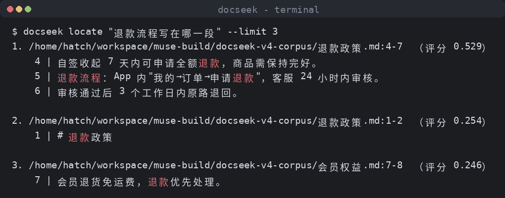
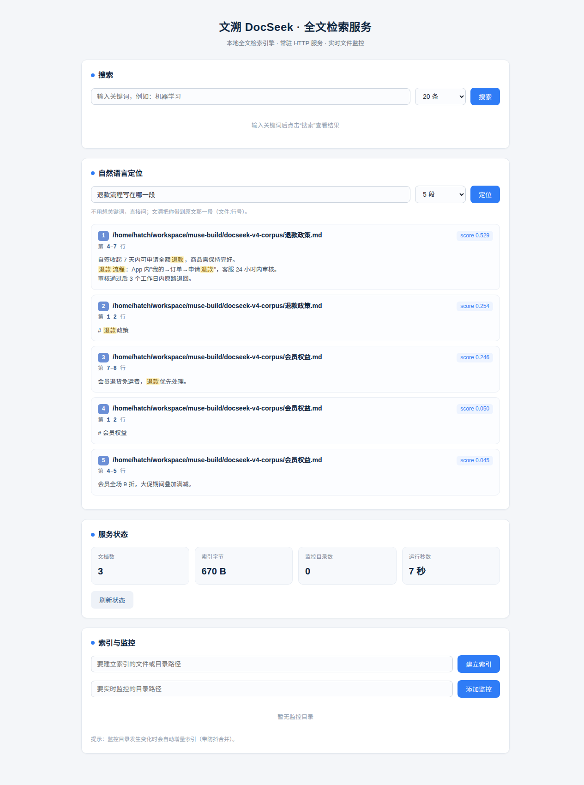

# 文溯 DocSeek · 本地全文检索引擎

**版本：v0.7.0**


DocSeek（文溯）是一个面向本地文档的全文检索引擎，提供 **CLI** 与 **HTTP 常驻服务** 两种使用形态。它使用 SQLite FTS5 作为索引与检索内核，**中文分词采用 cppjieba（v5.6.2，MIT）实现的 FTS5 自定义分词器**，支持递归目录索引、增量更新，以及在服务模式下通过 Linux inotify 实时监控文件变更并自动增量索引。所有数据均保存在本地数据库中，无需任何外部服务。检索侧为**混合检索 v2**：BM25 基础分 + AND→OR 回退 + 标题/短语加成重排序，**权重可配置**（v0.7.0 起）。


---

## 项目简介

DocSeek 的目标是：用最小的依赖、最简的部署方式，为本地纯文本类文档（`.txt` / `.md` / `.markdown` / `.text`）与网页文档（`.html` / `.htm`，v0.6.0 起自动去标签提正文）提供快速、可脚本化、可常驻的全文检索能力。

- **CLI 形态**：`docseek index` / `search` / `stats` / `prune` 等命令，适合脚本、批处理与一次性检索。
- **服务形态**：`docseek serve` 启动一个自研的极简 HTTP 服务器（仅依赖 POSIX sockets 与 C++ 标准库），提供检索 API 与内嵌 Web UI，同时用 inotify 监控目录变更。

---

## 功能特性

### CLI（v1）

- `index <path>... [--ext .txt,.md] [--max-mb N]`
  - 递归索引目录；默认识别 `txt` / `md` / `markdown` / `text` / `html` / `htm`（扩展名大小写不敏感）。
  - `.html` / `.htm` 走 HTML 提取管线：charset 探测（BOM → `<meta>` → 默认 UTF-8，GBK/GB18030/BIG5 等经 iconv 转码）→ 去 `<script>`/`<style>`/`<noscript>` → 提取 `<title>`（入库为文档标题，搜索时标题加权生效）、`<meta name="description">` 与正文（块级标签换行、HTML 实体解码）；提取失败或正文为空时回落为原始文本并记 warn 日志。
  - Web 搜索结果显示文件类型徽标（HTML/MD/TXT），效果见 `docs/screenshots/html-search-badge.png`（真实服务截图）。
  - 自动跳过二进制文件与超过 `--max-mb` 限制的超大文件。
  - 跳过隐藏目录。
  - 基于 **mtime + size** 的增量更新：未变化的文件不会重复索引。
- `search <query...> [--limit N] [--title-boost X] [--phrase-boost Y]`
  - 使用 FTS5 `MATCH`，多个词之间为**隐式 AND**。
  - **BM25** 相关性排序；标题加成权重默认 1.0、短语加成默认 2.0，可用 flag 或环境变量调整。
  - 返回 **30 token 摘要片段**。

- `stats`：查看索引统计信息。
- `prune`：清理失效/无效记录。
- `backup <dest>`：在线备份数据库（SQLite backup API，不阻塞读写）。
- `restore <src>`：用备份文件原子替换当前数据库（先校验有效性）。
- `help` / `version`：帮助与版本信息。
- 全局选项：
  - `--db PATH`：指定数据库路径。
  - `--json`：以 JSON 格式输出结果。
- 退出码：`0` 成功 / `1` 参数错误 / `2` 运行期错误。

### 服务（v2 新增）

- `docseek serve [--port N] [--watch DIR]... [--ext ...] [--max-mb N]`
  - `--port 0` 表示自动分配端口。
  - 启动 HTTP 检索服务。
  - 启动 inotify 实时监控：对新增 / 修改 / 删除的文件自动进行增量索引（带 debounce 去抖）。
  - `Ctrl+C` 优雅停止。
- HTTP API 与内嵌 Web UI（详见下方 API 表格）。
- Web UI 由 `web/index.html` 内嵌为 C++ 字符串直接提供，无需额外静态文件部署。

---

### 自然语言定位（v0.4.0 新增）

不用想关键词，直接用平时说话的方式问，文溯把你带到原文那一段：

```bash
docseek locate "退款流程写在哪一段"
# 1. /docs/退款政策.md:5-9  （评分 0.812）
#     5 | 七天无理由退款：自签收起 7 天内可申请全额退款。
#     6 | 退款流程：App 内"我的→订单→申请退款"，客服 24 小时内审核。
```



- `search` 给你文档列表；`locate` 给你**文件:行号锚点 + 命中词高亮的原文段落**。
- 离线运行：中文疑问句规则解析 → jieba 关键词抽取 → 混合召回 → 段落滑动窗口重排序 → 行号锚定，无模型、无 GPU。
- Web 服务同样可用：首页"自然语言定位"卡片，或 `GET /api/locate?q=...`。



为什么不用 ripgrep / Everything / 云 AI 问答：ripgrep 要你先想好关键词、给的是行不是段落；Everything 只认文件名；云 AI 要上传文档（涉密场景出局）且给的是生成答案不是原文锚点。文溯四条同时满足：离线、中文、自然语言、返回原文位置。

| 组件 | 说明 |
| --- | --- |
| 语言标准 | C++17 |
| 构建系统 | CMake >= 3.28 |
| 编译器 | GCC |
| 检索内核 | SQLite FTS5 + **cppjieba 中文分词器**（v0.3.0 起；v0.2.0 及之前为 `unicode61`） |
| 混合检索 | BM25 + AND→OR 回退 + 标题/短语加成重排序；v0.7.0 起权重可配置（v2） |

| SQLite 来源 | amalgamation，vendored 于 `third_party/sqlite3` |
| 测试框架 | GoogleTest v1.14.0（通过 FetchContent 拉取，**需联网**） |
| 文件监控 | Linux inotify |
| HTTP 服务器 | 自研极简实现，仅 POSIX sockets + 标准库，零第三方网络库 |
| Web UI | `web/index.html` 内嵌为 C++ 字符串 |

---

## 前置依赖

- Linux（inotify 与 POSIX sockets 依赖）
- GCC（支持 C++17）
- CMake >= 3.28
- 构建测试时需要网络（FetchContent 拉取 GoogleTest v1.14.0）

---

## 构建

```bash
cmake -S . -B build -DCMAKE_BUILD_TYPE=Release && cmake --build build -j$(nproc)
```

构建产物：

- `build/docseek`：主程序
- `build/docseek_tests`：测试程序

---

## 测试

```bash
ctest --test-dir build
```

共 **108 个测试用例**，覆盖 Database / Indexer / Searcher / HTTP 服务 / Watcher / Service / 自然语言定位 / 混合检索 / 分词器 / 日志 / 指标 / 备份恢复 / 失败注入 / 批量事务 / 并发守卫 / HTML 文本提取（基础/实体/畸形/编码/性能/集成）等套件。

---

## 使用

### CLI 示例

```bash
# 索引一个目录（默认扩展名）
docseek index ./docs

# 指定扩展名与单文件大小上限
docseek index ./notes --ext .txt,.md --max-mb 10

# 检索（隐式 AND，BM25 排序）
docseek search 全文检索 引擎 --limit 10

# 自然语言定位原文（v0.4.0）：问句直达文件:行号
docseek locate "退款流程写在哪一段"
docseek --json locate "退火温度 450℃ 是哪篇笔记写的" --limit 3

# 指定数据库并输出 JSON
docseek --db /tmp/docseek.db --json search 关键词

# 查看统计 / 清理
docseek stats
docseek prune
```

### serve 示例

```bash
# 启动服务，自动分配端口，监控一个目录
docseek serve --port 0 --watch ./docs

# 指定端口与扩展名
docseek serve --port 8080 --watch ./docs --ext .txt,.md --max-mb 20
```

### HTTP API

| 方法 | 路径 | 说明 |
| --- | --- | --- |
| GET | `/` | Web 检索界面 |
| GET | `/api/health` | 健康检查 |
| GET | `/api/stats` | 索引统计信息 |
| GET | `/api/search?q=关键词&limit=20&title_boost=1.0&phrase_boost=2.0` | 全文检索（标题/短语加成权重可配，显式非法值回 400） |

| GET | `/api/locate?q=自然语言问题&limit=5` | 自然语言定位原文，返回文件:行号锚点与高亮段落（并发上限默认 4，超限回 429） |
| GET | `/api/metrics` | 运行指标：查询量/延迟/Top 查询词/慢查询/限流拒绝数 |
| POST | `/api/index` | 索引指定路径，请求体：`{"path":"..."}` |
| POST | `/api/prune` | 清理无效记录 |
| GET | `/api/watch` | 查询当前监控目录 |
| POST | `/api/watch` | 新增监控目录，请求体：`{"path":"..."}`；成功返回 `{"added":true,"dir":"...","dirs":[...]}` |
| DELETE | `/api/watch?path=...` | 移除监控目录 |

---

## 数据库路径配置

数据库路径的优先级（从高到低）：

1. 命令行选项 `--db PATH`
2. 环境变量 `DOCSEEK_DB`
3. 默认路径 `$HOME/.local/share/docseek/docseek.db`

## 环境变量

| 变量 | 说明 |
|---|---|
| `DOCSEEK_DB` | 数据库文件路径（优先级见上） |
| `DOCSEEK_DICT_DIR` | cppjieba 词典目录。找不到词典时建库/打开会直接报错并列出尝试过的路径；定位顺序：`DOCSEEK_DICT_DIR` → 可执行文件 `../share/docseek/dict` → 可执行文件同级 `dict/` → 编译期默认（构建目录 `dict/`） |
| `DOCSEEK_LOG_LEVEL` | 日志级别：`debug`/`info`/`warn`/`error`，默认 `info` |
| `DOCSEEK_SLOW_MS` | 慢查询阈值（毫秒），默认 `500`，超限记入 `/api/metrics` |
| `DOCSEEK_LOCATE_CONCURRENCY` | `/api/locate` 最大并发数，默认 `4`，超限回 429 |
| `DOCSEEK_LOCATE_WAIT_MS` | 拿不到并发槽位的最大等待（毫秒），默认 `2000` |
| `DOCSEEK_JIEBA_VERBOSE` | 设为 `1` 恢复词典加载噪音日志（排障用） |
| `DOCSEEK_TITLE_BOOST` | 标题加成权重默认值（默认 `1.0`），非法值打警告回默认 |
| `DOCSEEK_PHRASE_BOOST` | 短语加成权重默认值（默认 `2.0`），非法值打警告回默认 |


---

## Docker

项目提供多阶段构建的 `Dockerfile`：

- **构建阶段**：完成编译。
- **运行阶段**：仅保留二进制、词典与必要的运行库，减小镜像体积。

一键部署（需要 Docker）：

```bash
cd docseek && docker compose up -d
```

compose 把 `./data` 挂载持久化数据库、`./docs` 只读挂载为演示语料，详见 `docker-compose.yml` 与 [docs/OPERATIONS.md](docs/OPERATIONS.md)。

---

## 项目结构

```
.
├── CMakeLists.txt
├── Dockerfile
├── docseek/
│   └── .github/          # GitHub Actions 配置（暂置于此，待迁移）
├── src/                  # 源码
├── tests/                # GoogleTest 测试
├── third_party/
│   └── sqlite3/          # SQLite amalgamation（vendored）
└── web/
    └── index.html        # 内嵌 Web UI
```

> **CI 说明**：GitHub Actions 配置当前暂置于 `docseek/.github`，待仓库根目录的 workflow 权限补齐后迁移至仓库根目录。

---

## 搜索质量（v0.7.0）

评测集 `eval/`（44 个中文 query→doc 评测对，覆盖 HTML 语料/中文分词边界/locate 定位），一键运行：

```bash
python3 eval/run_eval.py --binary ./build/docseek --dict ./build/dict
```

实测 Top-1 准确率 **36/44 (81.8%)**（html 10/10 / tok 14/14 / qa 4/12 / noise 6/6 / neg 2/2）。

权重调优示例：

```bash
# 标题党文档太多时压低标题权重
docseek search 全文检索 --title-boost 0.2
# 短语精确匹配优先时拉高短语权重
docseek search 全文检索 --phrase-boost 5
```

评测发现的已知问题（v0.8 排期）：T1 分词器游标逻辑在 CutForSearch 重叠词下会跳过中间 token 导致索引静默丢词；T2 索引/查询切分上下文不一致导致子串 query 漏召回。详见 `docs/PRODUCTION_CHECKLIST_REPORT_v0.7.0.md`。

## 已知局限

- **中文分词（v0.3.0 已解决）**：v0.2.0 及之前 FTS5 的 `unicode61` 分词器不对 CJK 做分词，中文子串检索（如用"检索"搜"全文检索"）无结果。v0.3.0 起引入 cppjieba（v5.6.2，MIT）实现的 FTS5 自定义分词器，建索引/查询双侧一致切词；旧库打开时自动迁移（`PRAGMA user_version` 2→3，重建 FTS 索引）。评测见 [docs/eval.md](docs/eval.md)，10 个中文查询 Top-1 全部符合预期。
- 当前支持纯文本类文档（`.txt` / `.md` / `.markdown` / `.text`）与 HTML（`.html` / `.htm`，v0.6.0）；PDF / Office 等格式的文本提取尚不支持。
- ~~cppjieba 词典加载噪音~~（v0.5.0 已解决）：词典加载期的 limonp 噪音日志现已重定向到 `/dev/null`（`DOCSEEK_JIEBA_VERBOSE=1` 可恢复）。

---

## 后续计划

- PDF / Office 文档的文本提取
- 多用户支持
