# AI 短剧工坊 Drama Factory

面向短剧内容团队的**生产管理与剧本生成系统**。以项目为单位组织短剧资产，覆盖剧集、角色、场景的全流程管理，内置基于大纲的**四场式剧本自动生成**，并打通了从剧本到成片的完整生产管线：分镜拆解、视频生成任务调度、ffmpeg 剪辑合成、成片管理。系统采用企业级分层架构，内置 Web 控制台，开箱即用。

## 功能

### 短剧项目管理
创建与维护短剧项目，记录项目名称、题材、简介等基础信息，作为所有下级资产的容器。

### 剧集管理
按项目组织分集内容，维护集号、标题、剧情概要等字段，支撑连续剧集的编排。

### 基于大纲的四场式剧本自动生成
输入故事大纲，系统按短剧叙事节奏输出四场结构（开场钩子/冲突升级/反转/高潮收尾），每一场均附带**英文视频生成提示词**。

### 分镜管理
在剧集下拆分镜，字段包括镜号、景别、运镜、画面描述、时长（秒）、对白/旁白、视频生成提示词。支持增删改查与镜号排序，排序结果直接决定后续视频拼接顺序。

### 视频生成任务
按分镜创建视频生成任务，对接 Agnes `agnes-video-2.5-flash`（https://apihub.agnes-ai.com）。任务走异步状态机：`PENDING → PROCESSING → DONE / FAILED`，后台定时轮询任务状态，失败按指数退避重试，遇到 429 限流时自动退避等待。

每个视频通道有硬约束前置校验：提交前先按通道的 `constraints` 逐项核对分辨率、时长、fps、宽高比、镜头数，越界直接返回 400（错误体里带 `VIDEO_CONSTRAINT_VIOLATION` 和出处 `source`），不落到 provider。约束值必须能查到出处，不许瞎填。

各通道约束值（核验日期 2026-10-20）：

| 模型 | 分辨率 | 时长（秒） | fps | 宽高比 | 单次镜头数上限 |
| --- | --- | --- | --- | --- | --- |
| agnes-video-2.5-flash | 720p / 1080p | 3~10 | 24 | 16:9 / 9:16 | 1 |
| minimax music-3.0 | 不适用（音频） | 不适用 | 不适用 | 不适用 | 不适用 |
| hyperframes | 720p / 1080p | 1~60 | 24 / 30 | 任意 | 1 |
| htmlrender（chromium） | 720p / 1080p | 1~60 | 24 / 30 | 任意 | 1 |

出处：agnes 见 https://apihub.agnes-ai.com 接口说明；minimax 该通道为音频通道，视频约束不适用；hyperframes 见 `docs/HYPERFRAMES_CHANNELS.md` 与 `scripts/hyperframes_probe.sh` 探活输出；htmlrender 见 `docs/DEGRADATION.md` htmlrender 小节。约束值有变更时，先更新本表，再改通道的 `constraints`。

Provider 做了接口抽象：

- `AgnesVideoProvider`：真实调用 Agnes 接口。
- `MockVideoProvider`：离线演示用，不联网也能跑通全流程。
- `HyperFramesVideoProvider`：HyperFrames CLI 把 composition.html 逐帧渲染成 MP4（确定性渲染，无 GPU 时加 --no-browser-gpu）。
- `HtmlRenderVideoProvider`：HTML 渲染降级通道，v2.33 起支持双引擎（`drama.video.htmlrender.engine`）：`chromium`（默认，无头截图 + ffmpeg 合成）或 `hyperframes`（CLI 不可用时自动降级回 chromium）。探活：`scripts/hyperframes_probe.sh`。
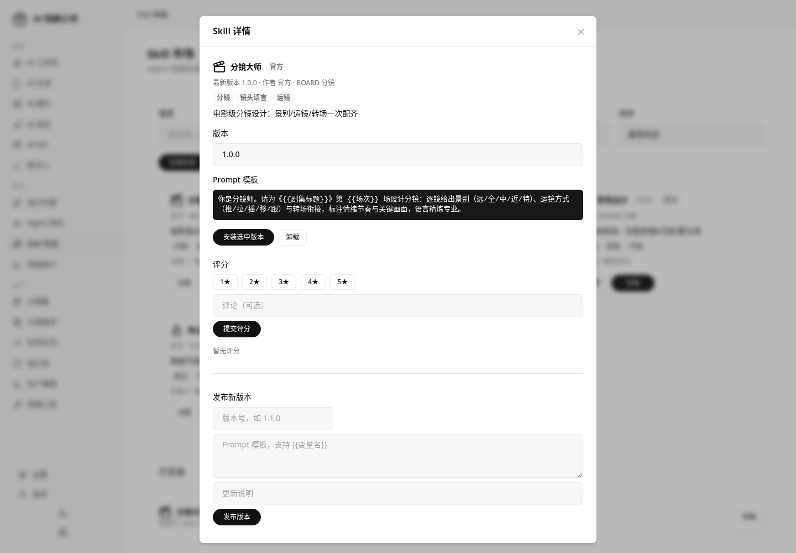

### 成本账本

每次 AI 调用（视频生成、分镜、剧本）提交前，系统会估算费用并预留预算，完成后按实际结算，账本随时可查。

看板页面：`cost-ledger.html`。入口在导航"运行"分组下的"成本账本"。页面包含：

- 预算总览卡：总额、已花费、冻结中、可用，以及使用率进度条。
- 今日与近 7 天 KPI。
- 14 天花费趋势图，可切换 7/14/30 天。
- 按供应商的条形图。
- 当天明细表。

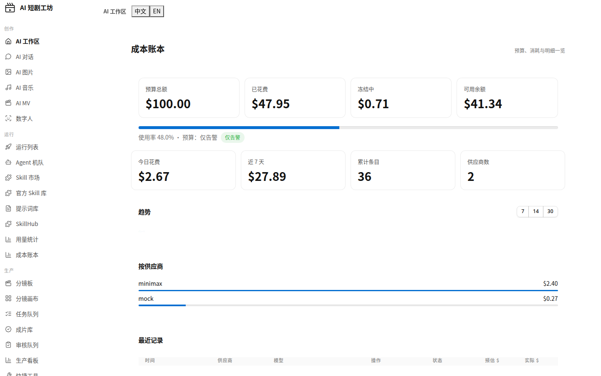

接口：

| 接口 | 参数 | 说明 |
|---|---|---|
| GET /api/cost-ledger/budget | 无 | 预算总览：budgetTotalUsd/spentUsd/reservedUsd/usableUsd/utilizationPct/mode/enabled |
| GET /api/cost-ledger/summary | projectId/provider/from/to（可选） | 汇总：entryCount/totalEstimated/totalReserved/totalSpent/countByStatus |
| GET /api/cost-ledger/daily | date=yyyy-MM-dd（可选，默认今天） | 当天按供应商汇总 |
| GET /api/cost-ledger/trend | days（可选，默认14，非法400，超限[1,90]由服务端钳制） | 最近 N 天每天的 estimatedUsd/spentUsd/entryCount，按日期升序 |
| GET /api/cost-ledger/entries | projectId/provider/status/from/to/limit（可选；limit 默认100、最大500，非法400） | 账本明细，按创建时间倒序 |

预算模式有两种，由 `drama.billing.mode` 控制：

- `WARN`：只告警，不拦截，照常提交。
- `CAP`：超过预算时自动降级，换成更便宜的通道。

相关环境变量：

- `drama.billing.enabled`：是否开启成本账本。
- `drama.billing.mode`：预算模式，取值 `WARN` 或 `CAP`。
- `drama.billing.budget-total-usd`：总预算，单位美元。
- `drama.billing.reserve-pct`：每次提交预留预算的比例。

注意：费用是提交时估算出来的，提供方不会返回真实费用，最终以提供方账单为准。

### SkillHub（自有 skillhub，v2.33）
我们自己的 skillhub 入口（挂在官方区导航"运行"分组下）：`GET /api/skillhub/index` 返回自有索引（hub=`playhouse-skillhub`，含全部内置与社区收录 skills，来源标注"官方出品"/"社区收录"，含安装状态），页面支持搜索、按来源筛选、一键安装到本地 `data/skills/`（走既有 `/api/official-skills/install/{id}`）。远端官网 skillhub 接入时客户端直接从官网下载（约定见 `docs/skillhub-server-convention.md`）。

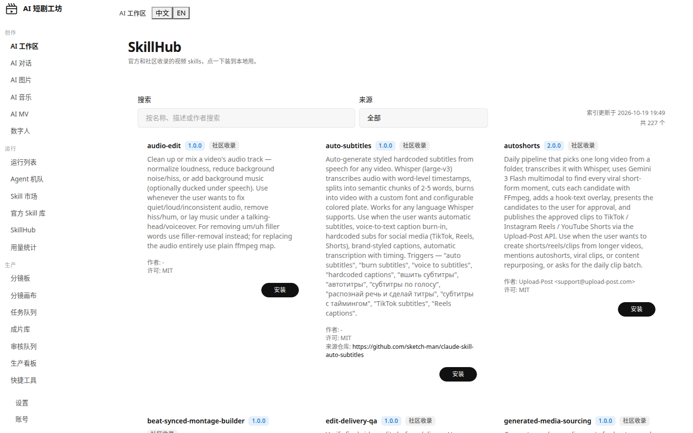

### 快捷工具集（P2-7）

默认使用 mock，配置 `drama.video.provider=agnes` 切换到真实接口。

### 剪辑成片
ffmpeg 流水线：按镜号拼接分镜片段，根据分镜对白自动生成 SRT 字幕并烧录，输出 H.264 mp4。成片文件可列表、预览、下载。

**可靠性（v2.29）**：ffmpeg 失败分瞬时/永久两类——瞬时抖动（超时、OOM-kill 等）有界重试（默认 3 次，`FFMPEG_RETRY_ATTEMPTS` 可配），永久失败（缺二进制等）直接报错不空转；视频任务轮询有单飞保护，防重复提交。重试与跳过均有 Prometheus 指标，设计注记见 `docs/FFMPEG_RELIABILITY.md`。

### 生产看板
按 项目 → 分集 → 分镜 → 视频任务 → 成片 的层级展示全流程状态，一眼看清哪一步卡住了。

### 全局统计
汇总项目、剧集、角色、场景等维度的数量指标，提供整体生产进度概览。

### 审核流
剧本走两级审核：先 L1 再 L2，任意一级驳回都打回草稿重来，两级都过才 APPROVED。
分镜走单级审核：提交后进待审，批准或驳回。
执行门：某集剧本没过审，这一集的 VIDEO 步骤不会跑，run 会置为 PAUSED 等着（日志里会写"等待剧本过审"），过审后 resume 继续。
审核队列页在 review.html，待审列表加批准/驳回按钮和意见输入框。
每次流转都记进 review_history 表（谁、何时、什么事件、意见、版本号），只增不删。
单用户部署下提交人和审批人可能是同一个，不硬拦，用 ReviewDetailResponse.selfReviewed 字段标出来，前端会醒目提示。

### 视频拆解
把喜欢的视频拆开看：ffmpeg 场景切分 + 逐镜关键帧 + 节奏指标（镜数/均镜长/每分钟切数/钩子段）+ 钩子/主体/转折/收尾结构划分 + 爆款公式提炼 + 逐镜反推提示词（含 Seedance 版）+ 一键生成同款分镜草稿。
逐字稿：内嵌字幕轨道离线提取（ffprobe 列流→ffmpeg 抽 SRT→分段时间轴），逐镜按时段映射字幕，报告与详情页展示；无字幕轨道时诚实提示，语音转写（ASR）尚未接入。链接导入（抖音/TikTok/小红书）为后续项。

## 生产管线
剧本（四场式生成）
      │
      ▼
审核（两级：L1 → L2，驳回打回草稿）
      │
      ▼
分镜拆解（镜号 / 景别 / 运镜 / 画面描述 / 时长 / 对白 / 提示词）
      │
      ▼
审核（单级）
      │
      ▼
视频生成（Agnes 或 Mock，异步任务 + 轮询 + 退避重试）
      │
      │  执行门：剧本未过审则暂停等待
      ▼
ffmpeg 剪辑（按镜号拼接 + SRT 字幕烧录）
      │
      ▼
成片 mp4
## 界面预览

以下为真实运行截图。

### 分镜板


### 任务队列


### 成片库


### 生产看板


### AI 对话


### 成片质检


### 视频拆解（含逐字稿）
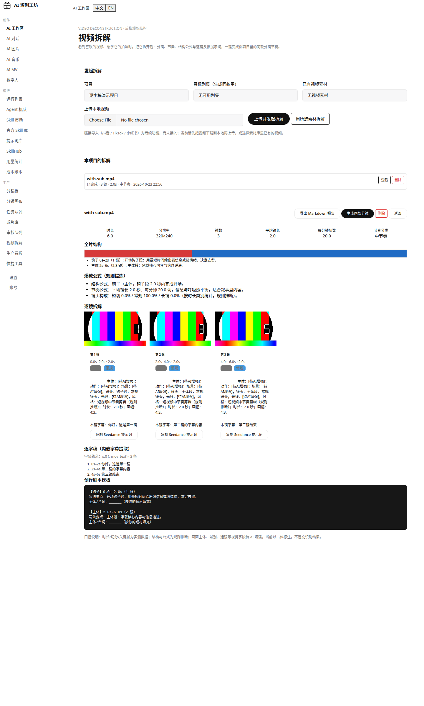

### AI MV（v2 时间轴对齐）
作词、分镜与渲染全部由歌词行时间戳驱动：时间轴展示区逐行列出每句歌词的起止时间码，分镜精确到每一句，字幕为逐行 SRT。

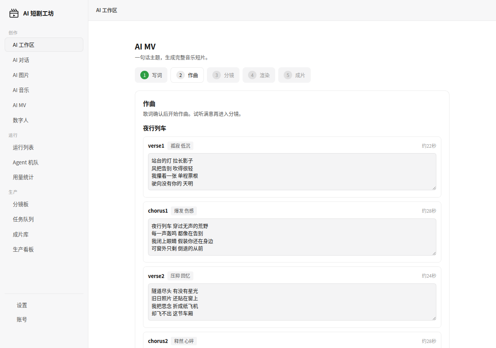

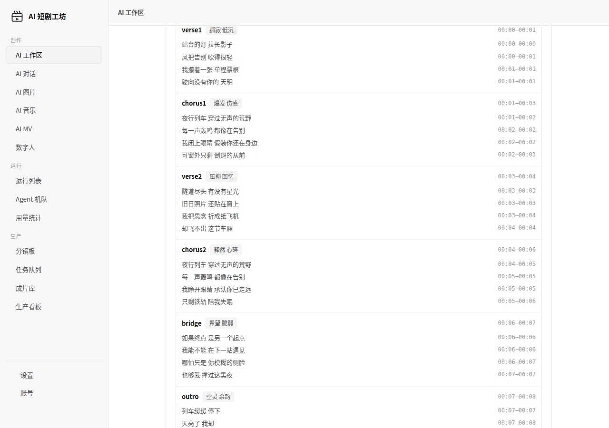

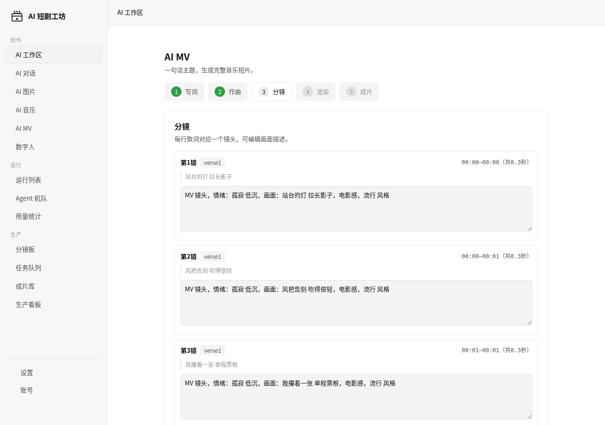

### v2.3 AI 编剧引擎


### 供应商连接自检
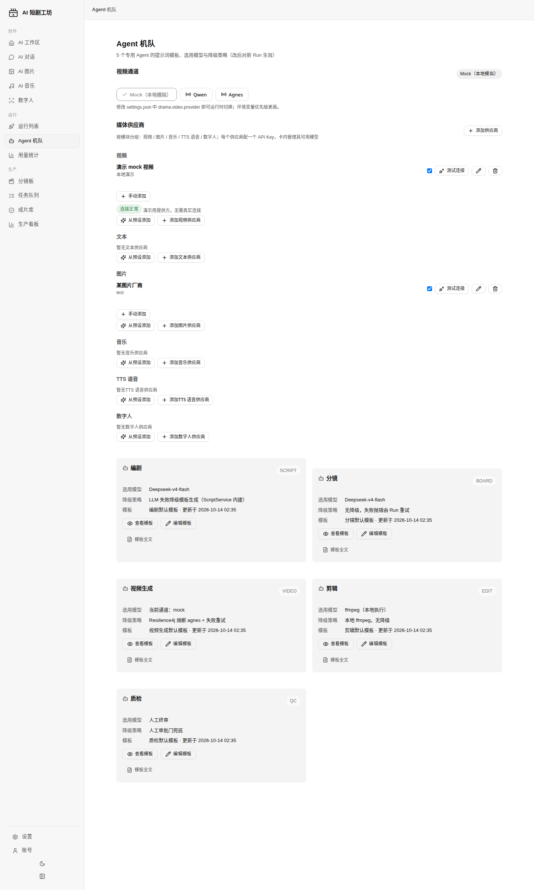

### Skill 市场（P2-6）
Agent 技能的发布、安装与管理：4 个官方预设 Skill（分镜大师/短剧钩子开头/转场设计/爽点节奏），
已安装 Skill 可在剧本与分镜生成时选用（prompt 模板注入大模型 system prompt）。

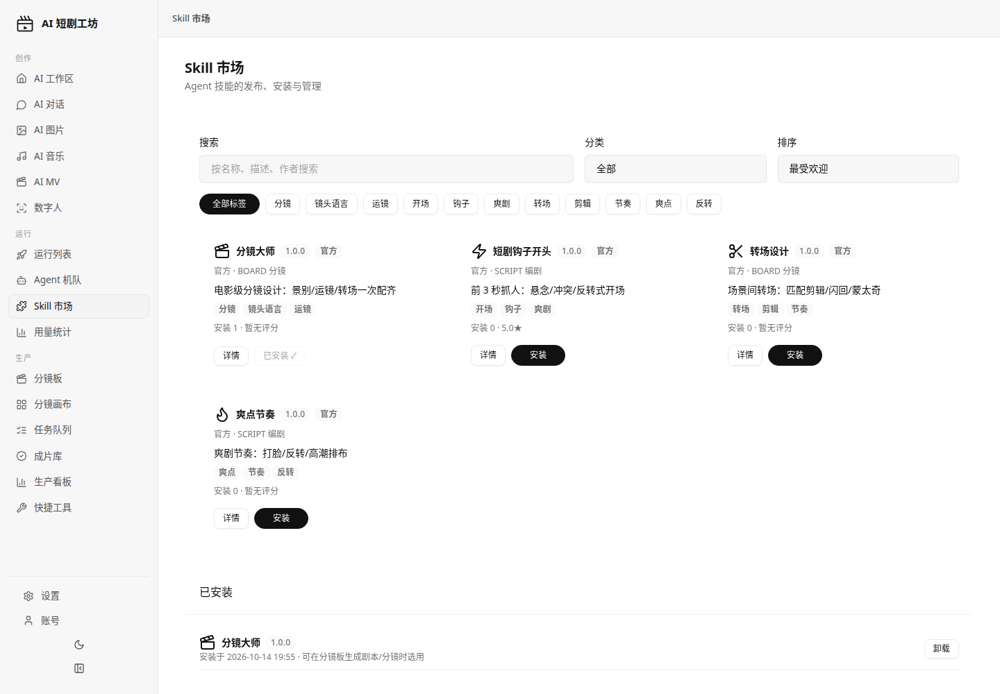


### 快捷工具集（P2-7）
资产批量打标/重命名、视频转码（mp4↔webm）、音频提取、分镜表 CSV 导出、操作记录。

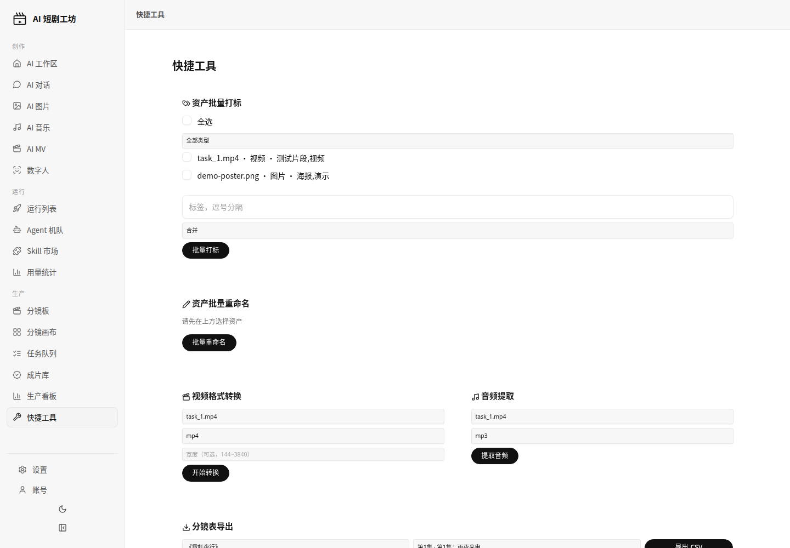

### 账号体系（P0-2）
邮箱注册登录 + Google / Apple / GitHub OAuth（无真实凭证时诚实返回未配置）；
个人资料（几何头像，禁字母头像）、账号与安全（改密码/改邮箱需验证密码、登录会话管理）、
个性化（主题/语言：语言偏好存服务端，账号页中英双语实时切换）；登录限流（同 email+ip 15 分钟 5 次失败 → 429）、密码强度校验。


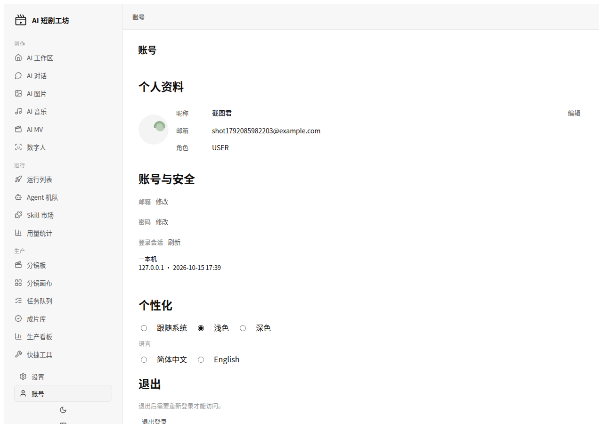

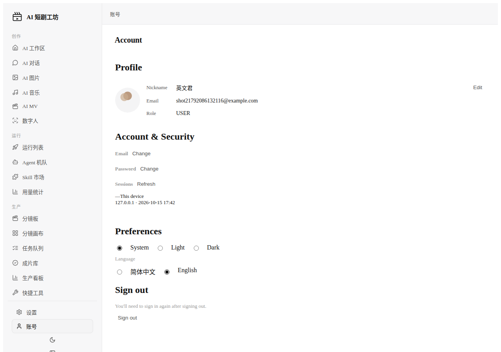

### 账号体系生产级补强（P0-3）
auth-service 独立微服务生产级补齐：Flyway 版本化迁移（`V1__baseline.sql`，`ddl-auto: validate`，老库自动基线）；
`/actuator/prometheus` 指标（注册/登录/刷新/OAuth 回调计数 + 用户数/活跃会话数）与 3 条 Prometheus 告警；
在线/离线双模式备份（`scripts/backup-auth.sh`，在线经 `POST /api/auth/admin/backup` 应用内热备）与恢复（`scripts/restore-auth.sh`，含恢复前快照与 sha256 校验）；
运维手册 `docs/OPERATIONS-AUTH.md`。

### 账号体系安全加固（P0-4）
浏览器登录态全面改用 httpOnly Cookie（`df_at`/`df_rt`，前端不再经 localStorage 碰 token，access 过期静默刷新）；
`auth.cookie.secure` 开关（生产 HTTPS 开启）；BFF 对 cookie 写请求做 Origin/Referer 同源校验防 CSRF；
API 客户端仍可直连 auth-service 走 Bearer。详见 `docs/SECURITY_DATA.md`。

### 全站中英双语（v2.28）
控制台顶栏右侧加了「中文 | EN」分段切换器，点一下就切，语言偏好写到服务端（`PUT /api/auth/profile {language}`），刷新、换设备都保持。覆盖工作区、分镜、任务、成片、看板、MV、Skill、工具、账号等 21 个业务页面，加上登录和注册页。中文文案逐字保留，英文按产品英文写。

实现方式是零依赖的原生方案：`static/i18n.js` 挂 `window.DFI18N`，各页自带页字典，静态文案用 `data-i18n` / `data-i18n-ph` / `data-i18n-title` 标注，动态渲染的收尾再调一次 `applyI18n` 并订阅 `onLangChange`。没有引入任何构建步骤或第三方库。

key 命名规范、页面接入步骤、英文风格指南见 `docs/I18N.md`。门禁脚本 `scripts/i18n-keycheck.js` 扫描 HTML 的 `data-i18n*` 与 JS 的 `tr('...')`，和已注册字典比对，缺 key 就 `exit 1`；本轮结果 `1033 defined / 885 used / MISSING: none`。

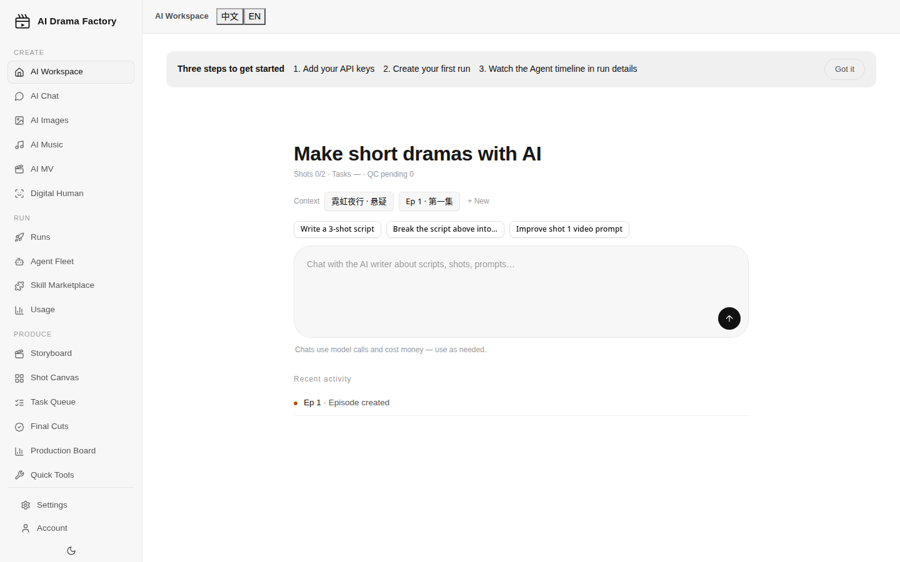

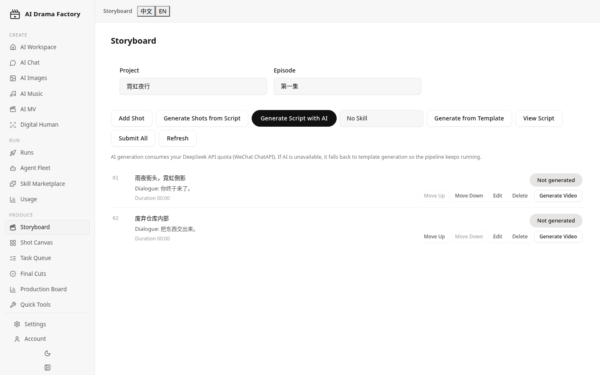

## 技术栈

| 类别 | 选型 |
| --- | --- |
| 语言 | Java 21 |
| 框架 | Spring Boot 3.3 |
| 持久化 | Spring Data JPA |
| 数据库 | H2（文件库，可平滑切换 PostgreSQL / MySQL） |
| 视频生成 | Agnes agnes-video-2.5-flash（可切换 Mock） |
| 剪辑 | ffmpeg / ffprobe |
| 前端 | 内置 Web 控制台（static 静态资源由 Spring 直接托管） |
| 构建 | Maven |

## 目录结构

src/main/java/.../
├── controller/           # REST 控制器（项目 / 剧集 / 分镜 / 视频任务 / 成片 / 看板 / 统计）
├── service/              # 业务服务
│   ├── video/            # 视频生成 Provider 抽象、Agnes 实现、Mock 实现、任务轮询与重试
│   ├── script/           # 四场式剧本生成
│   └── edit/             # ffmpeg 剪辑流水线（拼接 + 字幕烧录）
├── repository/           # JPA 仓储
├── domain/               # 实体与枚举
└── config/               # 配置绑定

src/main/resources/
├── application.yml
└── static/               # Web 控制台
    ├── index.html
    ├── storyboard.html   # 分镜板
    ├── tasks.html        # 任务队列
    ├── finals.html       # 成片库
    └── pipeline.html     # 生产看板

## 快速开始

mvn spring-boot:run
启动后访问 http://localhost:8081。

默认使用 Mock 视频 Provider，不需要任何外部账号即可跑通「生成剧本 → 拆镜 → 出视频任务 → 出成片」的完整链路（需要本机装好 ffmpeg）。

## 配置

### 基础

| 环境变量 | 说明 | 默认值 |
| --- | --- | --- |
| `PORT` | 服务监听端口 | `8081` |
| `DB_URL` | 数据库连接地址 | H2 文件库路径（本地默认） |

### 视频生成

| 配置项 | 环境变量 | 说明 | 默认值 |
| --- | --- | --- | --- |
| `drama.video.provider` | `VIDEO_PROVIDER` | 视频 Provider，`mock` 或 `agnes` | `mock` |
| `drama.video.poll-interval-ms` | `VIDEO_POLL_MS` | 任务状态轮询间隔（毫秒） | `10000` |
| `drama.video.max-attempts` | `VIDEO_MAX_ATTEMPTS` | 单个任务最大尝试次数（指数退避，429 额外退避） | `8` |

### 存储与剪辑

| 配置项 | 环境变量 | 说明 | 默认值 |
| --- | --- | --- | --- |
| `drama.storage` | `DRAMA_STORAGE` | 媒体文件根目录（分镜视频、成片） | `./data/media` |
| `drama.ffmpeg` | `FFMPEG_PATH` | ffmpeg 可执行文件路径 | `ffmpeg` |
| `drama.ffprobe` | `FFPROBE_PATH` | ffprobe 可执行文件路径 | `ffprobe` |

所有配置均可用 `--drama.video.provider=agnes` 这类命令行参数或 `VIDEO_PROVIDER=agnes` 环境变量覆盖。

## 构建

mvn clean package
java -jar target/drama-factory.jar

## API 文档

接口文档由 springdoc-openapi 自动生成，跟着代码走，代码改了文档就跟着变。

- JSON：`/v3/api-docs`
- 可交互页面（Swagger UI）：`/swagger-ui.html`

分组文档：

| 组名 | 文档地址 | 覆盖内容 |
| --- | --- | --- |
| runs | /v3/api-docs/runs | 运行管理：Run 生命周期、流水线状态 |
| videos | /v3/api-docs/videos | 视频生产：视频任务、成片、MV、媒体文件 |
| scripts | /v3/api-docs/scripts | 剧本与内容：项目、剧集、分镜、镜头、角色、画布、配方 |
| admin | /v3/api-docs/admin | 系统管理：认证、模型供应商、BYOK、设置、用量、运维 |

鉴权：配置了 `AUTH_JWT_SECRET` 后 `/api/**` 要带 `Authorization: Bearer <token>`，文档端点本身公开；没配就是开放模式。

安全提醒：不要把服务直接暴露到公网，否则接口文档等于公开给所有人看。

## Docker


FROM eclipse-temurin:21-jre
# 镜像内需包含 ffmpeg
RUN apt-get update && apt-get install -y ffmpeg && rm -rf /var/lib/apt/lists/*
COPY target/drama-factory.jar app.jar
ENTRYPOINT ["java", "-jar", "/app.jar"]

docker build -t drama-factory .
docker run -p 8081:8081 -v $(pwd)/storage:/storage drama-factory

## Docker Compose 一键部署

### 前置要求

- 已安装 Docker（20.10+）
- 已安装 Docker Compose 插件（`docker compose` 子命令可用）

### 三步启动

```bash
# 1. 准备环境变量文件（可按需修改 PORT、VIDEO_PROVIDER 等）
cp .env.example .env

# 2. 构建镜像并后台启动（首次构建会拉取依赖与安装 ffmpeg，耗时较长）
docker compose up -d --build

# 3. 访问服务
#    http://localhost:8081
```

### 数据卷说明

- `./data` 目录挂载到容器内 `/app/data`，用于持久化：
  - H2 文件数据库（`drama-factory.mv.db` 等）
  - 媒体文件（mock 生成的测试片段、剪辑成片等）
- 容器删除或重建不会丢失数据；如需彻底重置，删除 `./data` 目录即可（见下方 `down -v` 说明）。

### 常用命令

```bash
# 实时查看日志（含 request_id，便于全链路排查）
docker compose logs -f app

# 停止并移除容器（保留 ./data 数据）
docker compose down

# 停止并清空数据卷（⚠️ 会删除 H2 数据库与所有媒体文件，不可恢复）
docker compose down -v

# 查看容器健康状态
docker compose ps
```

### 开启 JSON 结构化日志

默认输出为可读 pattern（含 MDC request_id）。如需切换为 Logstash JSON 输出（含 `service` 与 `request_id` 字段，便于接入 ELK/Loki）：

1. 编辑 `.env`，取消以下行的注释：
   ```bash
   SPRING_PROFILES_ACTIVE=json
   ```
2. 重建并重启容器使配置生效：
   ```bash
   docker compose up -d --build

## API 概览

### 基础

| 方法 | 路径 | 说明 |
| --- | --- | --- |
| GET | `/api/health` | 服务健康检查 |
| GET / POST | `/api/projects` | 查询 / 创建短剧项目 |
| GET / POST | `/api/projects/{id}/episodes` | 查询 / 创建剧集 |
| POST | `/api/episodes/{id}/generate-script` | 基于大纲生成四场式剧本 |
| GET | `/api/stats` | 全局统计信息 |

### 分镜

| 方法 | 路径 | 说明 |
| --- | --- | --- |
| GET / POST | `/api/episodes/{eid}/shots` | 查询 / 创建某集的分镜 |
| PUT / DELETE | `/api/shots/{id}` | 更新 / 删除分镜 |
| POST | `/api/episodes/{eid}/shots/reorder` | 按传入镜号顺序重排分镜 |

### 视频生成任务

| 方法 | 路径 | 说明 |
| --- | --- | --- |
| POST | `/api/shots/{sid}/video-tasks` | 为单个分镜创建视频生成任务（幂等：已有 PENDING/PROCESSING 任务时返回 200 并复用，首次创建返回 201） |
| POST | `/api/episodes/{eid}/video-tasks/submit-all` | 为整集所有分镜批量提交任务 |
| GET | `/api/shots/{sid}/video-tasks` | 查询某分镜下的所有任务 |
| POST | `/api/video-tasks/{id}/retry` | 手动重试失败任务 |

### 成片

| 方法 | 路径 | 说明 |
| --- | --- | --- |
| POST / GET | `/api/episodes/{eid}/final-cuts` | 触发剪辑 / 查询某集成片列表 |
| GET | `/api/final-cuts/{id}` | 查询单个成片详情 |

### 看板

| 方法 | 路径 | 说明 |
| --- | --- | --- |
| GET | `/api/projects/{pid}/pipeline` | 某项目的全流程状态 |
| GET | `/api/pipelines` | 所有项目的管线概览 |

### 媒体

| 方法 | 路径 | 说明 |
| --- | --- | --- |
| GET | `/media/videos/{taskId}` | 获取某任务生成的视频文件 |
| GET | `/media/finals/{id}` | 获取成片文件（支持预览与下载） |

## 数据说明

- 数据默认存放在 H2 文件库，路径由 `DB_URL` 指定；切换 PostgreSQL / MySQL 只需替换驱动与连接串。
- 媒体文件（分镜视频、成片 mp4）落在 `drama.storage` 指定的目录下，按任务 / 成片 ID 命名，元数据存数据库，文件本身不进库。
- 视频任务状态由后台轮询更新，服务重启后未完成的任务会继续被轮询接管。
- 优雅关闭：`server.shutdown=graceful`，收到 SIGTERM 后在途的一轮轮询最多等待 25 秒收尾，调度器 `await-termination` 上限 30 秒。
- 成片依赖 ffmpeg / ffprobe，请在运行环境里确保这两个可执行文件可用，或用 `drama.ffmpeg` / `drama.ffprobe` 指定绝对路径。

## 数据库迁移（Flyway）

本项目使用 [Flyway](https://documentation.red-gate.com/flyway) 对数据库 schema 进行版本化管理。
`schema` 的唯一事实来源是 `src/main/resources/db/migration/` 下的迁移脚本，
JPA 的 `ddl-auto` 已固定为 `validate`，仅做校验，**不再由 Hibernate 自动改表**。

### V1 基线

`V1__baseline.sql` 是项目首个迁移，内容为 Hibernate `ddl-auto=create` 在 H2 2.2.224 上
实际导出的完整 schema（7 张表：`DRAMA_PROJECTS`、`DRAMA_CHARACTERS`、`EPISODES`、`SCENES`、
`SHOTS`、`FINAL_CUTS`、`VIDEO_TASKS`，含全部主键、外键与枚举列）。

- **全新库**：启动时完整执行 V1，创建全部表。
- **已存在的老库**（此前由 `ddl-auto=update` 建好）：配合 `spring.flyway.baseline-on-migrate: true`，
  首次启动时 Flyway 检测到非空 schema 且无 `flyway_schema_history` 表，会自动做基线，
  **跳过 V1 的执行**，仅记录基线版本，从而避免"表已存在"的冲突。此后所有新迁移从 V2 起正常执行。

### 新增迁移脚本命名规范

```
V{n}__{描述}.sql
```

- `V` 前缀 + 递增整数版本号 + 双下划线 + 下划线分隔的描述，例如：
  - `V2__add_episode_publish_date.sql`
  - `V3__create_asset_table.sql`
- 版本号必须严格递增且唯一，Flyway 会按版本号顺序执行。
- **已发布/已执行的脚本禁止修改**（Flyway 会校验 checksum，改动会导致启动失败）；
  如需修正，请新增一个更高版本的迁移脚本。

### 回滚策略

Flyway **社区版不支持自动回滚**（`undo` 属于 Teams 版特性）。因此：

- 上线前务必在预发/测试环境验证迁移脚本。
- 若某次迁移有问题，**不要**修改历史脚本，而是新增一个递增迁移（如 `V4__fix_xxx.sql`）
  来纠正 schema 或数据。
- 生产环境对破坏性变更（删列、改类型）建议采用"扩展-迁移-收缩"模式，分多次发布完成。

## 路线图

- ~~**对接视频生成**：把每场的英文提示词直接投递至视频生成管线，打通从剧本到成片的链路。~~（v2 已完成：Agnes / Mock Provider + 异步任务 + ffmpeg 剪辑成片）
- **审核流**：为剧本与分集内容引入多级审核状态机。
- **多用户**：引入账号体系与权限模型。
- **配音与配乐**：成片阶段接入 TTS 与背景音乐轨。
- **剪辑模板**：支持片头片尾、转场、水印等可配置的剪辑模板。
