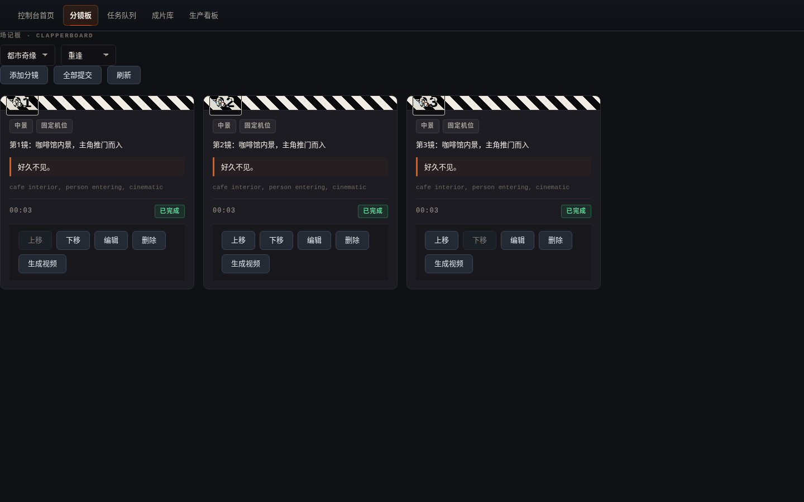
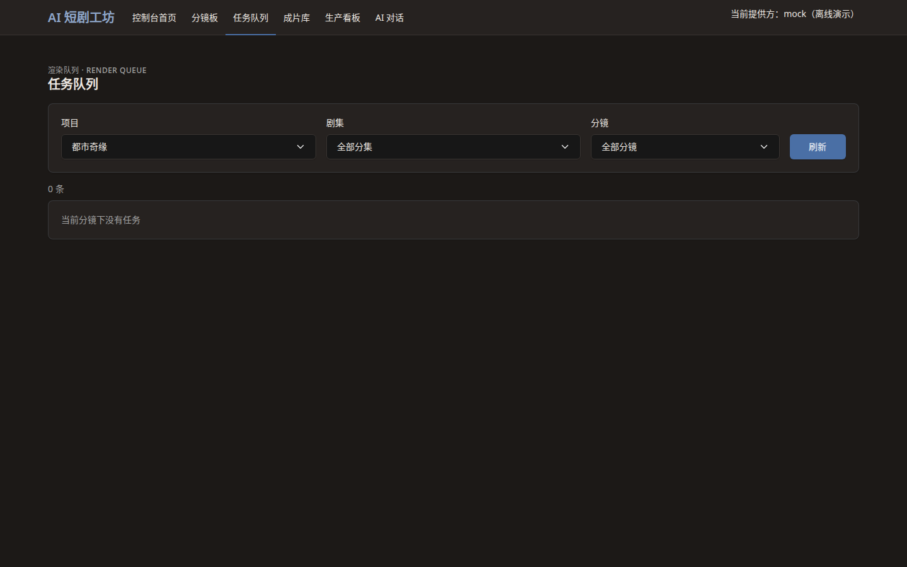
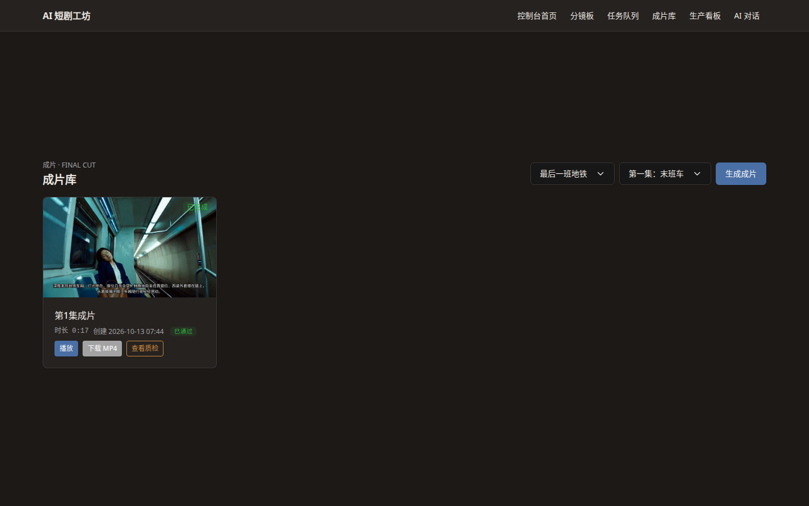
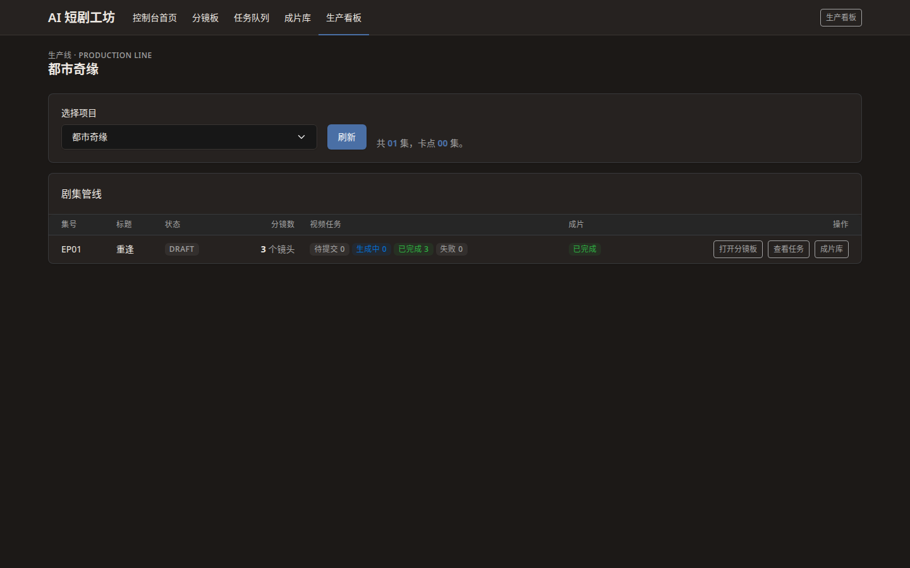
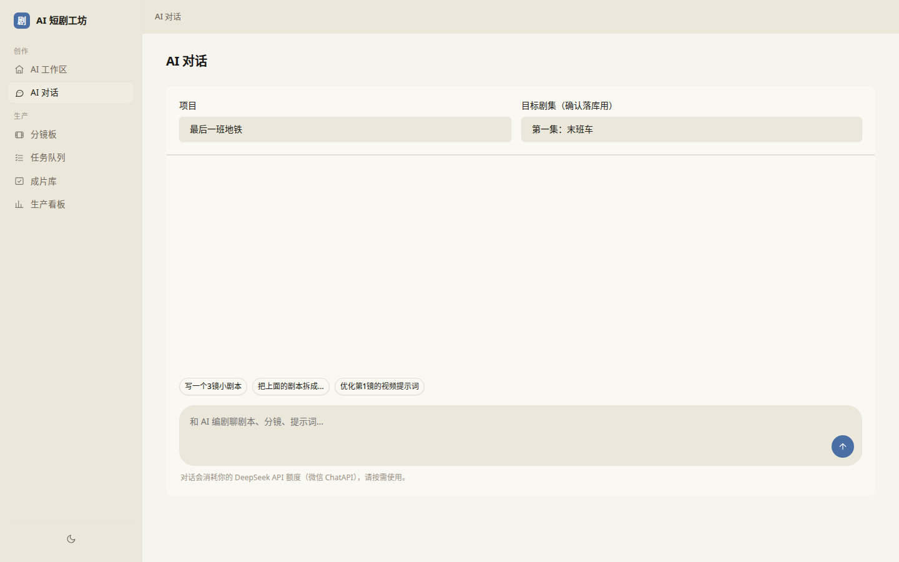
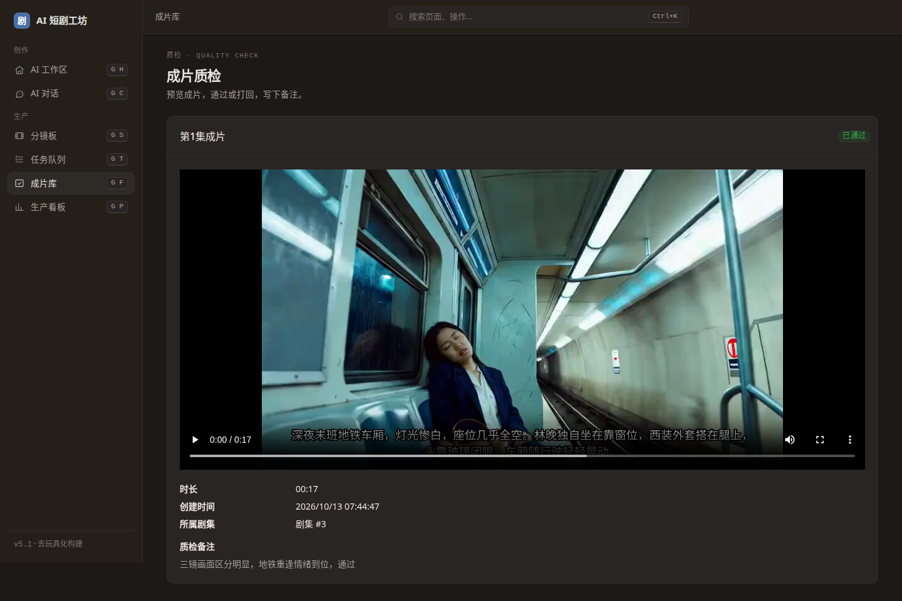
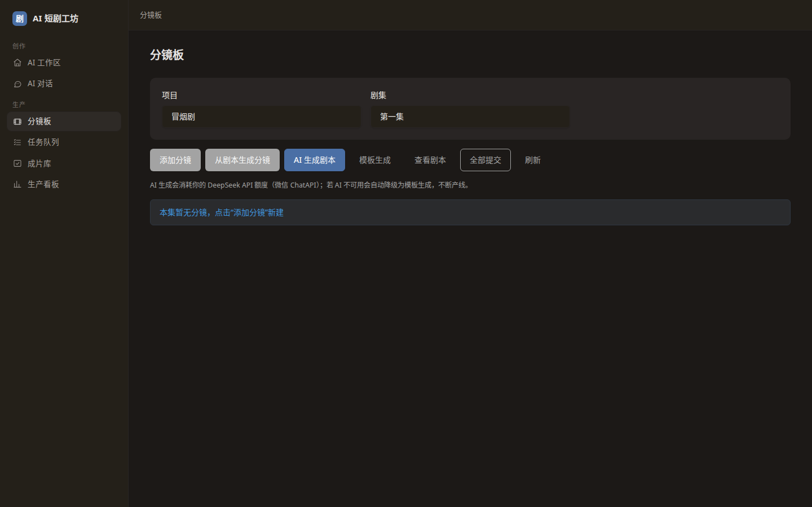
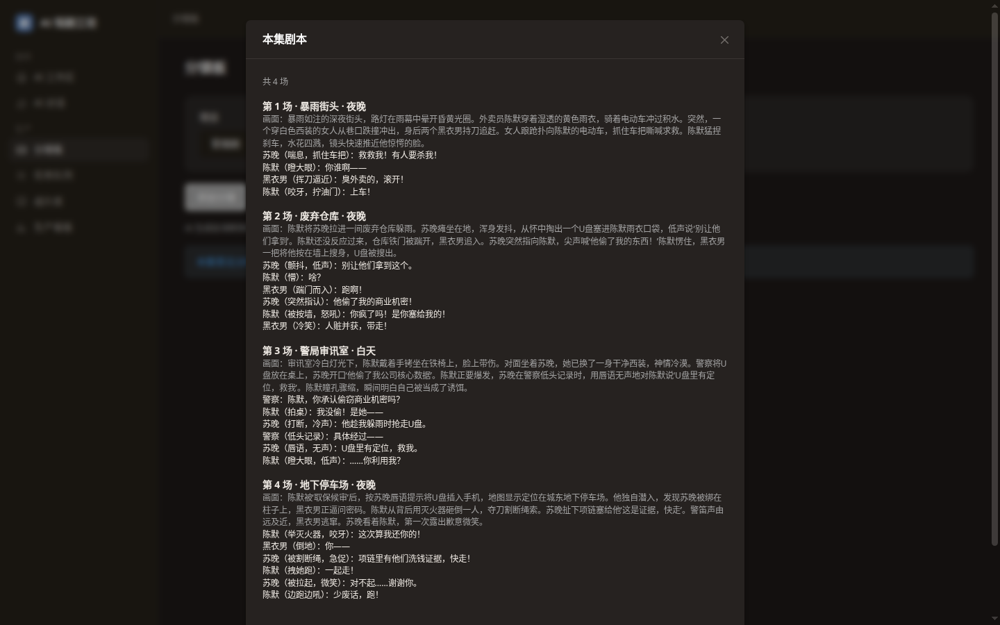

# AI 短剧工坊 Drama Factory

面向短剧内容团队的**生产管理与剧本生成系统**。以项目为单位组织短剧资产，覆盖剧集、角色、场景的全流程管理，内置基于大纲的**四场式剧本自动生成**，并打通了从剧本到成片的完整生产管线：分镜拆解、视频生成任务调度、ffmpeg 剪辑合成、成片管理。系统采用企业级分层架构，内置 Web 控制台，开箱即用。

## 功能

### 短剧项目管理
创建与维护短剧项目，记录项目名称、题材、简介等基础信息，作为所有下级资产的容器。

### 剧集管理
按项目组织分集内容，维护集号、标题、剧情概要等字段，支撑连续剧集的编排。

### 基于大纲的四场式剧本自动生成
输入故事大纲，系统按短剧叙事节奏输出四场结构（开场钩子/冲突升级/反转/高潮收尾），每一场均附带**英文视频生成提示词**。

### 分镜管理
在剧集下拆分镜，字段包括镜号、景别、运镜、画面描述、时长（秒）、对白/旁白、视频生成提示词。支持增删改查与镜号排序，排序结果直接决定后续视频拼接顺序。

### 视频生成任务
按分镜创建视频生成任务，对接 Agnes `agnes-video-2.5-flash`（https://apihub.agnes-ai.com）。任务走异步状态机：`PENDING → PROCESSING → DONE / FAILED`，后台定时轮询任务状态，失败按指数退避重试，遇到 429 限流时自动退避等待。

Provider 做了接口抽象：

- `AgnesVideoProvider`：真实调用 Agnes 接口。
- `MockVideoProvider`：离线演示用，不联网也能跑通全流程。

默认使用 mock，配置 `drama.video.provider=agnes` 切换到真实接口。

### 剪辑成片
ffmpeg 流水线：按镜号拼接分镜片段，根据分镜对白自动生成 SRT 字幕并烧录，输出 H.264 mp4。成片文件可列表、预览、下载。

### 生产看板
按 项目 → 分集 → 分镜 → 视频任务 → 成片 的层级展示全流程状态，一眼看清哪一步卡住了。

### 全局统计
汇总项目、剧集、角色、场景等维度的数量指标，提供整体生产进度概览。

## 生产管线

剧本（四场式生成）
      │
      ▼
分镜拆解（镜号 / 景别 / 运镜 / 画面描述 / 时长 / 对白 / 提示词）
      │
      ▼
视频生成（Agnes 或 Mock，异步任务 + 轮询 + 退避重试）
      │
      ▼
ffmpeg 剪辑（按镜号拼接 + SRT 字幕烧录）
      │
      ▼
成片 mp4

## 界面预览

以下为真实运行截图。

### 分镜板


### 任务队列


### 成片库


### 生产看板


### AI 对话


### 成片质检


### v2.3 AI 编剧引擎




## 技术栈

| 类别 | 选型 |
| --- | --- |
| 语言 | Java 21 |
| 框架 | Spring Boot 3.3 |
| 持久化 | Spring Data JPA |
| 数据库 | H2（文件库，可平滑切换 PostgreSQL / MySQL） |
| 视频生成 | Agnes agnes-video-2.5-flash（可切换 Mock） |
| 剪辑 | ffmpeg / ffprobe |
| 前端 | 内置 Web 控制台（static 静态资源由 Spring 直接托管） |
| 构建 | Maven |

## 目录结构

src/main/java/.../
├── controller/           # REST 控制器（项目 / 剧集 / 分镜 / 视频任务 / 成片 / 看板 / 统计）
├── service/              # 业务服务
│   ├── video/            # 视频生成 Provider 抽象、Agnes 实现、Mock 实现、任务轮询与重试
│   ├── script/           # 四场式剧本生成
│   └── edit/             # ffmpeg 剪辑流水线（拼接 + 字幕烧录）
├── repository/           # JPA 仓储
├── domain/               # 实体与枚举
└── config/               # 配置绑定

src/main/resources/
├── application.yml
└── static/               # Web 控制台
    ├── index.html
    ├── storyboard.html   # 分镜板
    ├── tasks.html        # 任务队列
    ├── finals.html       # 成片库
    └── pipeline.html     # 生产看板

## 快速开始

mvn spring-boot:run
启动后访问 http://localhost:8081。

默认使用 Mock 视频 Provider，不需要任何外部账号即可跑通「生成剧本 → 拆镜 → 出视频任务 → 出成片」的完整链路（需要本机装好 ffmpeg）。

## 配置

### 基础

| 环境变量 | 说明 | 默认值 |
| --- | --- | --- |
| `PORT` | 服务监听端口 | `8081` |
| `DB_URL` | 数据库连接地址 | H2 文件库路径（本地默认） |

### 视频生成

| 配置项 | 环境变量 | 说明 | 默认值 |
| --- | --- | --- | --- |
| `drama.video.provider` | `VIDEO_PROVIDER` | 视频 Provider，`mock` 或 `agnes` | `mock` |
| `drama.video.poll-interval-ms` | `VIDEO_POLL_MS` | 任务状态轮询间隔（毫秒） | `10000` |
| `drama.video.max-attempts` | `VIDEO_MAX_ATTEMPTS` | 单个任务最大尝试次数（指数退避，429 额外退避） | `8` |

### 存储与剪辑

| 配置项 | 环境变量 | 说明 | 默认值 |
| --- | --- | --- | --- |
| `drama.storage` | `DRAMA_STORAGE` | 媒体文件根目录（分镜视频、成片） | `./data/media` |
| `drama.ffmpeg` | `FFMPEG_PATH` | ffmpeg 可执行文件路径 | `ffmpeg` |
| `drama.ffprobe` | `FFPROBE_PATH` | ffprobe 可执行文件路径 | `ffprobe` |

所有配置均可用 `--drama.video.provider=agnes` 这类命令行参数或 `VIDEO_PROVIDER=agnes` 环境变量覆盖。

## 构建

mvn clean package
java -jar target/drama-factory.jar

## Docker

FROM eclipse-temurin:21-jre
# 镜像内需包含 ffmpeg
RUN apt-get update && apt-get install -y ffmpeg && rm -rf /var/lib/apt/lists/*
COPY target/drama-factory.jar app.jar
ENTRYPOINT ["java", "-jar", "/app.jar"]

docker build -t drama-factory .
docker run -p 8081:8081 -v $(pwd)/storage:/storage drama-factory

## Docker Compose 一键部署

### 前置要求

- 已安装 Docker（20.10+）
- 已安装 Docker Compose 插件（`docker compose` 子命令可用）

### 三步启动

```bash
# 1. 准备环境变量文件（可按需修改 PORT、VIDEO_PROVIDER 等）
cp .env.example .env

# 2. 构建镜像并后台启动（首次构建会拉取依赖与安装 ffmpeg，耗时较长）
docker compose up -d --build

# 3. 访问服务
#    http://localhost:8081
```

### 数据卷说明

- `./data` 目录挂载到容器内 `/app/data`，用于持久化：
  - H2 文件数据库（`drama-factory.mv.db` 等）
  - 媒体文件（mock 生成的测试片段、剪辑成片等）
- 容器删除或重建不会丢失数据；如需彻底重置，删除 `./data` 目录即可（见下方 `down -v` 说明）。

### 常用命令

```bash
# 实时查看日志（含 request_id，便于全链路排查）
docker compose logs -f app

# 停止并移除容器（保留 ./data 数据）
docker compose down

# 停止并清空数据卷（⚠️ 会删除 H2 数据库与所有媒体文件，不可恢复）
docker compose down -v

# 查看容器健康状态
docker compose ps
```

### 开启 JSON 结构化日志

默认输出为可读 pattern（含 MDC request_id）。如需切换为 Logstash JSON 输出（含 `service` 与 `request_id` 字段，便于接入 ELK/Loki）：

1. 编辑 `.env`，取消以下行的注释：
   ```bash
   SPRING_PROFILES_ACTIVE=json
   ```
2. 重建并重启容器使配置生效：
   ```bash
   docker compose up -d --build

## API 概览

### 基础

| 方法 | 路径 | 说明 |
| --- | --- | --- |
| GET | `/api/health` | 服务健康检查 |
| GET / POST | `/api/projects` | 查询 / 创建短剧项目 |
| GET / POST | `/api/projects/{id}/episodes` | 查询 / 创建剧集 |
| POST | `/api/episodes/{id}/generate-script` | 基于大纲生成四场式剧本 |
| GET | `/api/stats` | 全局统计信息 |

### 分镜

| 方法 | 路径 | 说明 |
| --- | --- | --- |
| GET / POST | `/api/episodes/{eid}/shots` | 查询 / 创建某集的分镜 |
| PUT / DELETE | `/api/shots/{id}` | 更新 / 删除分镜 |
| POST | `/api/episodes/{eid}/shots/reorder` | 按传入镜号顺序重排分镜 |

### 视频生成任务

| 方法 | 路径 | 说明 |
| --- | --- | --- |
| POST | `/api/shots/{sid}/video-tasks` | 为单个分镜创建视频生成任务（幂等：已有 PENDING/PROCESSING 任务时返回 200 并复用，首次创建返回 201） |
| POST | `/api/episodes/{eid}/video-tasks/submit-all` | 为整集所有分镜批量提交任务 |
| GET | `/api/shots/{sid}/video-tasks` | 查询某分镜下的所有任务 |
| POST | `/api/video-tasks/{id}/retry` | 手动重试失败任务 |

### 成片

| 方法 | 路径 | 说明 |
| --- | --- | --- |
| POST / GET | `/api/episodes/{eid}/final-cuts` | 触发剪辑 / 查询某集成片列表 |
| GET | `/api/final-cuts/{id}` | 查询单个成片详情 |

### 看板

| 方法 | 路径 | 说明 |
| --- | --- | --- |
| GET | `/api/projects/{pid}/pipeline` | 某项目的全流程状态 |
| GET | `/api/pipelines` | 所有项目的管线概览 |

### 媒体

| 方法 | 路径 | 说明 |
| --- | --- | --- |
| GET | `/media/videos/{taskId}` | 获取某任务生成的视频文件 |
| GET | `/media/finals/{id}` | 获取成片文件（支持预览与下载） |

## 数据说明

- 数据默认存放在 H2 文件库，路径由 `DB_URL` 指定；切换 PostgreSQL / MySQL 只需替换驱动与连接串。
- 媒体文件（分镜视频、成片 mp4）落在 `drama.storage` 指定的目录下，按任务 / 成片 ID 命名，元数据存数据库，文件本身不进库。
- 视频任务状态由后台轮询更新，服务重启后未完成的任务会继续被轮询接管。
- 优雅关闭：`server.shutdown=graceful`，收到 SIGTERM 后在途的一轮轮询最多等待 25 秒收尾，调度器 `await-termination` 上限 30 秒。
- 成片依赖 ffmpeg / ffprobe，请在运行环境里确保这两个可执行文件可用，或用 `drama.ffmpeg` / `drama.ffprobe` 指定绝对路径。

## 数据库迁移（Flyway）

本项目使用 [Flyway](https://documentation.red-gate.com/flyway) 对数据库 schema 进行版本化管理。
`schema` 的唯一事实来源是 `src/main/resources/db/migration/` 下的迁移脚本，
JPA 的 `ddl-auto` 已固定为 `validate`，仅做校验，**不再由 Hibernate 自动改表**。

### V1 基线

`V1__baseline.sql` 是项目首个迁移，内容为 Hibernate `ddl-auto=create` 在 H2 2.2.224 上
实际导出的完整 schema（7 张表：`DRAMA_PROJECTS`、`DRAMA_CHARACTERS`、`EPISODES`、`SCENES`、
`SHOTS`、`FINAL_CUTS`、`VIDEO_TASKS`，含全部主键、外键与枚举列）。

- **全新库**：启动时完整执行 V1，创建全部表。
- **已存在的老库**（此前由 `ddl-auto=update` 建好）：配合 `spring.flyway.baseline-on-migrate: true`，
  首次启动时 Flyway 检测到非空 schema 且无 `flyway_schema_history` 表，会自动做基线，
  **跳过 V1 的执行**，仅记录基线版本，从而避免"表已存在"的冲突。此后所有新迁移从 V2 起正常执行。

### 新增迁移脚本命名规范

```
V{n}__{描述}.sql
```

- `V` 前缀 + 递增整数版本号 + 双下划线 + 下划线分隔的描述，例如：
  - `V2__add_episode_publish_date.sql`
  - `V3__create_asset_table.sql`
- 版本号必须严格递增且唯一，Flyway 会按版本号顺序执行。
- **已发布/已执行的脚本禁止修改**（Flyway 会校验 checksum，改动会导致启动失败）；
  如需修正，请新增一个更高版本的迁移脚本。

### 回滚策略

Flyway **社区版不支持自动回滚**（`undo` 属于 Teams 版特性）。因此：

- 上线前务必在预发/测试环境验证迁移脚本。
- 若某次迁移有问题，**不要**修改历史脚本，而是新增一个递增迁移（如 `V4__fix_xxx.sql`）
  来纠正 schema 或数据。
- 生产环境对破坏性变更（删列、改类型）建议采用"扩展-迁移-收缩"模式，分多次发布完成。

## 路线图

- ~~**对接视频生成**：把每场的英文提示词直接投递至视频生成管线，打通从剧本到成片的链路。~~（v2 已完成：Agnes / Mock Provider + 异步任务 + ffmpeg 剪辑成片）
- **审核流**：为剧本与分集内容引入多级审核状态机。
- **多用户**：引入账号体系与权限模型。
- **配音与配乐**：成片阶段接入 TTS 与背景音乐轨。
- **剪辑模板**：支持片头片尾、转场、水印等可配置的剪辑模板。
