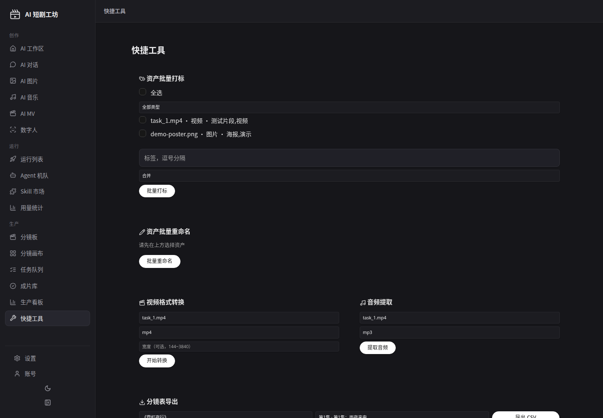

# 快捷工具集（P2-7）

批量处理、格式转换等小工具集：`tools.html`（导航"生产 → 快捷工具"），后端 `com.dramafactory.tools` 包。

## 工具一览

| 工具 | API | 说明 |
|---|---|---|
| 资产批量打标 | `POST /api/tools/assets/batch-tag` | 多选资产一键打标，mode=merge（合并去重）/replace（替换） |
| 资产批量重命名 | `POST /api/tools/assets/batch-rename` | 按 id→新名批量改文件名（展示名，不动磁盘文件） |
| 视频格式转换 | `POST /api/tools/video/convert` | 视频资产转 mp4（libx264+aac）/webm（VP9+Opus），可选 maxWidth 按比例压缩；产物自动入资产库 |
| 音频提取 | `POST /api/tools/video/extract-audio` | 从视频资产提取 mp3（libmp3lame）/wav（pcm_s16le）；产物自动入资产库 |
| 分镜表导出 | `GET /api/tools/episodes/{id}/shots.csv` | 按剧集导出分镜 CSV（UTF-8 BOM，RFC4180 转义）：镜号/景别/运镜/画面描述/台词/时长/创建时间 |
| 操作记录 | `GET /api/tools/op-logs` | 最近 50 条工具操作日志（成功/失败都记） |

## 数据表

`tool_op_log`（V16 迁移）：tool_name / operation / params / result / success / created_at。

## 实现要点

- ffmpeg 能力复用 `FfmpegService`（本轮追加 `convertVideo` / `extractAudio` 两个方法，走统一的 `run()` 超时控制）。
- 转换/提取产物写到 `assets/tools/` 下，经 `AssetService.registerGenerated` 登记（provider=`quick-tools`）。
- 路径穿越防护：输入 filePath 必须以 `assets/` 开头，normalize + startsWith 校验。
- 参数非法 → 400（IllegalArgumentException），id 不存在 → 404（ResourceNotFoundException）。

## 测试

`com.dramafactory.tools`：QuickToolsServiceTest（11）+ QuickToolsControllerTest（7），含真实 ffmpeg 端到端（生成片段→转码→探宽度→提音频）。

## 界面截图（2026-10-15 视觉验收通过，带真实演示数据重拍）

