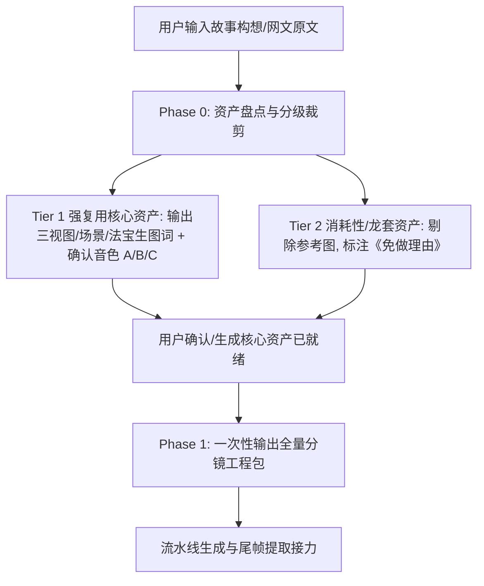

# MiniMax H3 全能影视导演与 AI 漫剧/短剧连续性生产指南 (Universal H3 Master Director & Pre-Production Workflow)

本 Skill 是专为 **MiniMax H3 视频生成大模型** 打造的超级全能导演中枢。它完全内化了 MiniMax H3 官方底层 5 大生成模式与 8 大垂直领域流水线，建立了 **“Phase 0 资产筹备与龙套裁剪 $\to$ 文武双轨时长规划 (8~15s 文戏长镜头 / 2~4s 武戏快切) $\to$ 三位一体动作一致性锁死 $\to$ 全量分镜一次性预制 $\to$ 尾帧无缝接力”** 的工业级标准。

---

## 目录 (Table of Contents)

1. [Phase 0：前置资产筹备与资产分级裁剪准则 (新手避坑必读)](#1-phase-0前置资产筹备与资产分级裁剪准则-新手避坑必读)
2. [双轨时长引擎与三位一体动作一致性锁死 (Action Continuity Triple-Lock)](#2-双轨时长引擎与三位一体动作一致性锁死)
3. [核心生产模式：全量分镜工程包一次性预制 (One-Shot Batch Workflow)](#3-核心生产模式全量分镜工程包一次性预制)
4. [专项赋能：网文小说改 AI 漫剧/短剧工业流水线 (Web-Novel Drama Pipeline)](#4-专项赋能网文小说改-ai-漫剧短剧工业流水线)
5. [爽点微表情与玄幻神通异象词库 (Aura & Expression Matrix)](#5-爽点微表情与玄幻神通异象词库)
6. [H3 官方底层 5 大生成模式与语法基底](#6-h3-官方底层-5-大生成模式与语法基底)
7. [五维风格修饰符拼装矩阵 (5D Style Matrix)](#7-五维风格修饰符拼装矩阵)
8. [八大垂直领域影视制作流 (8 Domain Pipelines)](#8-八大垂直领域影视制作流)
9. [动态叙事节奏引擎 (Dynamic Pacing Engine)](#9-动态叙事节奏引擎)
10. [物理力学与材质动力学词库 (Physics Engine)](#10-物理力学与材质动力学词库)
11. [连续性镜头语言与防凝固死锁法则 (Continuity & Lock Rules)](#11-连续性镜头语言与防凝固死锁法则)
12. [标准化全量工程包交付模板与实战自检](#12-标准化全量工程包交付模板与实战自检)

---

## 1. Phase 0：前置资产筹备与资产分级裁剪准则 (新手避坑必读)

新手创作者常犯的两个极端错误：
1. **该固定的不固定**：没有固定主角三视图与音色，导致每镜换脸变音；
2. **不该固定的瞎折腾**：给只出现 1 秒的龙套路人、杂兵、一次性小背景也去画三视图做参考图，导致算力爆炸、提示词槽位被占满。

因此，在正式写视频提示词前，系统必须先引导完成 **Phase 0 资产盘点、轻量化裁剪与音频决策**：



### 1.1 资产双层分级与轻量化裁剪法则 (Asset Pruning Rules)

| 资产层级 | 包含对象 | 制作规范 | H3 提示词处理方式 |
| :--- | :--- | :--- | :--- |
| **Tier 1：强复用核心资产 (必须前置准备)** | • 主角 / 核心反派<br>• 核心主场景 (宗门大殿/主擂台)<br>• 标志性本命法宝/关键特写道具<br>• 主角固定音色 | **必须在 Phase 0 提前生图/录音**。<br>输出 Midjourney/Flux 三视图提示词与音色采样方案。 | **必须分配独立标签**：<br>`subject_definitions:`<br>`<Subject 1> is ...`<br>`<Picture 1> is ...`<br>`<Audio 1> is ...`并在 `retention_analysis` 声明保留度。 |
| **Tier 2：消耗性/龙套非复用资产 (严禁前置生图)** | • 仅出场 1 次的龙套路人 / 杂兵 / 倒霉弟子<br>• 一次性过场背景 (山洞角落/普通茶馆)<br>• 随手捡起的普通石块/消耗品<br>• 龙套呼喊 / 杂兵惨叫音效 | **严禁生成参考图与三视图**。<br>直接由 AI 依靠通用先验常识生成，节约 80% 筹备时间。 | **严禁分配 `<Subject N>` 标签**！<br>仅在 `detailed_description` 中使用内联英文自然语言简写（如 `a generic shocked cultivator in the background`）。<br>在分镜表中注明《资产免做理由》。 |

### 1.2 固定角色音色策略与纯净人声提取 (Voice Strategy & Clean Vocal Extraction)
对于 Tier 1 有对白的核心角色，引导用户从以下 3 种路径中明确选择：

* **方案 A：TTS 预制纯净干音 (最推荐)**：用剪映AI配音/ElevenLabs/ChatTTS 预先生成 3~5 秒纯净干声音频，存放于 `./voices/` 目录，作为 `<Audio N>` 传入各分镜。
* **方案 B：首镜纯净人声回采接力 (Clean Vocal Isolation)**：
  * 镜头 1 由 H3 首次合成角色声音后，**必须提取视频中人物的纯净人声（去除 BGM 与环境杂音）**，防止背景噪音污染后续生成的镜头；
  * 提取音频至专用 `./voices/` 目录（`./voices/char1_vocal.aac`），作为后续所有镜头的 `<Audio 1>` 音色母本。
* **方案 C：纯后期剪辑配音**：视频生成时角色嘴唇紧闭（`lips remain completely closed`），`non_diegetic_music` 设为 `N/A`，提供独立对白时间轴。

---

## 2. 双轨时长引擎与三位一体动作一致性锁死

针对“镜头太长容易变形，镜头太短动作跳跃不一致”的矛盾，系统建立**双轨时长架构与三位一体动作锁死规范**：

```mermaid
graph TD
    A[分镜剧情分析] --> B{剧情类型判定}
    B -- 文戏 / 高密对白 / 心理博弈 --> C[文戏长镜头模式: 8s ~ 15s<br/>单条提示词内嵌多镜头时间轴一次直出]
    B -- 武戏 / 动作打脸 / 瞬身斗法 --> D[武戏快切模式: 2s ~ 4s<br/>三位一体动作一致性锁死 + 尾帧接力]
    D --> D1[1. 180° 轴线方向锁死 (朝右攻 vs 朝左防)]
    D --> D2[2. 肢体与道具坐标锁死 (左手掐诀/右手持剑)]
    D --> D3[3. 动作 50% 动量中途截断与爆发承接 (Match on Action)]
```

### 2.1 文戏长镜头模式 (8s ~ 15s Long-Take Dialogue)
* **适用场景**：宗门谈判、退婚长对白、密室谋划、棋局对峙、长句嘴炮。
* **H3 语法规范**：无需切碎为多个小片段，直接利用 MiniMax H3 官方的**多镜头时间轴语法**在单条 8~15 秒任务中一气呵成：
  ```text
  detailed_description:
  The scene is in cinematic anime style with warm indoor lighting.
  [Shot 1] A medium shot establishes <Subject 1> sitting on the left... <Subject 1> (S1) says: <d>[Chinese] 第一句长台词...</d>
  [Shot 2] At 00:05.500, the shot cuts to a close-up of <Subject 2> listening intently... <Subject 2> (S2) replies: <d>[Chinese] 第二句对白...</d>
  [Shot 3] At 00:10.000, the camera pushes in on <Subject 1> smirking confidently...
  ```
* **优势**：同一个 15 秒任务内由模型自洽维持角色五官与微表情，绝不串脸，对白口型极其平滑。

### 2.2 武戏短切模式与三位一体动作锁死 (Action Match & Triple-Lock, 2s ~ 4s)
当必须进行 2~4 秒的快节奏动作打斗与打脸切镜时，必须执行**三位一体锁死**：

1. **180° 动作轴线锁定 (Screen Direction Lock)**：
   * 严格规定空间视线与攻击方向：主角始终面向 **Screen Right (画框右侧)** 进攻，反派始终面向 **Screen Left (画框左侧)** 迎击，切景后绝对禁止轴线翻转。
2. **肢体与道具绝对坐标锁定 (Limb & Prop State Lock)**：
   * 跨镜头切景（如从全身切手部特写）时，严格锁定持物手与法宝状态：前镜右手持剑、左手掐诀，后镜特写必须 100% 锁定右手持剑，严禁换手或道具形态突变。
3. **动作 50% 动量中途承接 (Match on Action / 50% Momentum Handoff)**：
   * **镜 N 终幅**：动作进行至 **50% 蓄力顶点**（如：长剑挥至头顶 45°、拳头拉满蓄力中途、飞针激射至中途）；
   * **镜 N+1 起幅**：从 **50% 爆发瞬间** 起幅（如：长剑顺势斩落带出剑气、拳风震碎护体罡气、飞针钉入目标），并在交付表中单列《动量与轴线继承说明》。

---

## 3. 核心生产模式：全量分镜工程包一次性预制

当 Phase 0 资产与分镜时长模式就绪后，直接遵循工业化流水线**一次性交付完整全量分镜提示词工程包**：

```mermaid
graph TD
    A[已备齐人设图/音色资产] --> B[网文四步改编引擎 或 8 大垂直流自适应路由]
    B --> C[5D 风格矩阵拼装 + 叙事节奏引擎分配 (1.5s~5s/镜 或 8~15s长镜头)]
    C --> D[动量与空间物理矢量显式锚定 (起止 45°/视线/道具网格)]
    D --> E[爽点异象注入 + 声画一体 <d> 标签与口型内嵌]
    E --> F[一次性交付: 完整 Ref2VA 提示词包 + FFmpeg 批量提取命令]
    F --> G[流水线执行: 跑镜头 N -> 提取尾帧 -> 传入镜头 N+1 Picture 1 占位符]
```

---

## 4. 专项赋能：网文小说改 AI 漫剧/短剧工业流水线

针对中文短视频平台（抖音、B站、快手、红果、番茄小说等）主流的**“高精度二次元动漫影视画风 + 网文爽文推文漫剧”**，建立四步工业化改编 SOP：

### 4.1 网文四步工业化改编引擎 (Deconstruction SOP)

1. **Step 1: 提取角色资产与爽点内核**
   * 区分 Tier 1 核心人物（主角/大反派）与 Tier 2 龙套杂兵；
   * 提炼核心戏剧矛盾（退婚、宗门大比、战神亮明身份）与必杀金句台词。
2. **Step 2: 黄金三段式剧本重构**
   * **0~3 秒（极致冲突钩子 Hook）**：开场直接切入侮辱、危机、嘲讽、退婚或重伤濒死，3 秒内抓住眼球。
   * **中段（高频正反打与情绪反转 Conflict-Payoff）**：主角隐忍不发 $\to$ 展现底牌 $\to$ 强势反击。
   * **结尾（王炸高潮与断章留白 Cliffhanger）**：最强神通/神级身份揭晓的瞬间定格，配合金句落子，留下巨大悬念。
3. **Step 3: 远-全-中-近-特 景别梯度调度**
   * 严格遵循影视镜头规律：远景交代天地宗门 $\to$ 全景呈现双方阵营站位 $\to$ 中景高密对话对峙 $\to$ 近景特写压迫感微表情 $\to$ 微距重音杀招。
4. **Step 4: 一次性直出全量 Ref2VA 提示词工程包**
   * 结合文戏长镜头（8~15s）与武戏快切（2~4s），动量完全闭环，对白包裹进 `<d>[Chinese] ...</d>`。

---

## 5. 爽点微表情与玄幻神通异象词库 (Aura & Expression Matrix)

专门针对 AI 漫剧中“装逼、打脸、觉醒、灵压爆发”等核心时刻的英文视觉力学词库：

### 5.1 角色压迫感与微表情 (Micro-Expressions)
* **冷漠俯视/冷笑**：`A condescending cold sneer with an unfazed, indifferent smirk, looking down with icy disdain`.
* **杀气实质化**：`Eyes burning with intense, concentrated murderous intent, unblinking piercing gaze that radiates pure menace`.
* **隐忍与怒火**：`Clenching jaw tightly with grinding teeth, veins pulsing subtly at the temple in suppressed fury`.
* **惊恐打脸受击**：`Pupils dilating violently in sheer terror, facial muscles contorting in disbelief as color drains from the face`.

### 5.2 战力异象与神通领域 (Aura & Domains)
* **灵压/气场空间扭曲**：`Overwhelming golden spiritual pressure warping and rippling the surrounding gravitational space in heavy visual waves`.
* **神圣领域展开**：`Instantaneous expansion of a boundless luminous domain, glowing runic arrays rotating beneath the feet`.
* **瞳孔异象/神瞳雷芒**：`Crackling violet lightning arcs igniting violently inside the glowing iris, leaving brilliant trailing light streaks`.
* **残影瞬步/极速位移**：`High-speed kinetic flash-step leaving fading chromatic aberration afterimages, displaced air shockwaves blowing backward`.

### 5.3 受击打脸与护体破碎 (Impact & Shatter Physics)
* **护体罡气碎裂**：`The crystalline energy shield shatters explosively into countless refracting geometric shards upon impact`.
* **被击退踉跄**：`Staggering backward violently from the kinetic shockwave, feet dragging deep trenches in the cracked stone floor`.

---

## 6. H3 官方底层 5 大生成模式与语法基底

全能导演 Skill 严格遵循 MiniMax H3 官方解析器语法标准：

### 6.1 模式选型与 AI 漫剧“Ref2VA 全参考默认优先”铁律

> 🚨 **AI 漫剧/短剧默认铁律**：制作 AI 漫剧与连续剧集时，**强制默认采用 Ref2VA 全参考模式**！  
> 只有 Ref2VA 能在同一时间轴内同时挂载【首帧起幅 Picture 1 + 角色三视图 Picture 2 + 道具定妆 Picture 3 + 纯净干音 Audio 1】，实现真正的全模态角色与音色锁死。

| 模式 | 适用场景 | 官方首行对齐指令 (First-line Alignment Directive) | 漫剧推荐度 |
| :--- | :--- | :--- | :--- |
| **Ref2VA** | **AI 漫剧/短剧/多参考连续剧** | 采用标准的**六段式结构 (Six-Section Format)**，配合置顶媒体挂载清单 | ⭐⭐⭐⭐⭐ **(默认第一优先)** |
| **FL2VA** | 严格首尾关键帧动作插值 | `How the reference pictures align with the target video — Picture 1 (from Shot 1) aligns with the 0.00-second mark of the target video; Picture 2 (from Shot N) aligns with the S.SS-second mark of the target video.` | ⭐⭐⭐ (定点动作特效) |
| **I2VA** | 纯风景/无音频单图推演 | `For the target video, at 0.00 seconds into the target video, <Picture 1> (from [Shot 1]) is fully referenced.` | ⭐⭐ (仅限空镜头) |
| **L2VA** | 逆向收敛至尾帧 | `How the reference pictures align with the target video — <Picture 1> (from [Shot N]) aligns with the S.SS-second mark of the target video.` | ⭐ (特殊逆向运镜) |
| **T2VA** | 纯文生视频（无任何图） | 无第一行对齐指令，直接从核心字段起幅 | ⭐ (概念草图) |

### 6.2 Ref2VA 六段式标准语法顺序 (Strict Order)

1. `subject_definitions:` 仅定义 Tier 1 核心素材标签（`<Subject N>`, `<Picture N>`, `<Video N>`, `<Audio N>`）。**严禁给 Tier 2 龙套建档**。
2. `summary:` 以 `[task_type]` 起首的 1 句简明英文概述（如 `[keyframe completion + reference generation]`）。
3. `retention_analysis:` 逐项声明 Tier 1 素材保留关系（`fully_preserved`, `partially_preserved`, `attribute_transfer`, `weak_reference`, `fully_copy`, `partially_copy`, `reference`）。
4. `detailed_description:` 分镜头逐秒详细英文描述（前置 1~2 句风格定义，镜头编号 `[Shot 1]`, `[Shot 2] At MM:SS.mmm...`，运镜三要素，口型 `<d>[Language] ...</d>`，转场 `<scenetrans>`，截断 `<cutoff>`）。**Tier 2 龙套直接在文中用自然语言内联描述**。
5. `overall_soundscape:` 全片环境音与动作音效总结。
6. `non_diegetic_music:` 观众听到的背景音乐描述（后期配乐必须写 `N/A`）。

---

## 7. 五维风格修饰符拼装矩阵 (5D Style Matrix)

在 `detailed_description` 首句自由组合五维修饰符，锁定顶级电影质感：
$$\text{风格句} = [\text{摄影机/传感器}] + [\text{光学镜头/焦段}] + [\text{光影/色彩科学}] + [\text{艺术流派}] + [\text{物理材质}]$$

* **摄影机与传感器**：`Shot on ARRI ALEXA LF with ARRI RAW sensor`, `Shot on RED V-RAPTOR 8K`, `IMAX 70mm film stock`, `Phantom Flex4K 1000fps ultra-slow-motion`.
* **光学镜头与焦段**：`Cooke Anamorphic /i Prime lenses, horizontal blue streak flares`, `Master Prime 85mm T1.3 razor-sharp shallow depth of field`, `Laowa 24mm Periprobe extreme macro`.
* **光影与色彩科学**：`Three-point cinematic lighting with strong rim light, volumetric chiaroscuro`, `Film look graded with Kodak 2383 LUT, teal and orange palette`, `Low-key atmospheric moody fog lighting`.
* **艺术流派**：`High-budget cinematic anime aesthetic by Ufotable and Makoto Shinkai`, `Hyper-realistic live-action cinematic feature film`, `Cyberpunk sci-fi mechanical realism`, `Cinematic wuxia ink-wash brush dynamism`, `Minimalist luxury commercial aesthetic`.
* **物理微观材质**：`Subsurface scattering (SSS) on realistic skin, fine pores, micro-scratches on anodized aluminum, woven fiber texture, brushed steel sheen`.

---

## 8. 八大垂直领域影视制作流 (8 Domain Pipelines)

### 🛍️ 8.1 极简产品广告流 (Minimalist Product Ad)
提炼 3 大核心卖点英文短文案，锁定产品锚点，规划节奏同步的排版与高级镜头语言。

### 🎬 8.2 3D 叙事动画流 (3D Animation Short)
建立角色多视图卡与环境卡，锁定发型、服饰与道具一致性；采用夸张且符合重力的动作曲线。

### 🎵 8.3 音乐 MV 与空间动力学歌词 (Music Video & Subtitles)
音频节拍点（BPM）与人声起伏精准卡点，将歌词设计为具有空间深度、光影互动的场景内嵌文字。

### 📜 8.4 纸艺定格与立体书科普 (Papercraft Stop-Motion)
多层剪纸拼贴（Layered Diorama）、折纸透视、手工触感定格动画；保留剪纸边缘厚度、纸张纤维质感与光影分层。

### 📰 8.5 报纸拼贴与手作音效 (Paper Collage Explainer)
半色调网点（Halftone Dots）、复古报刊撕纸边缘、符号化视觉隐喻；保留纯手作音效。

### 🎨 8.6 手绘涂鸦实景融合 (Hand-Drawn Live Morphing)
粗糙发光线条涂鸦（Rough Glowing Doodles）与实景真人互动，设计连续变形（Morphing）与延迟手持跟随运镜。

### 🎮 8.7 双人游戏菜单与角色卡 (Co-op Game Intro)
双角色站位对称框架、玩家信息卡（Player 1 / Player 2）、UI 交互动效与手柄光标动态响应。

### 🏢 8.8 品牌宣传与真实资产 (Brand Promo Video)
严格锁定品牌 Logo、UI 界面截图、真实产品图资产，严禁虚构产品功能。

---

## 9. 动态叙事节奏引擎 (Dynamic Pacing Engine)

| 影视节奏类型 | 适用场景 | 单镜时长 | 运镜动量与剪辑切点 |
| :--- | :--- | :--- | :--- |
| **🔥 网文漫剧打脸蒙太奇** | 爽点爆发、战力觉醒、嘲讽反击 | **1.5s ~ 3.0s** | 高速大动作推拉（`large amplitude at fast speed`）、重音碰撞 |
| **🌊 慢镜头情绪叙事** | 情感MV、史诗序幕、心理沉思 | **4.0s ~ 5.0s** | 缓慢平移摇移（`small amplitude at slow speed`）、光影流动 |
| **👁️ 悬疑惊悚推拉** | 心理博弈、危机逼近、暗室探索 | **3.5s ~ 4.5s** | 潜行匀速推进（`creeping slow Push In`）、视线死角揭示 |
| **⚔️ 动作正反打对峙** | 棋局对战、谈判交锋、武戏拆招 | **2.5s ~ 4.0s** | 侧向跟拍（`lateral tracking`）、正反打视线高低严格对齐 |
| **💎 商业广告微距流** | 产品亮相、珠宝腕表、流体美妆 | **2.0s ~ 3.5s** | 探针微距穿梭（`Macro Tracking`）、高速拉开全景 |

---

## 10. 物理力学与材质动力学词库 (Physics Engine)

* **流体动力学**：`viscous fluid dynamics`, `turbulent splash with micro-droplets`, `cohesive surface tension`, `boiling bubbles rapidly rising`.
* **燃烧与热辐射**：`intense thermal radiation heat warp`, `volumetric raymarched soot billows`, `rapidly expanding fireball with flying embers`.
* **刚体动量撞击**：`high-velocity kinetic projectile impact`, `splintering wood fracture with high-frequency mechanical vibration`, `kinetic steel collision sparks`.
* **气动布料解算**：`multi-layered fabric simulation`, `silk cape billowing violently with aerodynamic ripple folds in high-speed headwind`.

---

## 11. 连续性镜头语言与防凝固死锁法则 (Continuity & Lock Rules)

1. **单向大动作幅度法则**：严禁 3 秒内“先下摇再上移”（反向冲突会导致画面冻结）。必须完整书写 `[运动类型] + [大动作幅度 large amplitude] + [速度 fast speed]`。
2. **微距画幅边界死锁 (Extreme Macro Lock)**：只展示局部（如手部、刀剑）时，严格锁定画框：`An extreme macro close-up strictly locks on the hand. No face, head, or upper body ever enters the frame.`
3. **同速跟随法则 (Moving at Exact Same Speed)**：让镜头移动速度与肢体速度 1:1 锁定，使目标在画框中保持相对静止。
4. **动势/角度对齐 (Vector Matching)**：前镜头以 45 度剑指特写收尾；后镜头必须以相同 45 度箭雨齐射起幅。
5. **材质与视线置换 (Texture & Eye-line Morphing)**：前镜头角色垂眸俯视木纹；后镜头顺应视线下摇，木纹平滑虚化转化为深色实木棋盘。
6. **物理平移替代光学变焦 (Anti-Rack Focus)**：杜绝易导致塑料融化的纯光学虚化，改用实体平滑摇移（`smoothly tilts up and pans right along the wall`）。

---

## 12. 标准化全量工程包交付模板与实战自检

### 12.1 一次性交付标准结构

每当接收到任何漫剧小说或视频需求时，系统在交付全量工程包时，**每一个分镜提示词上方必须强制置顶【ComfyUI 媒体槽位挂载清单】**：

#### 1. Phase 0 资产筹备与裁剪清单
* **Tier 1 核心资产**：主角三视图生图词、核心场景图清单、音色方案 A/B/C 确认（纯净人声存放于 `./voices/`）；
* **Tier 2 龙套与非复用资产列表**：逐项列出并注明《资产免做理由》；

#### 2. 剧本/漫剧视听分镜总览表
包含：景别、运镜、时长模式 [文戏8~15s长镜头 / 武戏2~4s快切]、动作与神通异象、台词、动量与180°轴线继承说明。

#### 3. 全量 MiniMax H3 逐镜头 Ref2VA 提示词包（含置顶槽位映射）
每个镜头按以下标准格式输出：

```markdown
### 🎬 【镜头 N】分镜提示词（Ref2VA 全参考模式）

> **📦 本镜头 ComfyUI 节点输入挂载清单 (Media Slot Binding)**：
> • **🖼️ `<Picture 1>`（首帧起幅）**：`./tail_frames/{N-1}_last_frame.png`（从镜头 N-1 提取的尾帧，镜 1 为指定首帧）
> • **🖼️ `<Picture 2>`（人设锚定）**：`./assets/chuxuan_turnaround.png`（主角楚玄三视图卡）
> • **🖼️ `<Picture 3>`（道具/场景）**：`./assets/sword_anchor.png`（本命飞剑定妆图）
> • **🎙️ `<Audio 1>`（角色音色）**：`./voices/chuxuan_vocal.aac`（楚玄纯净干音）

```text
subject_definitions:
<Picture 1> is the first frame of [Shot N] from ./tail_frames/{N-1}_last_frame.png.
<Subject 1> is the young cultivator Chu Xuan from <Picture 2>.
<Subject 2> is the ancient dark steel sword from <Picture 3>.
<Audio 1> is the voice-timbre reference for <Subject 1> (S1) from ./voices/chuxuan_vocal.aac.

summary:
[keyframe completion + reference generation] ...

retention_analysis:
<Picture 1> ([Shot N] first frame): fully_preserved ...
<Subject 1> (appears in [Shot N]): fully_preserved ...
<Subject 2> (appears in [Shot N]): fully_preserved ...
<Audio 1> (voice for S1): fully_copy ...

detailed_description:
...

overall_soundscape:
...

non_diegetic_music:
N/A
```
```

#### 4. 自动化专用目录与资产提取命令清单
```bash
# 1. 创建专用存放目录（防止文件散乱）
mkdir -p ./tail_frames ./voices
# 2. 提取无损尾帧至专用目录
ffmpeg -y -sseof -0.05 -i "1.mp4" -update 1 -q:v 1 "./tail_frames/1_last_frame.png"
# 3. 提取纯净音频至专用目录（供后续镜头音色引用）
ffmpeg -y -i "1.mp4" -vn -c:a aac "./voices/char1_voice.aac"
```

### 12.2 生产前终极自检清单 (Pre-flight Checklist)
- [ ] **漫剧模式优先级**：是否默认采用 Ref2VA 全参考模式？
- [ ] **媒体槽位挂载清单**：每个镜头上方是否已清晰标明 Picture 1~N 与 Audio 1~N 分别对应哪个具体文件？
- [ ] **资产分级合规性**：是否已将龙套路人/一次性道具从 `subject_definitions` 中彻底剔除？是否已注明免做理由？
- [ ] **Tier 1 资产完备度**：主角三视图卡与核心场景/道具定妆图是否已生成？
- [ ] **音色策略确认**：固定角色是采用 TTS 预制（方案 A）、首镜回采（方案 B）还是纯后期剪辑（方案 C）？
- [ ] **时长模式匹配**：文戏对白是否采用 8~15s 单提示词多镜头语法？武戏打斗是否采用 2~4s 快切 + 动作 50% 动量继承？
- [ ] **动作一致性三锁**：180° 动作轴线（朝右攻 vs 朝左防）、肢体手势坐标（左手持物/右手掐诀）是否在跨镜头切景时 100% 保持一致？
- [ ] **运镜单向性与防凝固**：单镜头是否已规避反向复合运镜？是否均声明了 `large amplitude` 与 `speed`？
- [ ] **六大区块完整性**：Ref2VA 是否严格按 6 段顺序书写？保留度修饰符是否选用正确？
- [ ] **声画与口型**：角色发声是否使用 `(Sx)` 与 `<d>[Language] ...</d>`？画外音是否声明 `lips remain completely closed`？
- [ ] **音效与配乐**：`overall_soundscape` 是否囊括了所有动作重音？后期配乐是否已将 `non_diegetic_music` 设为 `N/A`？
