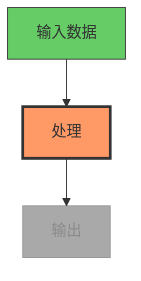

# 图表生成使用规范

> 参考来源：Mermaid.js 文档、`.agents/skills/beautiful-mermaid/` 现有技能、Mermaid-Sonar 复杂度分析研究、Mermaid GitHub issue #651（缩放）与 #3029（动画）。

## 速查卡

```
最大节点数（1080p）:  15-20 节点，20-25 条边
最大节点数（4K）:     25-35 节点，35-45 条边
最大节点数（竖屏）:   10-12 节点，12-15 条边
最小字号:             1080p 下 16px，4K 下 14px
渲染宽度:             最少 1200px
渲染视口:             3840x2160（4K）以导出高清 PNG
主题（深色底）:       tokyo-night 或 dracula
主题（浅色底）:       github-light 或 catppuccin-latte
```

## 图表类型选择

| 类型 | 视频适配度 | 最适合 |
|------|-----------|-------|
| **流程图（TD）** | 优秀 | 流程、决策树、算法 |
| **时序图** | 良好 | API 调用、用户交互、消息流 |
| **状态图** | 良好 | 状态机、生命周期、工作流状态 |
| **类图** | 一般 | 架构（限制 3-5 个类） |
| **ER 图** | 视频中较差 | 太密——仅简化到关键实体 |
| **甘特图** | 一般 | 时间线、项目阶段 |
| **思维导图** | 良好 | 概念概览、主题拆解 |

**默认：** 除非内容明确需要其他类型，一律用流程图（自上而下 `TD`）。它阅读自然，也适合逐步构建。

## 视频复杂度限制

视频是瞬时的——观众无法缩放或滚动。相比静态文档，复杂度要减半。

| 目标分辨率 | 最大节点 | 最大边 | 最小字号（CSS） |
|-----------|---------|-------|---------------|
| 1920x1080（HD） | 15-20 | 20-25 | 16px |
| 3840x2160（4K） | 25-35 | 35-45 | 14px |
| 1080x1920（竖屏） | 10-12 | 12-15 | 18px |

**若超出限制：** 拆成多帧，每帧展示一个子集。这同时自然形成“逐步构建”的动画效果。

## 视频配色主题

| 用途 | 主题 | 原因 |
|------|------|------|
| 深色视频背景 | `tokyo-night` 或 `dracula` | 高对比，可读 |
| 浅色视频背景 | `github-light` 或 `catppuccin-latte` | 柔和、专业 |
| 代码/开发者内容 | `one-dark` | 开发者受众熟悉 |
| 最大对比 | `zinc-dark` | 中性，无色彩偏好 |
| 企业/演示 | `nord-light` | 沉稳、专业 |

**匹配 playbook：** 图表主题应与风格 playbook 的调色板协调。

## 视频渐进构建

Mermaid 原生不支持动画。用渐进渲染制造“构建”效果：

### 方法：多阶段渲染

1. 分阶段渲染图表——先 2 个节点，再 4 个，最后完整图。
2. 每个阶段是独立的 Mermaid 渲染 → SVG → PNG。
3. 在 FFmpeg 中交叉淡入或在阶段间切换。
4. 观众逐步跟随逻辑。

### 高亮当前步骤

用 `classDef` 高亮活动节点、弱化已完成节点：



每步用不同的 `classDef` 分配生成一张 PNG，再在合成阶段排序播放。

## 面向视频可读性的样式

### 节点尺寸
- 1080p 下节点最小宽度 150px。
- 节点内边距 15-20px。
- 每节点文字控制在 3-5 个词，必要时用缩写。

### 边标签
- 最多 1-2 个词。
- 仅在关系从上下文不明显时才用边标签。
- 优先给节点加标签，而非给边加标签。

### 布局方向
- **自上而下（TD）：** 最适合流程、层级、流向。
- **从左到右（LR）：** 最适合时间线、序列、管线。
- 避免自下而上（BT）——对多数观众反直觉。

## 在 OpenMontage 中应用

使用 `diagram_gen` 工具时：

1. **检查复杂度**——1080p 下最多 15-20 节点。更大的图拆成多帧。
2. **选主题**匹配视频的风格 playbook 与背景。
3. **用渐进构建**——渲染各阶段并交叉淡入，形成视频中的“构建”效果。
4. **用 classDef 高亮**——当前步骤橙色/红色，已完成绿色，待进行灰色。
5. **文字极简**——每节点 3-5 个词，每条边标签 1-2 个词。
6. **默认流程图 TD**，除非内容明确需要其他类型。
7. **以 4K 视口渲染**（3840x2160），即便输出是 1080p——确保缩放后文字清晰。
8. **测试可读性**——在合成前按实际视频帧尺寸查看渲染出的 PNG。
