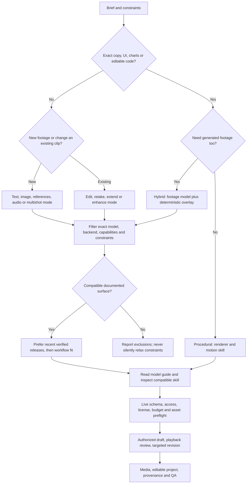

# Decision flow

Start from what must be delivered, not a model leaderboard. The executable counterpart is `scripts/avs.py route`; the machine graph is `registry/navigation.json` plus `registry/workflows.json`.

Native generated audio is not input-audio conditioning. Motion transfer is not motion graphics. First-frame anchoring is not a loose identity reference. A newer model is not a valid substitute for an older model’s missing edit operation. Exact model requests remain hard constraints; freshness is a preference, not permission to override them.
