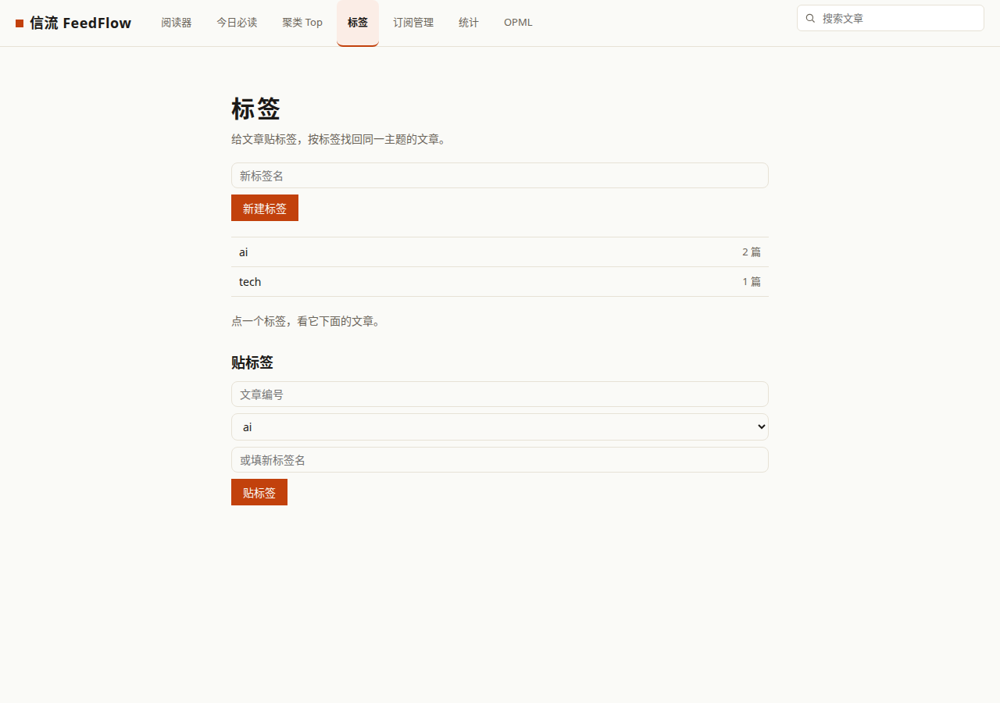
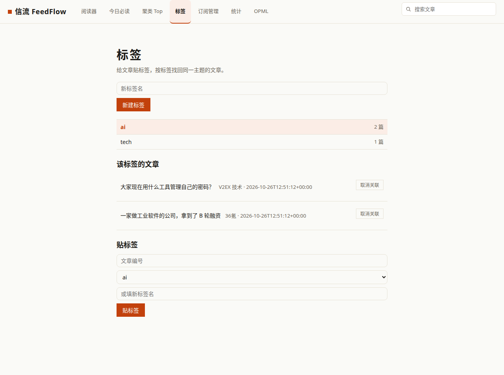

# 信流 FeedFlow · 自托管 RSS 阅读器

自托管的 RSS 阅读器。一个进程、一个 SQLite 文件，跑起来就能用。

[](#)
[](https://www.python.org/)
[](https://flask.palletsprojects.com/)
[](LICENSE)

## 截图

阅读器三栏：左边分组和源，中间文章列表，右边正文。


订阅管理：新建源、改分组、调抓取间隔都在这一页。


统计：订阅源、文章、未读一览。


搜索：标题、正文、作者一起搜。


OPML：导入导出订阅清单。


阅读器里的"为什么排前面"：打开文章自动算出重要性总分，五个分项一条条摆出来，每条理由都是大白话。


设了密码后先过登录页，默认不设密码、行为不变。


## 重要性排序与今日必读

订阅一多，时间线根本刷不完，最后往往变成"收藏夹吃灰"。今日必读每天只挑最重要的 N 篇给你，默认 20 篇，想多看几篇就去兴趣设置里改数字。

每篇文章都会算一个 0~1 的重要性分数，它是下面五个分项的加权和。每个分项都先归一化到 0~1，所以分数可以拆开看，不是黑盒：

| 分项 | 怎么算 | 权重 |
| --- | --- | --- |
| 时效 | 发布时间越近越高，半衰期 48 小时 | 0.30 |
| 事件热度 | 同一事件跟进的文章越多越高 | 0.25 |
| 来源 | 你手动设的权重 × 系统按你的已读/星标学到的权重 | 0.20 |
| 关键词 | 标题或正文命中你设的关键词就加分 | 0.15 |
| 未读 | 没读过的文章有加成 | 0.10 |

今日必读页每篇文章下面都会写清"为什么这篇排前面"，哪一项拉的分、拉了多少，一眼就能看到。


今日必读页，每篇下面都标了排序理由。

关键词和来源权重不用记公式，在"今日必读"页右上角点"调我的兴趣"就能改，改完排序立刻生效。

## 聚类 Top：同一事件只看一次

同一件事十个源都在报，时间线刷不动。聚类 Top 把去重后的事件按重要性排成卡片流，一张卡片就是一件事：聚类主题、成员篇数、来源数、来源标题（至多 5 个）、簇重要性分，以及"为什么这件事排前面"（cluster_reasons）。点开卡片能看到每篇成员的排序理由（score_info），"还有 N 篇已折叠"告诉你这件事一共被报了多少次。


设计注记：卡片流不用三栏特性格样板；分数必须可解释——用户能看到每一项的来由；无数据时如实提示，不许空状态当门面。


## 文章标签

在 `/tags` 页新建标签并给文章贴标签，点击任一标签即可找回同一主题的全部文章。标签名会自动规范化：去除首尾与多余空白并转为小写，重复名称直接复用已有标签。也可通过 API 操作：`GET/POST /api/tags` 与 `GET/POST/DELETE /api/articles/<id>/tags`。

阅读器正文区标题下方现以 chips 展示文章标签：点按任一标签即按该标签筛选文章列表，chip 后的 × 可摘除该关联；chips 下方提供贴标签编辑器，可下拉选已有标签或填新标签名（下拉优先）。点 chip 进入筛选后保留当前 scope，状态栏显示“<scope 文案> · 标签：<名>”，并可用“清除标签筛选”按钮退出筛选。切换 scope 或点订阅树/分组也会清除标签筛选。





## 阅读笔记

在阅读器打开一篇文章后，正文区标签编辑器下方的“我的笔记”编辑器可以为这篇文章写下一条纯文本笔记，支持保存与删除，操作结果会以状态文字提示。左侧树底栏的“我的笔记”入口可打开 `/notes` 页，集中查看全部笔记。接口方面提供 `GET /api/notes`，以及针对单篇文章的 `GET` / `PUT` / `DELETE /api/articles/<id>/note`。笔记目前仅支持纯文本，每篇文章一条。

### 稍后读队列

在阅读器打开文章后，点击正文区的“稍后读”按钮即可把文章排进队列。`/later` 页按入队顺序列出队列，支持上移、下移和移出。相关接口包括 `GET /api/later`、针对单篇文章的 `POST/GET/DELETE /api/articles/<id>/later` 以及调整顺序的 `POST /api/articles/<id>/later/move`。注意队列与星标是两套东西：星标是收藏，队列是待读顺序。

### 阅读历史

在阅读器打开一篇文章，就会在阅读历史里留下一条记录：同一文章多次打开只占一行，旁边标着“读过 N 次”，按最后阅读时间倒序排列。左侧树底栏的“阅读历史”入口可打开 `/history` 页集中查看，不想要了可以一键“清空历史”。相关接口包括 `GET /api/history`、针对单篇文章的 `POST /api/articles/<id>/history` 以及 `DELETE /api/history`。

### 星标收藏

在阅读器打开一篇文章，点一下“星标”即可收藏，再点一次就取消星标。左侧树底栏的“星标收藏”入口可打开 `/starred` 页集中查看，每行显示标题、来源与加星时间，已读文章旁标着“已读”，不想要了可以点行右侧的“取消星标”；列表为空时会显示“还没有星标文章，去阅读器打开一篇文章点“星标”吧。”。

相关接口包括 `GET /api/starred`（返回星标列表）和针对单篇文章的 `POST /api/articles/<id>/star`，后者的返回结果带有 `starred_at` 字段：加星时为当前时间，取消星标时为 null。星标列表按加星时间倒序排列，加星时间为空的老星标排在最后。

注意 `/starred` 页的标题链接与 `/later`、`/history` 页一样指向原文外链，不会跳回站内阅读器。

### 文章归档

在阅读器打开一篇文章，点一下“归档”即可归档，再点一次就取消归档。左侧树底栏的“文章归档”入口可打开 `/archived` 页集中查看，每行显示标题、来源与归档时间，已读文章旁标着“已读”，不想要了可以点行右侧的“取消归档”；列表为空时会显示“还没有归档文章，去阅读器打开一篇文章点“归档”吧。”。

相关接口包括 `GET /api/archived`（返回归档列表）和针对单篇文章的 `POST /api/articles/<id>/archive`，后者的返回结果带有 `archived_at` 字段：归档时为当前时间，取消归档时为 null。归档列表按归档时间倒序排列，归档时间为空的老归档排在最后。

注意 `/archived` 页的标题链接与 `/later`、`/history` 页一样指向原文外链，不会跳回站内阅读器。

### 保存的搜索

在搜索页搜出结果后，点“保存这次搜索”，当前查询词即存入保存列表；阅读器左侧树底栏的“保存的搜索”入口可打开 `/saved-searches` 页集中查看。

`/saved-searches` 页每行显示查询词、保存时间与“删除”按钮，点查询词立刻按该词重搜；列表按保存时间倒序，空态文案为“还没有保存的搜索，去搜索页搜一次并点“保存这次搜索”吧。”。

相关接口包括 `GET /api/saved-searches`、`POST /api/saved-searches` 与 `DELETE /api/saved-searches/<id>`。

注意 `/saved-searches` 页的查询词链接跳回站内搜索页（不是原文外链）；同一查询词只存一条，重复保存不重复建行。

### 阅读清单

想慢慢读的文章可以收进阅读清单。打开阅读器左侧树底栏的“阅读清单”进入清单页：先在顶部表单输入名字新建一个清单（同名不会重复建），再把文章的 ID 填进该清单下的加入表单，文章就收进来了；读完一条用“移出”撤下，整个清单不要了就点“删除”，会连同成员关系一起清掉（文章本身不受影响）。清单页按创建时间倒序列出所有清单并显示各自的文章数，点进清单可以看到成员文章的标题、来源与加入时间。

接口上提供 6 个端点：GET/POST /api/reading-lists 用于列出与新建清单，DELETE /api/reading-lists/<id> 删除清单，GET/POST /api/reading-lists/<id>/articles 用于查看清单文章与按文章 ID 加入，DELETE /api/reading-lists/<id>/articles/<article_id> 用于移出文章。

注意两点：同一清单里同一篇文章只存一条，重复加入会直接返回已有记录；清单页的标题链接指向原文外链，与星标页一致。

在阅读器打开文章后，正文区标签编辑器下方有“加入清单”行，下拉选已有清单或填新清单名点“加入清单”即可收进清单，成功时行内显示“已加入清单「<清单名>」”；重复加入不会重复建成员行。

## Fever API（第三方客户端同步）

想在手机或别的阅读器里看？FeedFlow 兼容 Fever 协议，Reeder、Unread 这类支持 Fever 的客户端可以直接连上来同步，
订阅、文章、已读和星标状态两边互通。

三步接上：

1. 生成 api_key：跑 `python -m feedflow fever-key`，按提示输入邮箱和密码（密码不回显），它会吐出一串 md5。
   这个邮箱密码只活在你这条命令里，服务端只认这串 md5。
2. 启动服务时带上环境变量：`FEEDFLOW_FEVER_API_KEY=<那串 md5>`。
3. 在客户端里加 Fever 账号：地址填 `http://你的机器:8300/fever/`，用户名/密码随便填当时输入的那套就行，
   客户端实际提交的是 api_key。

几点如实说明：

| 事项 | 现状 |
| --- | --- |
| 已支持 | 分组/订阅/文章/未读 id/星标 id 读取；单篇标已读、标星标/取消星标；按源/按组标已读（带 before 时间戳）；unread_recently_read |
| 分页 | items 接口支持 since_id/max_id/with_ids，每次最多 50 篇 |
| favicon | 没做抓取，统一返回 1x1 透明占位图 |
| is_spark | 没这个概念，恒为 0 |
| 未分组的源 | 归到 group 0；按组标已读时 id=0 表示全部源 |

安全提醒：Fever 协议本身是明文 api_key，自用走内网或反向代理加 HTTPS；api_key 妥善保管，泄露了重新生成一个换上就行。

## 演示数据

第一次启动时，如果数据库是空的，会自动写入一套演示数据：2 个分组（技术博客、科技资讯）、6 个订阅源、24 篇文章，发布时间错开在最近 7 天内，混合已读/未读/星标状态。源地址是真实站点的 RSS 地址，文章内容是本地生成的示例文本，仅供试用和截图。

演示数据只在空库时写入一次，不会覆盖你自己的数据。想要干净的库，删掉 `data/feedflow.db` 重启即可。

## 监控指标

`GET /metrics` 返回 Prometheus 文本格式，可直接被抓取。

| 指标名 | labels | 含义 |
| --- | --- | --- |
| `feedflow_http_requests_total` | `method`、`route`、`status` | HTTP 请求计数。 |
| `feedflow_fetch_total` | `status` | 抓取总次数。 |
| `feedflow_fetch_errors_total` | `kind` | 抓取错误计数，`kind` 取值 `timeout` / `dns` / `http_4xx` / `http_5xx` / `parse_error` / `unknown`。 |
| `feedflow_articles_stored_total` | 无 | 已入库文章累计数量。 |
| `feedflow_fetch_duration_seconds_total` | 无 | 抓取耗时累计秒数。 |
| `feedflow_feeds_total` | 无 | 订阅源总数。 |
| `feedflow_articles_total` | 无 | 文章总数。 |
| `feedflow_unread_total` | 无 | 未读文章数。 |
| `feedflow_starred_total` | 无 | 加星文章数。 |

## 更新记录

### v1.6 — 2026-10-16

- 键盘快捷键：`j`/`k` 上下篇、`o` 新标签页打开原文、`r` 标已读/未读、`s` 加星/取消星标、`?` 快捷键帮助浮层。
- 阅读进度记忆：滚动位置按文章存进数据库，重进自动恢复。
- OPML 导出加固：脏数据不崩，加 `dateCreated`。
- 测试：pytest 129 例全过、ruff 全洁。

### v1.4 — 2026-10-16


- 新增 Prometheus 指标（`GET /metrics`）。
- 新增失败注入测试。
- 补全运维手册，共 8 章。
- 新增 Fever 运维章节。
- 移动端阅读优化（≤768px：订阅/文章/正文三段式视图切换，顶栏横滑，触控目标 ≥44px）。
- 测试：pytest 102 例全过（新增 18：指标 6 + 失败注入 12）、ruff 全洁。


移动端：三段式视图切换，一次只看一栏。

- v1.1（2026-10-13）：视觉返工。阅读器三栏改为全幅布局（之前被锁在 900px 容器里，右边大片空白）；演示数据换成真实命名的订阅源和文章（之前是"示例博客"这类敷衍命名且有重复）；修了订阅管理页分组列显示"未分组"的加载竞态；修了搜索页模板变量写错导致永远无结果；短于 3 字的搜索词改走 LIKE 匹配（trigram 索引形不成 3 元组）。pytest 35 例全过，ruff 全洁。

## 功能

- 分组和源树，未读数直接标在名字后面。
- 三栏阅读器，键盘操作：`j`/`k` 上下篇、`o` 打开原文、`r` 标已读、`s` 加星、`?` 看全部快捷键；阅读进度按文章记住，重进接着看。

- 未读、收藏、全部三种视图，按源或按分组筛。
- 全文搜索，中文按三元组匹配，正文一起搜。
- 每个源可单独设抓取间隔，也可只手动抓。
- OPML 导入导出，从别的阅读器搬过来不折腾。
- 支持 ETag 和 Last-Modified，源没更新就不重复拉。
- 后台调度器每 60 秒检查一次到期源。
- 可选单用户密码门：默认关闭；设 FEEDFLOW_AUTH_PASSWORD_HASH（推荐）或 FEEDFLOW_AUTH_PASSWORD 即开启，开启时必须同时设 FEEDFLOW_SECRET_KEY；探针与 Fever 不受影响，详见 OPERATIONS.md 第 11 节。

## 快速开始

安装：

```bash
python3 -m venv .venv && .venv/bin/pip install -r requirements.txt
# 或
make install
```

运行：

```bash
make run
# 等价于 .venv/bin/python -m feedflow serve
```

然后浏览器打开 http://127.0.0.1:8300（监听地址与端口可用 FEEDFLOW_HOST / FEEDFLOW_PORT 环境变量修改）。

手动抓一次订阅：

```bash
make fetch
```

跑测试：

```bash
make test
```

Docker 一把梭：

```bash
docker compose up --build
```

容器内监听 8300 并映射到宿主机 8300；数据库与备份落在宿主机 ./data 目录（挂载为 /app/data），重建容器不丢数据。启动后同样打开 http://127.0.0.1:8300。

