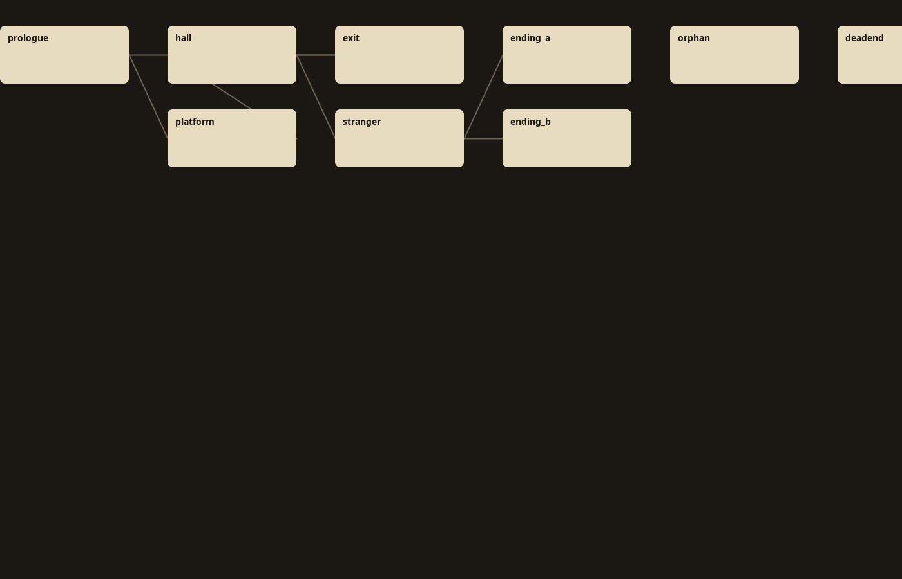

# 幕间 Interlude

分支写多了，最后一定会烂尾。你写着写着就忘了哪条线没接回来，哪个变量还没初始化就被判断，哪个选项其实永远走不到。Twine 能帮你连线，但查不出这些问题。

幕间是一个开源的桌面工具，给独立游戏叙事设计师、互动小说作者、剧本杀作者用。它做一件事：像 linter 一样，把你写的分支剧本从头到尾查一遍。

> 截图说明：桌面 UI 的完整截图待正常构建环境补拍（见 docs/PRODUCTION_CHECKLIST_REPORT.md「环境限制」）。
> 下图为分支图布局算法的真实渲染输出（GraphLayout 对示例剧本的计算结果）。



## 为什么不用 Twine / articy:draft

| 维度 | Twine | articy:draft | 幕间 |
| --- | --- | --- | --- |
| 价格 | 免费 | 商业授权，按席位收费 | 免费，MIT |
| 分支校验 | 没有内置校验，靠肉眼和连线 | 有部分校验，但绑定在商业工具里 | 5 条规则，行号精确报错 |
| DSL | 主要靠可视化连线，文本格式弱 | 自有格式，导出流程重 | 自研叙事 DSL，纯文本可版本管理 |
| 开源 | 是 | 否 | 是 |

## 快速开始

1. 安装 JDK 21。
2. 在项目根目录执行 `./gradlew run`。第一次运行需要联网下载依赖。
3. 载入示例剧本，点「校验」。

## 核心功能

一致性校验引擎，目前 5 条规则，每条都能定位到行号：

- 死路：某个场景没有任何出口，玩家进去就出不来。
- 不可达节点：从 start 出发永远走不到的场景。
- 变量未初始化：条件里用到的变量，在之前从没被 `set` 过。
- 条件永假：两个条件互相矛盾，这个分支实际上永远进不去。
- 跳转目标缺失：`jump` 或 `choice` 指向了不存在的场景。

其他能力：

- 自研叙事 DSL，手写递归下降解析器，报错精确到行号。
- 可视化分支图，层次化布局，有问题的节点用朱砂红圈注（布局算法渲染见上图）。
- 本地化文本抽取与回填，保留 `{var}` 占位符。

复盘模式（v1.4）：

- 对局事件流：记录一次跑团/试玩的完整时间线——进入场景、每次选择（含"没选的路"）、投票、出局、人工关键标注。
- 一键生成 Markdown 复盘报告：对局时间线、抉择点复盘（每个抉择点引用剧本原文行号、列出没走的路）、投票与出局、MVP 评选表（留白投票列）、关键标注。
- CLI：`interlude-lint replay 对局日志.json --script 剧本.interlude --out 复盘报告.md`（不给 --script 则只按日志生成）。

示例（对示例剧本的一次真实走法）：

```
interlude-lint replay src/main/resources/replays/sample-session.json \
  --script src/main/resources/scripts/sample.interlude --out 复盘报告.md
```

## DSL 语法速查

```
scene start:
  text: "你站在岔路口。"
  choice "向左走" -> forest
  choice "向右走" -> cave if courage > 0
```

- `scene` 定义一个场景，`scene start:` 是入口。
- `text:` 是这个场景的正文。
- `choice "..." -> 目标` 是一个选项，指向另一个场景。
- `if 条件` 给选项加上条件，条件不成立时选项不出现。
- `jump 目标` 无条件跳转。
- `set 变量 = 值` 给变量赋值。
- `end` 结束这条线。

## 架构

```
DSL 文本
   |
   v
Parser  --->  AST  --->  Validator  --->  Issues
               |
               +---->  GraphLayout  --->  分支图
               |
               +---->  Extractor  --->  本地化文本
```

技术栈：Kotlin + Compose Multiplatform Desktop，Gradle 构建，JUnit5 测试（24 例全过）。

## 路线图

v1 已完成：

- 解析器
- 校验
- 分支图
- 本地化抽取

计划中：

已完成：

- v1.4 剧本杀复盘模式：对局时间线记录 + Markdown 复盘报告（含抉择点复盘与 MVP 评选输入）
- 玩家路径热力分析：CLI heatmap 子命令（text/json 报告）+ 桌面端「热力分析」面板（Top 路径/节点热力/流失点）


## 许可证

MIT
