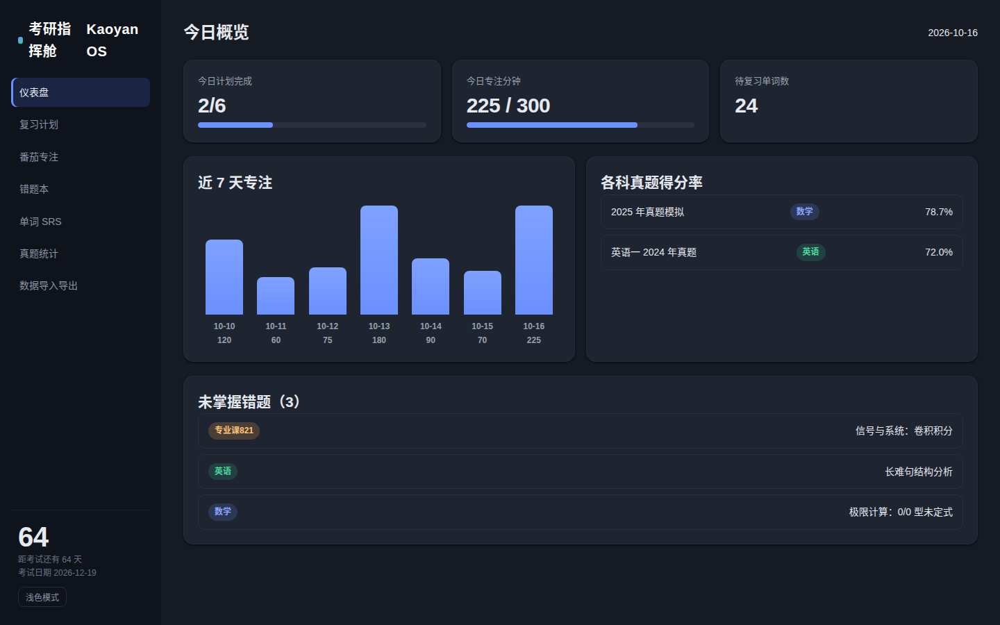
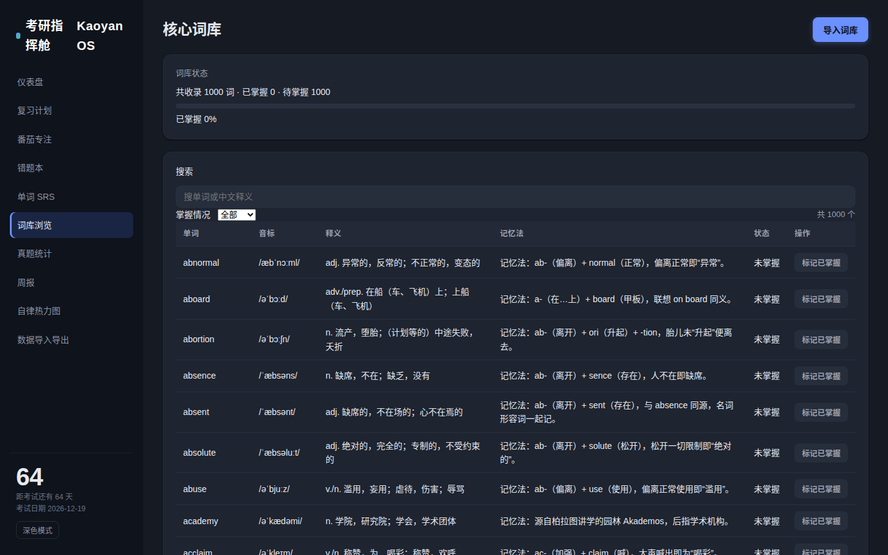
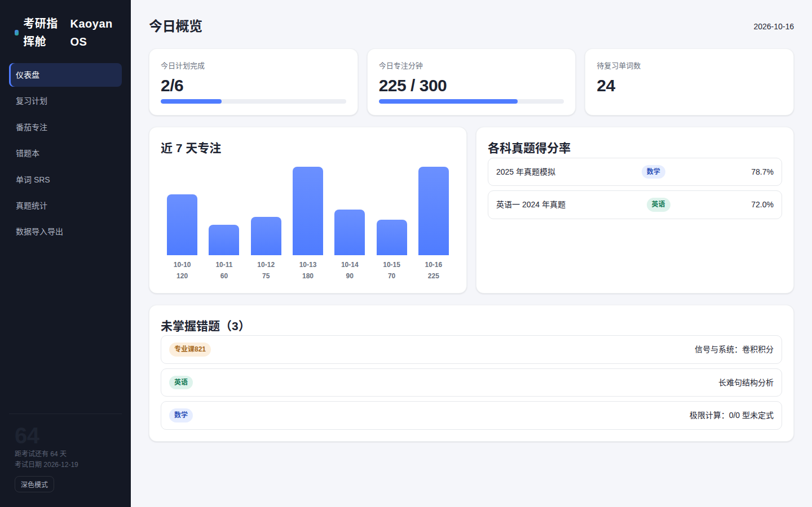
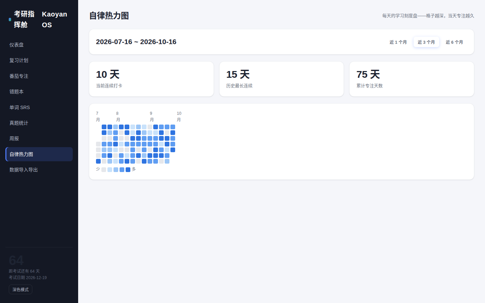
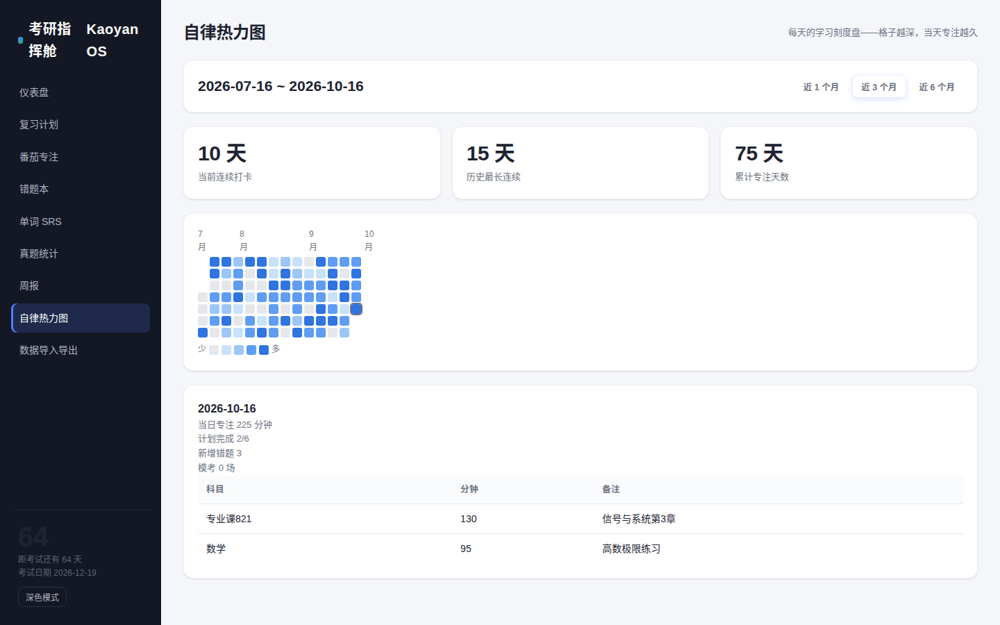
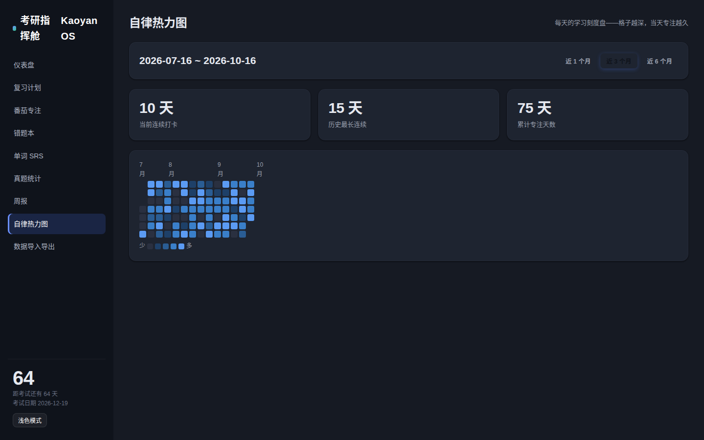
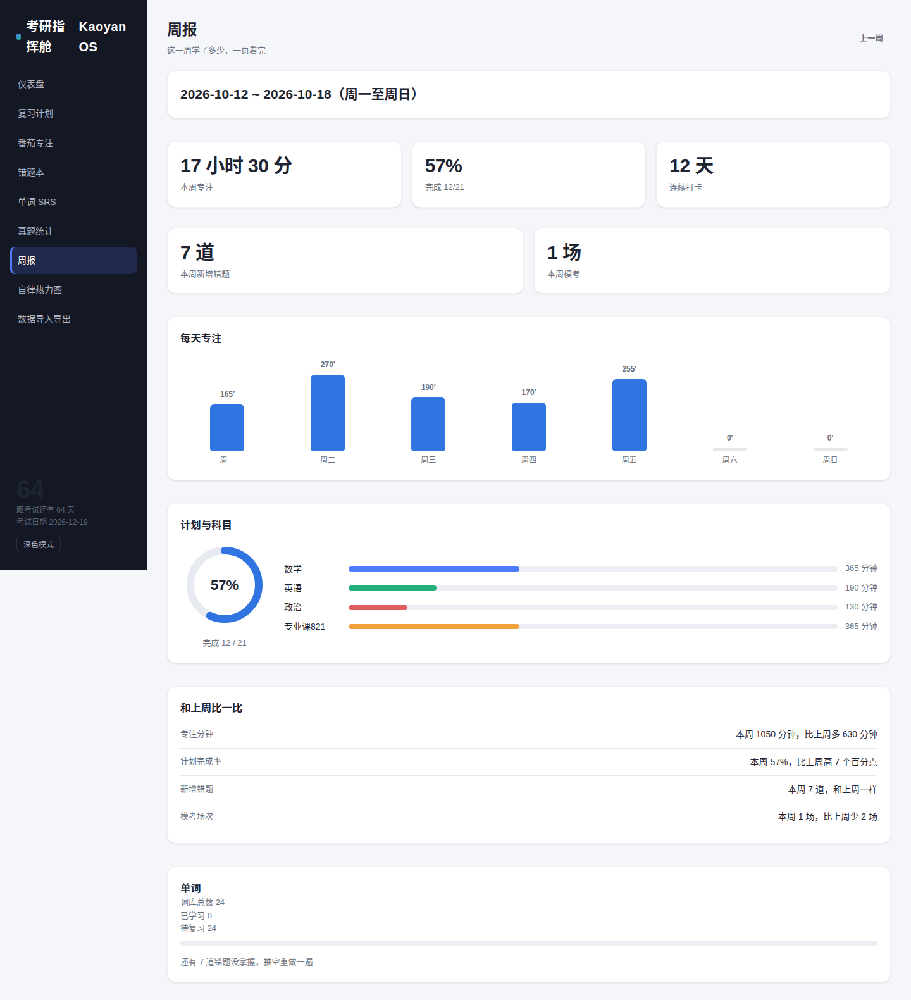
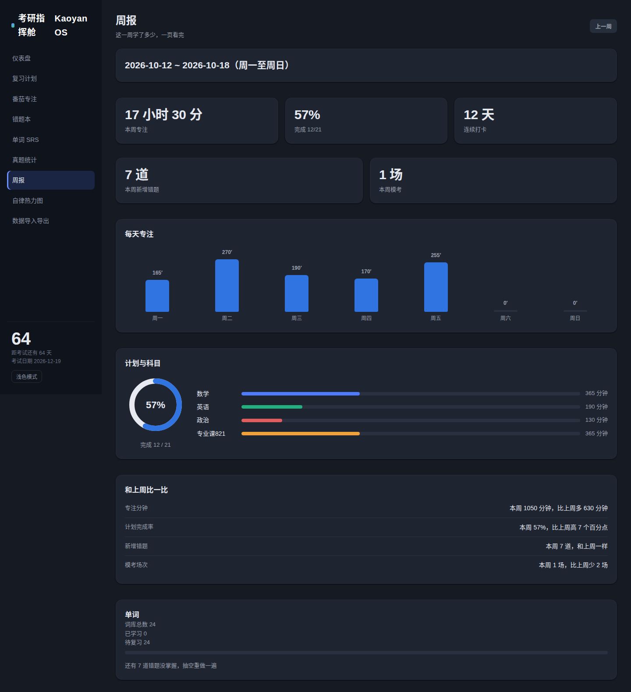

# 考研指挥舱 Kaoyan OS

> 面向考研备考场景的全栈复习管理系统：把计划、专注、错题、单词、真题与全局进度收进同一块「指挥舱」仪表盘。

## 项目简介

考研备考的痛点不在于缺少工具，而在于工具太散：计划表在 Excel、计时器在手机 App、错题在笔记软件、单词在另一个应用，最终没人知道整体进度到底如何。Kaoyan OS 用一套自托管的全栈系统把这些环节串起来——所有数据经 REST API 落到服务端 SQLite，不再依赖浏览器本地存储，换设备、清缓存都不会丢进度。

系统默认内置**初试倒计时（2026-12-19）**与**西电杭州研究院备考场景**的科目常量，开箱即可用于真实复习节奏，而非一个需要大量配置才能用的空壳。

## 功能列表

| 模块 | 说明 |
| --- | --- |
| 复习计划排程 | 按科目与阶段编排任务，跟踪每日/每周完成情况 |
| 番茄专注计时 | 专注会话记录，累计有效学习时长并回流到仪表盘 |
| 错题本 | 按科目/知识点归档错题，记录错因与重做状态 |
| 单词 SRS | 基于 SM-2 简化算法的间隔重复调度，管理复习队列与到期词 |
| 真题计时与得分统计 | 套卷计时、按题型/科目录入得分，输出趋势统计 |
| 仪表盘 | 初试倒计时、今日任务、专注时长、待复习单词、错题与真题得分概览 |
| 数据导入导出 | 全量 JSON 备份与恢复（覆盖/合并）、单词 CSV 与错题 CSV 导入 |
| 深色模式 | 浅/深主题一键切换，偏好存服务端多端同步，深色板为 slate 家族配色体系 |
| 自律热力图 | 近 1/3/6 个月专注热力图、当前/最长连续打卡与累计专注天数，点击格子查看当日专注、计划、错题、模考明细 |
| 周报 | 本周概览卡、7 天专注条形、计划完成率圆环、上周对比、连续打卡 |


## 深色模式

v1.2.0 起支持浅色 / 深色两套主题。

切换入口在侧边栏底部，按钮文案跟着当前主题走：现在是浅色就显示"深色模式"，点一下变深色；现在是深色就显示"浅色模式"。没有 emoji 图标。

实现上不换组件、不换 class 名，靠 `document.documentElement` 上的 `data-theme` 属性驱动，`index.css` 里用 `[data-theme="dark"]` 覆盖全部设计 token。所以新增页面只要用了 token，就自动有深色。

深色板是 slate 家族，和既有侧边栏（#141824）同一族，不会出现"侧边栏是深色、内容区是纯黑"的割裂感：

- 页面底色 #161a23，卡片 #1e2430
- 正文文字 #e6e9f0，次要文字 #9aa0ae
- 边框 #2a3040
- 科目四色在深色下提亮一档，保证仍然可辨识
- 阴影改弱黑影，深色下不做大面积投影

偏好存在服务端的 settings 表里（key-value），换设备登录后主题跟着走，不用重新点。写入走 `PUT /api/settings {theme}`，theme 只接受 `light` / `dark`，其它值返回 400。

截图：





浅色对照：



## 自律热力图

v1.3.0 起新增「自律热力图」页面（导航在"周报"之后）：把每天的专注分钟数画成 GitHub 贡献图式的热力图，格子越深代表当天专注越久。

- 数据：`GET /api/stats/heatmap?months=N` 按天聚合专注、计划、错题、模考，并算出当前连续打卡、最长连续、累计专注天数。
- 视觉逻辑：单色系蓝色五档（0/1~30/31~60/61~120/>120 分钟），浅色 `#c9e2fb → #2f74e0`，深色 `#1e4068 → #5b9bf3`，与 slate 深色板同族；月份标签、少→多图例；hover 显示当日明细（title 原生提示），点击格子展开当日详情卡（含当日专注会话列表）。
- 文案用大白话，不做营销腔。







## 周报视图

v1.4.0 起 /weekly 周报页升级为完整周报视图。数据来自 GET /api/stats/weekly：本周专注、计划完成率、连续打卡、新增错题、模考场次，外加 7 天每日专注分钟。连续打卡口径和热力图一致：今日有专注就从今日往前数，否则从昨日往前数。视觉延续 v1.3.0 热力图体系（蓝五档：浅 #c9e2fb→#2f74e0 / 深 #1e4068→#5b9bf3），深色模式跟随 data-theme，没引入新配色和新字体。





## 技术栈


- **包管理 / 仓库结构**：pnpm workspace monorepo
- **后端** `apps/server`：Fastify 5 + TypeScript + SQLite（Node 内置 `node:sqlite`，无原生依赖）
- **前端** `apps/web`：Vite 6 + React 18 + TypeScript + React Router
- **共享层** `packages/shared`：跨端共享类型定义与科目常量
- **数据流**：前端 → REST API → SQLite，服务端为唯一数据源

## 目录结构

```
kaoyan-os/
├── apps/
│   ├── server/              # Fastify 5 + TypeScript 后端服务
│   │   ├── src/
│   │   │   ├── routes/      # plans / focus / mistakes / words / exams / settings / backup
│   │   │   ├── db/          # node:sqlite 初始化与迁移
│   │   │   └── index.ts     # 服务入口
│   │   └── dist/            # 构建产物
│   └── web/                 # Vite 6 + React 18 前端
│       ├── src/
│       │   ├── pages/       # 仪表盘、计划、专注、错题、单词、真题、数据导入导出
│       │   ├── api/         # REST 客户端封装
│       │   └── main.tsx
│       └── dist/            # 前端构建产物（由后端托管）
├── packages/
│   └── shared/              # 共享类型与科目常量
├── package.json
├── pnpm-workspace.yaml
└── Dockerfile
```

## 快速开始

**环境要求**：Node.js >= 20（`node:sqlite` 依赖），pnpm。

```bash
pnpm install
```

**一键启动前后端**：

```bash
pnpm dev
```

**或分别启动**：

```bash
pnpm dev:server
pnpm dev:web
```

默认地址：

- 前端：http://localhost:5173
- 后端：http://localhost:3001
- 前端 `/api` 请求经 Vite 代理转发到后端，无需额外配置跨域

## 构建与生产运行

```bash
pnpm build
node apps/server/dist/index.js
```

生产模式下通过 `WEB_DIST` 指定前端构建产物目录，由 Fastify 直接托管静态资源与 SPA 回退，单进程即可对外服务。

## 测试

```bash
pnpm test
```

后端采用 vitest 编写集成测试，覆盖各 REST 端点与数据库读写路径。

## 环境变量

| 变量 | 默认值 | 说明 |
| --- | --- | --- |
| `PORT` | `3001` | 后端监听端口 |
| `DATABASE_PATH` | `./data/kaoyan.db` | SQLite 数据库文件路径 |
| `WEB_DIST` | 未设置 | 前端构建产物目录，设置后由后端托管静态资源 |
| `NODE_ENV` | `development` | 运行环境标识 |

## Docker

```bash
docker build -t kaoyan-os .
docker run -d \
  --name kaoyan-os \
  -p 3001:3001 \
  -v kaoyan-data:/app/data \
  -e NODE_ENV=production \
  kaoyan-os
```

数据库文件位于容器内 `/app/data`，挂载数据卷即可持久化，重建镜像不丢数据。

## API 概览

| 分组 | 主要端点 | 说明 |
| --- | --- | --- |
| health | `GET /api/health` | 服务健康检查 |
| plans | `GET/POST /api/plans`，`PATCH/DELETE /api/plans/:id` | 复习计划增删改查与完成状态 |
| focus | `GET/POST /api/focus` | 番茄专注会话记录与统计 |
| mistakes | `GET/POST /api/mistakes`，`PATCH/DELETE /api/mistakes/:id` | 错题归档、错因与重做状态 |
| words | `GET/POST /api/words`，`POST /api/words/:id/review` | 词条管理与 SRS 复习结果提交 |
| exams | `GET/POST /api/exams` | 真题计时记录与得分统计 |
| settings | `GET/PUT /api/settings` | 考试日期、科目等配置 |
| stats | `GET /api/stats/weekly`，`GET /api/stats/heatmap` | 周报聚合（专注分钟/计划完成率/新增错题/模考场次/连续打卡 + 7 天每日专注分钟）；热力图聚合（专注/计划/错题/模考按天聚合 + 连续打卡统计） |

| 备份导入 | `GET /api/backup/export`，`POST /api/backup/import`，`POST /api/import/words`，`POST /api/import/mistakes` | 全量备份导出/恢复（覆盖·合并）、单词 CSV / 错题 CSV 导入 |

## 开发说明与路线图

开发约定：

- 共享类型统一放在 `packages/shared`，前后端不得各自复制一份定义。
- 所有持久化只走 REST API + SQLite，禁止在前端引入 localStorage 作为数据源。
- 新增端点需补充对应的 vitest 集成测试。

后续路线图：

1. **账号体系**：多用户注册登录、数据按用户隔离，支持多设备同步。
2. **数据导入导出**：~~全量 JSON 备份与恢复，兼容常见错题/单词表格式导入。~~（2026-10-15 已交付 v1.1.0）
3. **深色模式**：~~浅/深主题切换 + 服务端偏好持久化。~~（2026-10-16 已交付 v1.2.0）
4. **考研核心 500 词库扩充**：~~500 个考研英语核心词 JSON 词库（word/phonetic/pos/meanings_zh/example_en/example_zh），POST /api/words/import 幂等导入（按 word 去重），单词表新增 source 来源字段（内置种子/核心500词库/手动录入/CSV导入），前端单词页支持按来源筛选与学习进度展示。~~（2026-10-16 已交付）
5. **移动端**：面向手机浏览器的响应式优化，并评估轻量原生客户端方案。
6. **周报视图**：~~GET /api/stats/weekly 周统计聚合（专注/计划/单词/错题/模考），前端 /weekly 周报页（本周/上一周切换、四科专注条、计划完成率、单词进度）。~~（2026-10-16 已交付）；v1.4.0（2026-10-16）深化：7 天专注条形、完成率圆环、上周对比、连续打卡
7. **自律热力图**：~~GET /api/stats/heatmap 按天聚合（专注/计划/错题/模考）+ 连续打卡统计，前端 /heatmap 热力图页（GitHub 贡献图式、1/3/6 个月切换、点击格子看当日详情）。~~（2026-10-16 已交付 v1.3.0）

