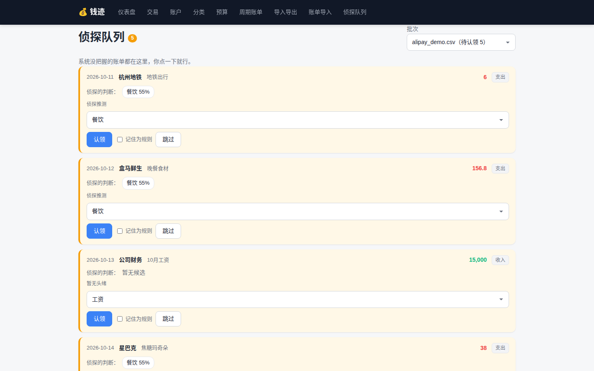
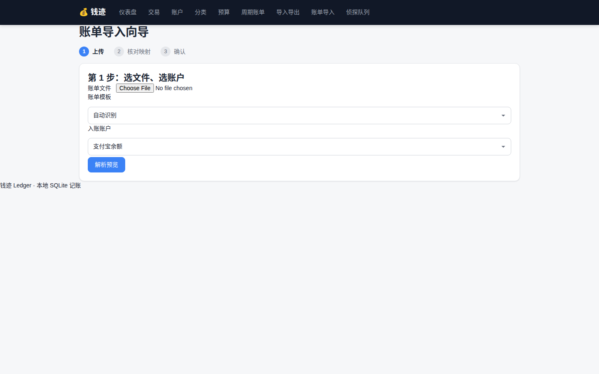
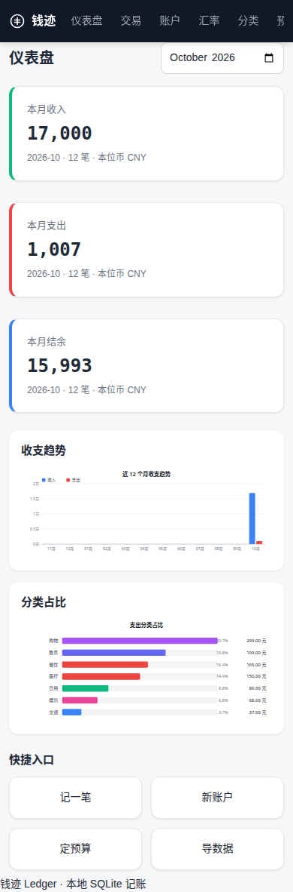
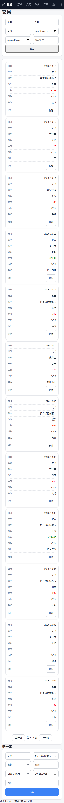
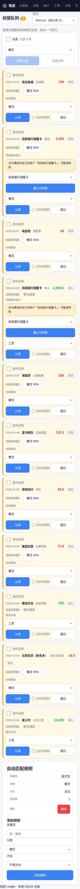
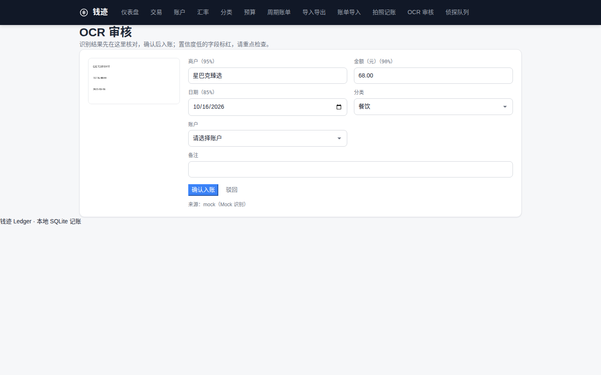
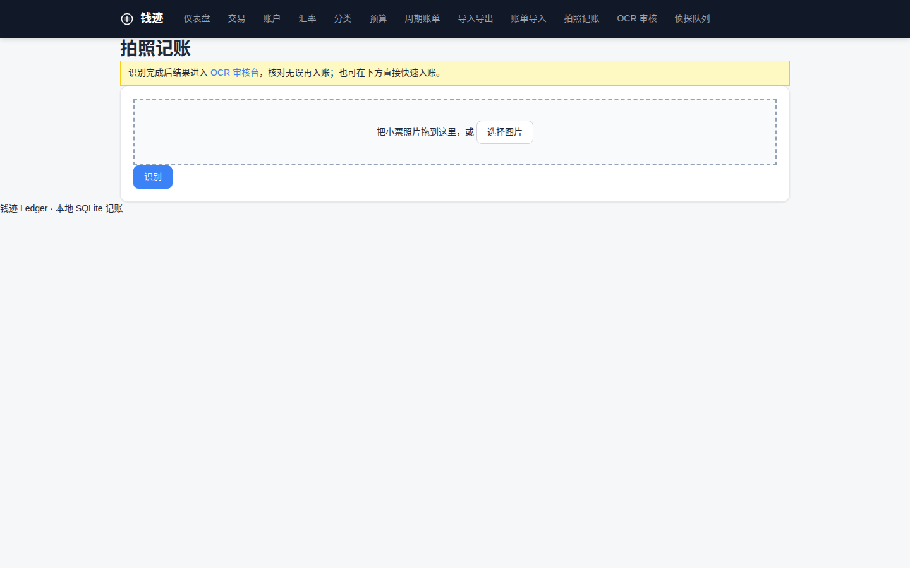

# 钱迹 Ledger

给中国人的记账本。补录账单太累，逐条分类劝退——所以钱迹让你把银行、支付宝、微信的账单直接导进来，能自动对上的自动入账，对不上的进"侦探队列"，你点一下认领，它就学会了。

灵魂一页纸见 [docs/SOUL.md](docs/SOUL.md)。

## 快速开始

make install
make dev

然后打开 http://127.0.0.1:8100

`make install` 会建 `.venv` 并做可编辑安装；`make dev` 用 uvicorn 热重载跑在 127.0.0.1:8100。

## 功能

### v1 基础

- 多账户：银行卡、支付宝、微信、现金分开记。
- 交易：收入、支出、转账。
- 分类：自定义分类，支持 emoji。
- 预算：按分类按月设预算，执行进度与超支预警。
- 统计：服务端渲染 SVG 图表，零前端构建。
- CSV 导入导出：自己的数据随时带走。
- 周期账单：房租、订阅这类固定支出自动记。
- Web UI：12 个页面，Jinja2 服务端渲染（`/`、`/transactions`、`/currencies`、`/accounts`、`/categories`、`/budgets`、`/recurring`、`/import`、`/statement`、`/bills`、`/bills/review`、`/detective`）。

### v2.0 银行账单侦探

- 账单导入向导 `/statement`：上传 → 解析预览 → 列映射可调 → 确认。
- 预置 4 个模板：支付宝、微信支付、招商银行、工商银行。
- 三路匹配：关键词规则（priority）> 历史习惯（同商户多数票）> 候选建议（Top3 + 置信度）。
- 侦探队列 `/detective`：待认领卡片流，一键认领 / 换分类 / 记住为规则 / 跳过。
- 认领即学习：认领时 `save_rule=true` 存关键词规则，下次同类自动入账。
- 转账识别：对方是自己账户名时建议转账。
- 指纹去重：`sha256(日期|金额|方向|对方|摘要)`，重复导入自动跳过。

### v2.1 生产级补强

- DB 迁移版本化：`PRAGMA user_version`，v1 老库自动升级。
- 结构化日志 + request_id 全链路（JSON Lines，`X-Request-Id` 响应头）。
- `GET /api/metrics`（Prometheus 格式）与 `GET /api/ready`（就绪探针）。
- 备份恢复 CLI：`python -m ledger backup` / `python -m ledger restore FILE`，`make backup` / `make restore FILE=`。
- `docker-compose.yml` 一键部署 + `docs/OPERATIONS.md` 运维手册。

### v2.2 多币种与汇率

- 账户与交易支持币种（ISO 4217 三字母代码，默认 CNY）。
- 汇率表 `/currencies`：设置各币种兑本位币汇率（本位币恒为 1，不可改）。
- 统计（月度汇总、净资产）按本位币折算；缺汇率的交易/账户不计入并单独计数。
- `LEDGER_BASE_CURRENCY` 环境变量设置本位币（默认 CNY，非法值启动失败）。
- 限制：跨币种转账不做实时换算，按转出币种金额记录。

### v2.4 侦探规则引擎 2.0

- 模糊匹配：金额容差（±x 元/±x%）、日期窗口（±N 天），银行两边金额差一点手续费也能认出来。
- 商户别名学习：手工认领一次就记住（"淘宝商城"→购物），下次同类自动入账；纠正了就更新。
- 转账配对：提现/转入两条金额接近、日期接近的记录自动配对，侦探页提示"转账配对成功"。
- 批量处理：侦探队列卡片多选，一键批量认领 / 批量忽略，部分失败逐条告诉你原因。

## 侦探规则引擎 v2（v2.11）

- 现在有三种规则：关键词、正则、fuzzy（模糊匹配）。关键词最简单，写个词就行；正则适合复杂模式；fuzzy 用来兜住拼写不标准或手写备注。
- 每条规则都有优先级（数字越小越先跑）、方向（in 只看收入、out 只看支出、both 两边都看、any 不限）、启用开关，还有命中计数——跑过几次都记着。
- 正则做了防护：嵌套量词、回溯引用、超长表达式直接拒收，不会让你写出一条能把服务卡死的规则。匹配时还有熔断，单条规则跑太久会被掐掉。
- preview 接口会把整条解释链吐出来：哪条规则先跑、哪条命中、哪条被跳过，跳过原因也写清楚（方向不对、没启用、优先级被前面截胡等）。
- 截图：docs/screenshots/rules-manage.png

## 月度收支报告（v2.11）

- 分类口径可以自己定，不再固定那套种子分类。比如 9 月可以设成「考研投入 / 饮食 / 交通 …」，用 PUT /api/reports/category-scheme 提交。
- 月报里带环比：这个月和上个月比，收入和支出各涨跌多少。
- 还有商户榜：按商户汇总，看钱主要花在谁那儿。
- 转账不算收支，两边都不进，别把它当消费或收入统计。
- 截图：docs/screenshots/monthly-report.png

### v2.11 规则引擎 v2 / 对账工作台 / 月度报告

- 规则引擎 v2：规则支持关键词与正则两种类型，可单独启用或停用，并记录命中次数。
- 规则预览：给定一条流水，返回命中链，说明走了别名记忆、正则规则还是关键词规则。
- 决胜顺序：别名记忆 85 > 正则规则 97 > 关键词规则 95 > 历史 > 候选，同级按 priority、长度、id 决胜。
- 容错：非法正则在调度中被跳过，不会让整批匹配中断。
- 规则管理页：/rules 提供表格、启用开关与测试命中区，可直接看到某条规则命中了哪些流水。
- 对账工作台：/workbench 按批次列出差异流水，支持逐条确认、忽略、记成规则、转账。
- 批量操作：对账工作台支持批量处理，采用部分成功语义，失败的条目会单独计数。
- 月度报告：/report 按月展示分类汇总、环比、Top 商户，并按口径分桶。
- 口径方案：默认使用“9月口径”，分桶为考研投入、一次性大项、饮食、日用、话费、交通，可通过接口读写。
- 报告导出：月度报告可导出自包含 HTML，便于离线查看与存档。
- 演示数据：scripts/seed_workbench_demo.py 可生成工作台演示数据，样例流水见 docs/samples/cmb-statement-sample.csv。
- 导入边界：覆盖 GBK、UTF-8-SIG 解码，以及千分位、括号负数、¥ 符号、全角逗号、中文日期与重复导入幂等。

规则管理页截图：docs/screenshots/rules-manage.png

对账工作台截图：docs/screenshots/workbench.png

月度报告截图：docs/screenshots/monthly-report.png

### v2.3 移动端适配

- 手机浏览器可用：`@media (max-width: 768px)` 断点，顶栏 10 个导航横向滑动，按钮与表单触控目标 ≥44px。
- 大表格转卡片流：交易列表、侦探队列规则表在窄屏下变成卡片，一行一条，列名标在左边。
- 仪表盘：三汇总卡单列、两张统计图上下排、快捷入口两列；预算页行内信息换行、删除按钮加大。
- 品牌 logo 从 emoji 换成 SVG 硬币线稿；顺手修了导航高亮样式不生效的 bug。
- 新增 `tests/test_mobile.py` 移动端冒烟测试（10 个页面 200 + viewport 标记 + 断点 CSS 存在性）。

## 账单侦探工作流

1. 上传：在 `/statement` 传账单文件（CSV），系统自动识别模板、编码、表头前导行。
2. 自动匹配：解析后逐条跑匹配（关键词规则 > 别名 > 历史习惯，另有金额容差与日期窗口），能对上的直接入账。
3. 侦探队列：对不上的进 `/detective`，卡片流展示；支持多选批量认领 / 批量忽略。
4. 认领即学习：点一下认领就记住（别名学习），勾上"记住为规则"则存为关键词规则，下次同类自动入账。

## API

所有端点前缀 `/api`。

| 方法 | 路径 | 说明 |
| --- | --- | --- |
| GET/POST/DELETE | `/api/statement-templates` | 账单模板管理 |
| POST | `/api/statements/parse-preview` | 上传并解析预览（multipart） |
| POST | `/api/statements/upload` | 上传账单（multipart） |
| GET | `/api/statements/batches` | 批次列表 |
| GET/DELETE | `/api/statements/{id}` | 批次详情 / 删除 |
| POST | `/api/statements/{id}/confirm` | 确认导入 |
| GET | `/api/statements/{id}/items` | 批次条目 |
| POST | `/api/statements/items/{id}/claim` | 认领条目 |
| POST | `/api/statements/items/{id}/claim-transfer` | 认领为转账 |
| POST | `/api/statements/items/{id}/skip` | 跳过条目 |
| POST | `/api/statements/items/batch-claim` | 批量认领（部分成功） |
| POST | `/api/statements/items/batch-skip` | 批量忽略（部分成功） |
| GET/POST/DELETE | `/api/match-rules` | 匹配规则管理 |
| GET | `/api/health` | 健康检查（含版本号） |
| GET | `/api/ready` | 就绪探针（DB 连通性） |
| GET | `/api/metrics` | Prometheus 指标 |
| GET | `/api/currencies` | 汇率列表 |
| PUT | `/api/currencies/{code}` | 新增/更新汇率 |
| GET/POST/PUT/DELETE | `/api/transactions` | 交易管理 |
| GET/POST/PUT/DELETE | `/api/accounts` | 账户管理（含 `/{account_id}/transactions`） |
| GET/POST/PUT/DELETE | `/api/categories` | 分类管理 |
| GET/POST/PUT/DELETE | `/api/budgets` | 预算管理（含 `/yearly`） |
| GET/POST/PUT/DELETE | `/api/recurring` | 周期账单管理（含 `/upcoming`） |
| GET/PATCH/DELETE | `/api/merchant-aliases` | 商户别名管理 |
| GET | `/api/stats/summary` | 统计汇总 |
| GET | `/api/stats/trend` | 统计趋势 |
| GET | `/api/stats/by-category` | 按分类统计 |
| GET | `/api/stats/net-worth` | 净资产统计 |
| POST | `/api/import/csv` | CSV 导入（multipart） |
| GET | `/api/export/csv` | CSV 导出 |
| POST | `/api/statements/ocr` | 账单 OCR 解析预览（multipart） |
| POST | `/api/bills/ocr` | 拍照记账 OCR 识别（multipart） |
| GET | `/api/bills/review` | OCR 审核队列 |
| GET | `/api/bills/review/{review_id}/image` | 审核原图 |
| POST | `/api/bills/review/{review_id}/confirm` | 确认入账 |
| POST | `/api/bills/review/{review_id}/reject` | 驳回 |
| POST | `/api/bills/review/batch` | 批量审核 |

## 为什么不用随手记 / Excel 记账

| | 随手记 | Excel | 钱迹 Ledger |
| --- | --- | --- | --- |
| 数据存放 | 云端 | 本地文件 | 本地 SQLite 单文件 |
| 账单导入 | 手工补录 | 手工整理 | 银行/支付宝/微信账单自动认领 |
| 开源自托管 | 否 | 是 | 是 |

## 开发

make test   # pytest，889 例（2026-10-19 实测）

lint：

.venv/bin/python -m ruff check src/ tests/

目录：

src/ledger/
  main.py              应用入口 + 页面路由
  config.py            LEDGER_DB / LEDGER_HOST / LEDGER_PORT / LEDGER_LOG_LEVEL / LEDGER_BACKUP_DIR 环境变量
  database.py
  migrations.py        v2.1 PRAGMA user_version 版本化迁移
  backup.py            v2.1 备份/恢复（integrity_check + 安全快照）
  logging.py           v2.1 结构化日志 + request_id 中间件
  models.py            10 张表（含 merchant_aliases）
  schemas.py
  services.py
  matching.py          v2.0 三路匹配纯函数引擎；v2.4 加金额容差/日期窗口/别名匹配/转账配对
  statement_parser.py  v2.0 账单解析：GBK / 表头探测 / 列映射
  routers/
    accounts.py
    categories.py
    transactions.py
    budgets.py
    stats.py
    import_export.py
    recurring.py
    statements.py
    health.py
    metrics.py           v2.1 Prometheus 指标
  templates/           9 页
  static/
    style.css
    app.js
tests/
docs/
  SOUL.md
  screenshots/

## 功能

### v2.6 真实 OCR + 审核台

- 三种 OCR 提供商：`mock`（默认，固定演示结果，响应中 `mock: true` 明确标识）、`tesseract`（本地真实识别）、`env`。
- `get_provider()` 支持 `mock`/`tesseract`/`env`。
- tesseract 模式：`LEDGER_OCR_PROVIDER=tesseract`，语言 `LEDGER_OCR_LANG`（默认 `chi_sim+eng`），超时 `LEDGER_OCR_TIMEOUT`（默认 30 秒）；缺二进制时报错并给出 apt/brew 安装命令。Debian/Ubuntu 安装：`sudo apt install tesseract-ocr tesseract-ocr-chi-sim tesseract-ocr-eng`。
- 审核流程：`/bills` 上传图片 → 识别结果进入 `/bills/review`「OCR 审核」队列 → 人工核对（置信度低于 70% 的字段标红）→ 确认入账 / 驳回。确认调记账 API 入账；重复确认返回 409。

## 配置

| 环境变量 | 说明 |
| --- | --- |
| `LEDGER_DB` | SQLite 数据库文件路径 |
| `LEDGER_HOST` | 监听地址 |
| `LEDGER_PORT` | 监听端口 |
| `LEDGER_LOG_LEVEL` | 日志级别（DEBUG/INFO/WARNING/ERROR/CRITICAL，默认 INFO，非法值启动失败） |
| `LEDGER_BACKUP_DIR` | 备份目录（默认 `<项目根>/data/backups`） |
| `LEDGER_BASE_CURRENCY` | 本位币（ISO 4217 三字母大写，默认 CNY，非法值启动失败） |
| `LEDGER_OCR_PROVIDER` | OCR 提供商：`mock`（默认）/`tesseract`/`env`，非法值启动失败 |
| `LEDGER_OCR_API_KEY` | 真实 OCR 服务 API Key（`LEDGER_OCR_PROVIDER=env` 时必填） |
| `LEDGER_OCR_LANG` | tesseract 语言包（默认 `chi_sim+eng`） |
| `LEDGER_OCR_TIMEOUT` | tesseract 识别超时秒数（默认 30） |

## 运维

- 一键部署：`docker compose up -d --build`
- 备份/恢复：`make backup` / `make restore FILE=...`
- 完整运维手册见 `docs/OPERATIONS.md`（升级/监控/排障）。
