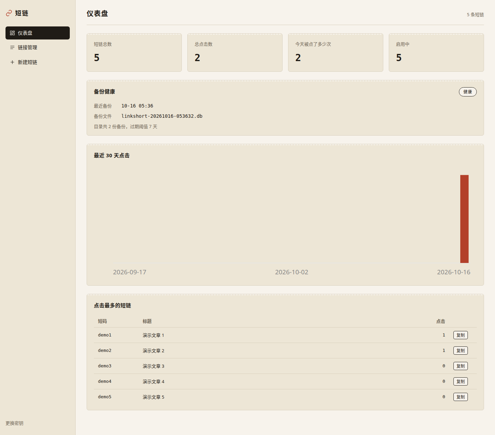
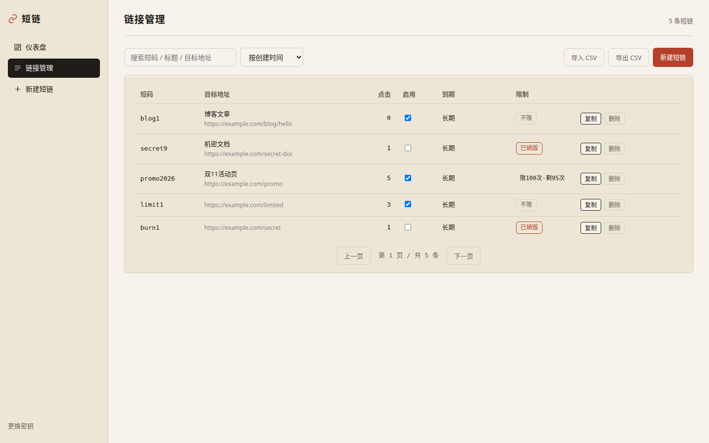
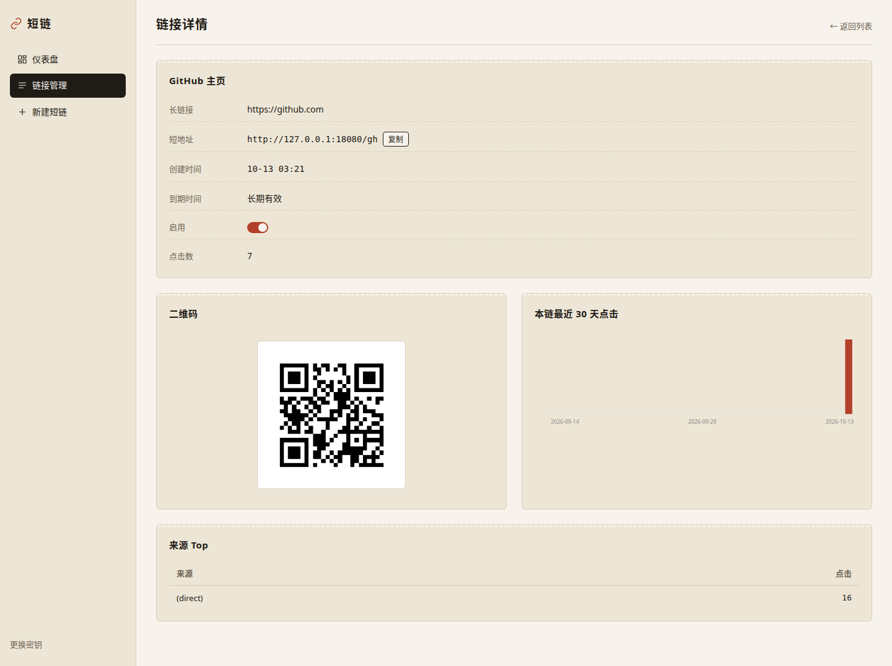
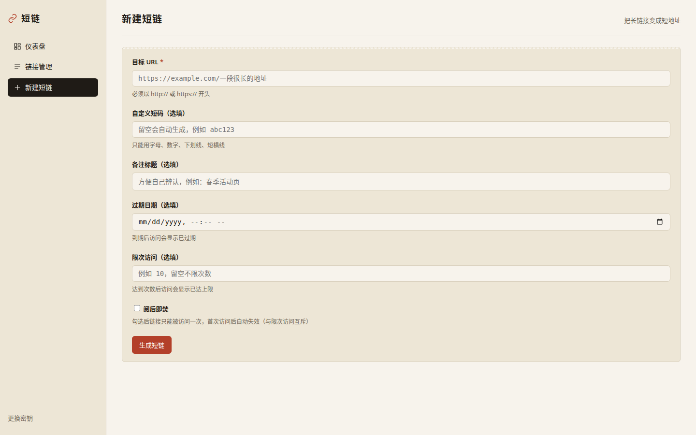

# 短链 LinkShort

自托管的短链服务——把长链接变成短地址，一个二进制、一个 SQLite 文件就能跑。

[](https://go.dev/)
[](https://github.com/go-chi/chi)
[](./LICENSE)
[](./.github/workflows/ci.yml)

## 截图



仪表盘：总览数字、30 天点击曲线、Top 链接和 Top Referer。



链接管理：列表里能启用/禁用、改过期时间、导出 CSV。列表新增"限制"列徽标，一眼看出限次/阅后即焚状态。




详情：单条链接的短地址、二维码、访问日志和每日点击。



新建短链：填长链接，短码留空就自动生成，也可以自己写 slug。

## 功能

- **短链创建**：自动生成 base62 短码，也支持自定义 slug
- **302 跳转**：每次访问计数，并记录访问日志（时间、IP 哈希、UA、Referer）
- **统计**：总览、30 天点击曲线、Top 链接、Top Referer
- **过期时间**：到期后返回 410
- **限次访问**：设置最多可访问 N 次，超限返回 410
- **阅后即焚**：一次性链接，首次访问后自动失效，再访返回 410

- **启用/禁用开关**：随时停用一条链接
- **二维码**：服务端直接生成 PNG
- **CSV 导入导出**：方便迁移和备份
- **API Key 鉴权**：`X-API-Key` 头或 `?key=` 参数
- **Web UI 四页**：仪表盘、链接管理、详情、新建

## 快速开始

### make run

```bash
git clone https://github.com/yourname/linkshort.git
cd linkshort
make run
```

默认监听 `:8080`，数据库在 `./data/linkshort.db`。首次启动会在日志里打印自动生成的 admin key，记下来。

打开 <http://localhost:8080> 就能用。

### 二进制运行

```bash
make build
./bin/linkshort
```

或者：

```bash
go build -o linkshort ./cmd/linkshort
LINKSHORT_ADDR=:9000 LINKSHORT_DB=./links.db ./linkshort
```

### docker

```bash
docker build -t linkshort .
docker run -d \
  -p 8080:8080 \
  -v $(pwd)/data:/app/data \
  -e LINKSHORT_ADMIN_KEY=your-secret-key \
  linkshort
```

## 配置

全部通过环境变量：

| 变量 | 默认值 | 说明 |
| --- | --- | --- |
| `LINKSHORT_ADDR` | `:8080` | 监听地址 |
| `LINKSHORT_DB` | `./data/linkshort.db` | SQLite 文件路径 |
| `LINKSHORT_ADMIN_KEY` | 自动生成并打印到日志 | API Key 和管理入口密钥 |
| `LINKSHORT_BASE_URL` | 空 | 拼短地址用的前缀，例如 `https://s.example.com` |
| `LINKSHORT_RATE_LIMIT_RPS` | `20` | 限流速率，每秒补充的 token 数 |
| `LINKSHORT_RATE_LIMIT_BURST` | `40` | 令牌桶容量，允许的突发请求数 |
| `LINKSHORT_RATE_LIMIT_ENABLED` | `true` | 是否启用限流（IP + API Key 双维度） |

`LINKSHORT_BASE_URL` 不填时，短地址用请求里的 Host 拼。

## API

所有 `/api/*` 端点都需要鉴权，二选一：

- 请求头 `X-API-Key: <key>`
- 查询参数 `?key=<key>`

`GET /{slug}` 是跳转，不需要鉴权。

| 方法 | 路径 | 说明 | 鉴权 |
| --- | --- | --- | --- |
| POST | `/api/links` | 创建短链 | 是 |
| GET | `/api/links` | 链接列表 | 是 |
| GET | `/api/links/{id}` | 单条链接详情 | 是 |
| PATCH | `/api/links/{id}` | 修改链接（slug、过期、启用状态等） | 是 |
| DELETE | `/api/links/{id}` | 删除链接 | 是 |
| GET | `/api/links/{id}/qrcode.png` | 二维码 PNG | 是 |
| GET | `/api/links/{id}/daily` | 单条链接的每日点击 | 是 |
| GET | `/api/stats/overview` | 总览统计 | 是 |
| GET | `/api/stats/daily` | 全站每日点击 | 是 |
| GET | `/api/stats/top-links` | 点击最多的链接 | 是 |
| GET | `/api/stats/top-referers` | 点击最多的 Referer | 是 |
| POST | `/api/import` | 从 CSV 导入 | 是 |
| GET | `/api/export.csv` | 导出 CSV | 是 |
| GET | `/api/meta` | 服务元信息 | 是 |
| GET | `/api/health` | 存活探针（进程活着即 200） | 是 |
| GET | `/api/readyz` | 就绪探针（DB 通 200，否则 503） | 是 |
| GET | `/metrics` | Prometheus 文本指标 | 否 |
| GET | `/{slug}` | 302 跳转 | 否 |

创建短链的例子：

```bash
curl -X POST http://localhost:8080/api/links \
  -H "X-API-Key: $LINKSHORT_ADMIN_KEY" \
  -H "Content-Type: application/json" \
  -d '{"url":"https://example.com/some/very/long/path","slug":"hello"}'
```

导出 CSV：

```bash
curl -H "X-API-Key: $LINKSHORT_ADMIN_KEY" \
  http://localhost:8080/api/export.csv > links.csv
```

## 目录结构

```
cmd/linkshort/           程序入口
internal/config/         环境变量读取
internal/db/             SQLite 连接与迁移
internal/model/          数据结构
internal/store/          数据库读写
internal/handler/        HTTP 处理器（API）
internal/handler/web/    内嵌 Web UI（go:embed）
internal/util/           base62、IP 哈希等小工具
internal/qr/             二维码 PNG 生成
```

## 测试与质量

```bash
make test    # go test ./...   24 个用例
make vet     # go vet ./...
make fmt     # gofmt -w .
make tidy    # go mod tidy
```

CI 配置在 `.github/workflows/ci.yml`，每次 push 跑 vet、fmt 检查和测试。

## 选型与视觉注记

**路由用 chi 而不是 gin/echo/fiber。** 单二进制小服务，chi 零第三方依赖、纯 `net/http` 兼容，和"一个二进制跑起来"的气质最贴合。

**二维码用 skip2/go-qrcode。** 短链场景只要求稳定输出 PNG，这个库 API 极简、依赖近乎零。

**数据库用 modernc.org/sqlite。** 纯 Go、不需要 cgo，交叉编译没有负担。

**Web UI 走「快递面单 / 邮政标签」视觉。** 米白 `#F7F3EC` 打底、墨黑 `#1F1B16` 写字、邮戳红 `#B3402A` 点睛，牛皮纸卡 `#EDE6D6` 做区块，边上有邮票齿孔装饰，短码和数字用等宽字体。没有紫渐变、没有渐变标题、没有三栏特性格、没有 emoji 图标。

## License

MIT，见 [LICENSE](./LICENSE)。
