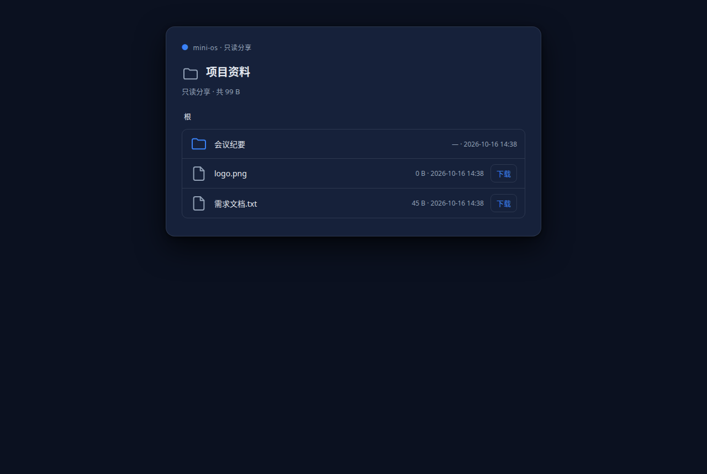
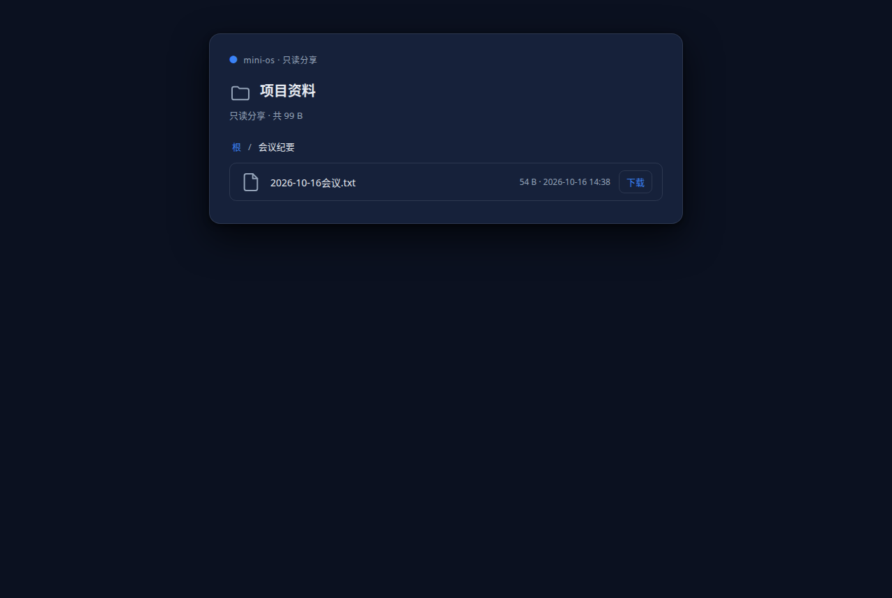
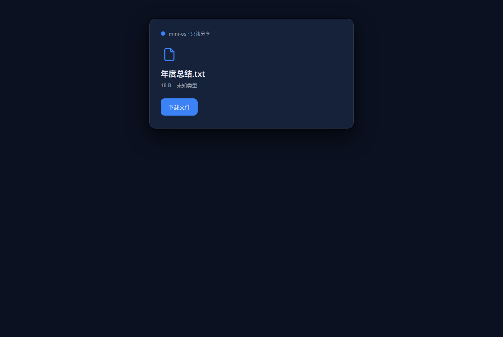
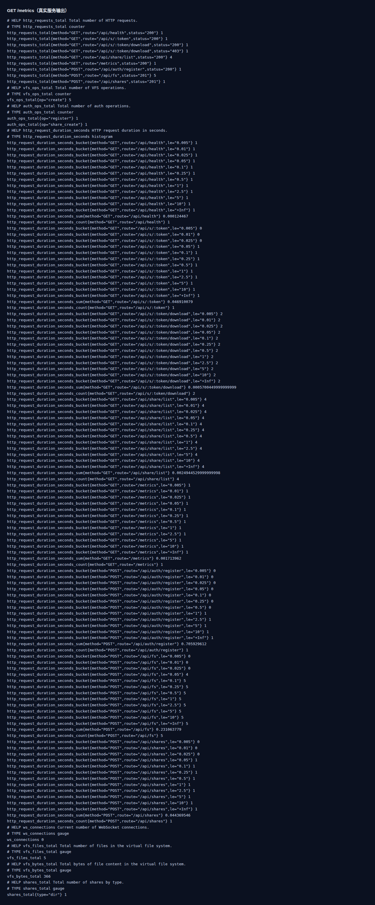
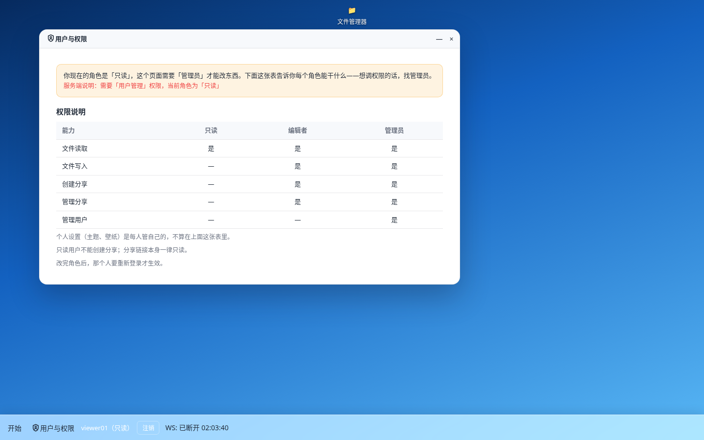
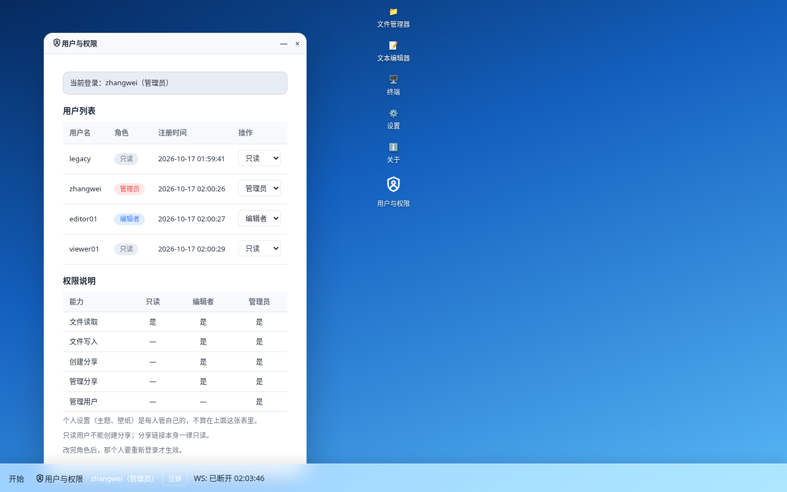
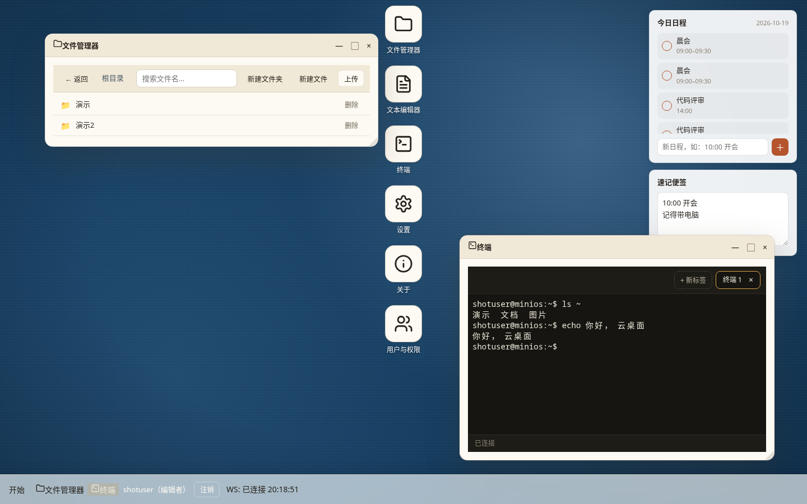
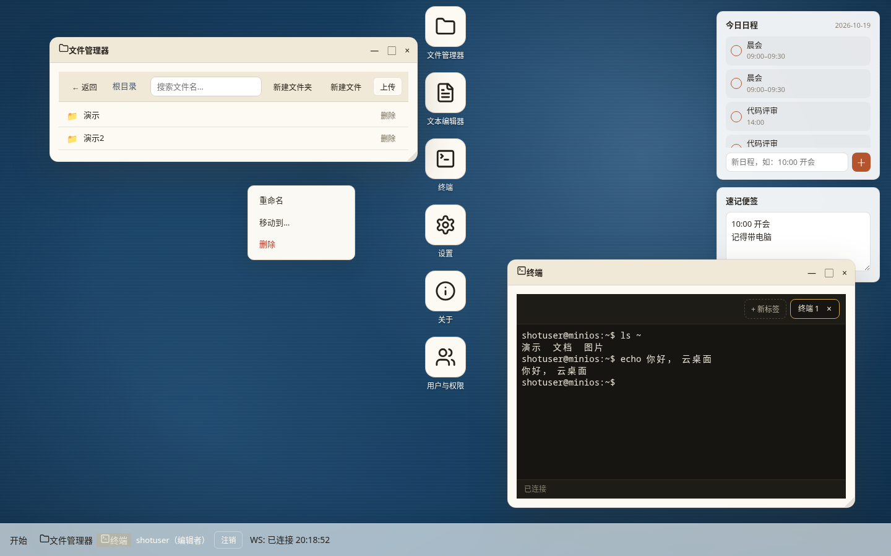
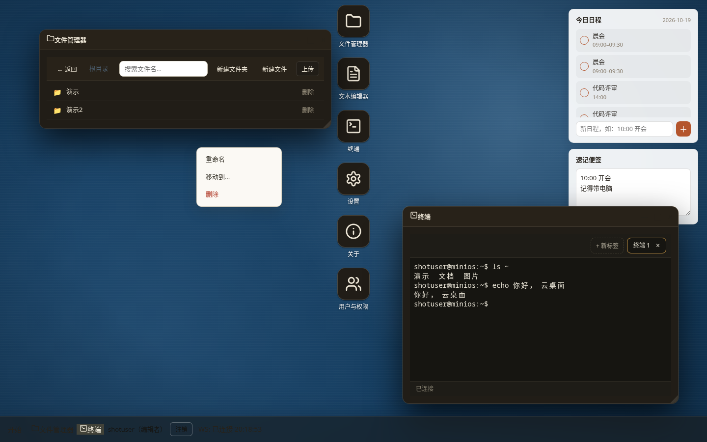
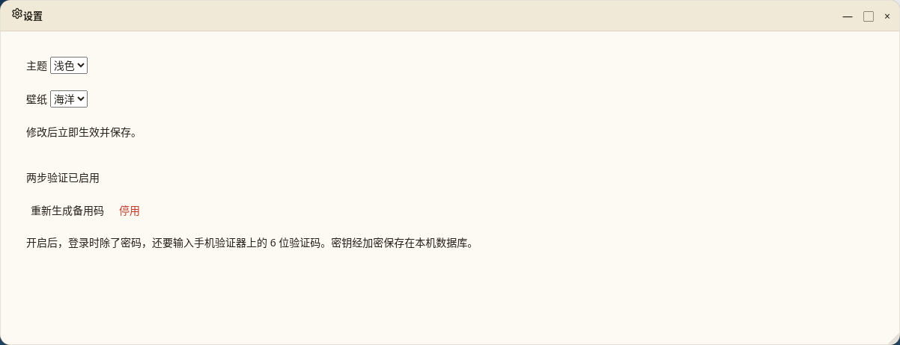

# Mini OS

一个运行在浏览器里的桌面操作系统。后端用 Rust 提供虚拟文件系统、应用注册表、设置与实时通信能力，前端是一套原生 JavaScript 实现的桌面环境：可拖拽窗口、开始菜单、文件管理器、文本编辑器、终端、设置与关于面板。所有文件与设置通过 SQLite 持久化，重启服务后状态不丢失。

项目位于 `mini-os/` 目录。

## 功能

- **虚拟文件系统**：文件夹与文件的增删改查，支持嵌套目录，数据落地 SQLite 表 `vfs_nodes`。
- **应用注册表**：内置 5 个应用——文件管理器、文本编辑器、终端、设置、关于。
- **设置持久化**：主题（theme）与壁纸（wallpaper）保存在 `settings` 表，刷新后保留。
- **统计面板**：文件数、文件夹数、占用字节数。
- **文件上传与下载**：`POST /api/files/upload?path=<目录>` 上传（multipart，单文件默认上限 50MB），`GET /api/files/download?path=<文件>` 流式下载；文件名消毒防路径穿越，二进制文件存 BLOB 列。v1.4 起加安全加固：上传时用 magic-bytes 嗅探（PE/MZ、ELF、Mach-O/fat binary、MSI/OLE 复合文档、shebang 脚本），命中可执行文件直接返回 415 `{"error": "可执行文件不允许上传"}` 且不入库；mime 取值优先级为嗅探结果 > 客户端 Content-Type 头 > 扩展名猜测；前端上传队列单个文件失败不再中断，失败记名后继续下一个。


- **WebSocket 通道**：连接建立后服务端主动下发欢迎消息，文本消息原样回显。
- **多用户与鉴权**（v1.3）：注册/登录（argon2id 密码哈希）、opaque session token（HttpOnly Cookie，`SESSION_TTL_SECS` 可配默认 7 天）；VFS、设置、统计按用户隔离；未登录访问 `/api/*`（除白名单）返回 401，前端自动跳登录页。
- **访客只读分享**（v1.3 文件分享，v1.6 加目录分享）：文件管理器对文件/目录生成分享链接（`/share.html?token=...`），访客免登录只读查看/下载，不可写。目录分享带面包屑浏览（`GET /api/share/list?token=...&path=`），路径穿越一律 403。
- **Prometheus 指标**：`GET /metrics` 暴露 `http_requests_total`、`http_request_duration_seconds`（直方图）、`vfs_ops_total`、`ws_connections`、`vfs_files_total`、`vfs_bytes_total`、`shares_total{type}`（文本格式，零依赖，路由 label 已归一化防爆炸）。
- **桌面交互**：窗口拖拽、开始菜单、实时时钟、WebSocket 连接状态指示。
- v1.11.0 加了两步验证，登录时除了密码还要填手机验证器 App 上的 6 位数字（TOTP 标准，像 Google Authenticator 或 Authy 都能用），验证器不在身边也能用 10 个一次性备用码救急。去桌面“设置”里的两步验证区开启，流程是先输密码确认本人，再扫二维码（或手工输密钥）绑定，填 6 位码确认后把 10 个备用码抄好。密钥会用 AES-256-GCM 加密后存进数据库，服务端看不到明文，只要提前配好 `MINIOS_TOTP_MASTER_KEY`（64 个十六进制字符）环境变量就行。

## 技术栈

| 组件 | 说明 |
| --- | --- |
| 语言 | Rust 2021 |
| Web 框架 | axum 0.7（含 ws） |
| 异步运行时 | tokio（full） |
| 序列化 | serde / serde_json（模型字段 camelCase） |
| 存储 | rusqlite 0.32（bundled，无需系统 SQLite） |
| 中间件 | tower 0.5、tower-http 0.5 |
| 前端 | 原生 HTML / CSS / JavaScript，无构建步骤 |

## 目录结构

```
mini-os/
├── Cargo.toml
├── src/
│   ├── main.rs          # 服务入口：读配置、初始化状态、绑定监听
│   ├── lib.rs           # AppState、init_state、build_app 路由装配
│   ├── config.rs        # 从环境变量读取 PORT / DATABASE_PATH / STATIC_DIR
│   ├── db.rs            # open_db 建表、seed 种子数据
│   ├── models.rs        # Node / AppInfo / Stats 等 serde 模型
│   └── handlers.rs      # health / apps / fs / settings / stats / ws 处理器
├── static/
│   ├── index.html       # 桌面外壳
│   ├── style.css        # 桌面与窗口样式
│   └── app.js           # 窗口管理、文件管理器、编辑器、终端等
├── tests/
│   └── api_test.rs      # 16 个集成测试


├── .env.example
├── .gitignore
├── Dockerfile
└── .github/
    └── workflows/
        └── mini-os.yml # CI：fmt / clippy / test / build
```

## 快速开始

需要安装 Rust 工具链（stable 即可，rusqlite 使用 bundled 特性，无需额外系统依赖）。

```bash
cd mini-os
cargo run
```

启动后打开浏览器访问：

```
http://localhost:8090
```

首次启动会自动创建数据库文件、建表并写入种子数据：根目录下生成 `Desktop/` 与 `Documents/` 两个文件夹，以及 `Desktop/welcome.txt`、`Documents/notes.txt` 两个文件；设置中预置 `theme=light`、`wallpaper=ocean`。

## 配置

配置全部通过环境变量读取，未设置时使用默认值：

| 环境变量 | 默认值 | 说明 |
| --- | --- | --- |
| `PORT` | `8090` | HTTP 服务监听端口 |
| `DATABASE_PATH` | `data/mini-os.db` | SQLite 数据库文件路径，目录不存在时自动创建 |
| `STATIC_DIR` | `static` | 静态资源目录，提供 `index.html` 等前端文件 |
| `UPLOAD_MAX_BYTES` | `52428800`（50MB） | 单文件上传大小上限（字节） |
| `SHUTDOWN_TIMEOUT_SECS` | `30` | 优雅关闭排空阶段超时（秒），只约束排空、不掐正常服务 |
| `SESSION_TTL_SECS` | `604800`（7 天） | 登录 session 有效期（秒），非法值回落默认 |


参考 `.env.example` 可以快速了解可用变量。若使用进程管理器或容器，直接在启动环境中注入即可。

## 构建与发布

```bash
cargo build --release
```

产物为单个二进制文件 `target/release/mini-os`。运行时需要与 `static` 目录同级部署，或通过 `STATIC_DIR` 指向实际静态资源路径；数据库位置通过 `DATABASE_PATH` 指定，建议指向一个持久化目录。

```bash
DATABASE_PATH=/var/lib/mini-os/mini-os.db STATIC_DIR=/opt/mini-os/static PORT=8090 ./mini-os
```

## 测试

```bash
cargo test        # 运行全部测试（单元 + 集成 + 失败注入）


cargo clippy      # 静态检查
cargo fmt         # 代码格式化
```

集成测试覆盖健康检查、应用列表、文件系统 CRUD、设置读写与统计、文件上传/下载（含超限 413、路径穿越拦截、同名 409、目录下载 400 等边界）等接口行为。metrics 专项测试覆盖端点文本格式合法性、请求计数的实时增长与标签正确性。v1.4 新增 upload_security_test 8 例，覆盖 magic-bytes 嗅探与可执行文件 415 拒绝。当前 `cargo test` 共 73/73 全过（lib 15、api_test 16、auth_test 8、failure_injection 11、isolation_test 5、metrics_test 4、share_test 6、upload_security_test 8）。CI（`.github/workflows/mini-os.yml`）会在每次提交时依次执行 fmt、clippy、test 与 build。


## Docker

```bash
docker build -t mini-os .
docker run --rm -p 8090:8090 -v mini-os-data:/app/data mini-os
```

容器内监听 8090 端口，数据卷挂载到 `/app/data` 以持久化 SQLite 文件。可通过 `-e PORT=...`、`-e DATABASE_PATH=...`、`-e STATIC_DIR=...` 覆盖默认配置。

## API 概览

| 方法 | 路径 | 说明 |
| --- | --- | --- |
| GET | `/api/health` | 健康检查 |
| GET | `/api/apps` | 应用注册表，返回内置应用列表 |
| GET | `/api/fs` | 列出节点，可按父目录查询 |
| POST | `/api/fs` | 新建文件夹或文件 |
| GET | `/api/fs/{id}` | 读取单个节点 |
| PUT | `/api/fs/{id}` | 更新节点（重命名、移动、写入内容） |
| DELETE | `/api/fs/{id}` | 删除节点 |
| GET | `/api/settings` | 读取设置 |
| PUT | `/api/settings` | 更新设置（theme、wallpaper） |
| GET | `/api/stats` | 统计信息：文件数、文件夹数、字节数 |
| POST | `/api/files/upload?path=<目录>` | 文件上传（multipart/form-data，字段名 `file`）；可执行文件（按 magic-bytes 嗅探）返回 415 拒绝 |
| GET | `/api/files/download?path=<文件>` | 文件下载（流式，`Content-Disposition: attachment`） |
| GET | `/ws` | WebSocket 连接入口 |
| GET | `/metrics` | Prometheus 指标（`text/plain; version=0.0.4`） |
| POST | `/api/auth/register` | 注册（首个用户自动为管理员；用户名 3–32 字符，仅字母数字 `_.` `-`；密码 ≥8 位） |
| POST | `/api/auth/login` | 登录（失败统一 401，防枚举） |
| POST | `/api/auth/logout` | 登出（清除 session 与 Cookie） |
| GET | `/api/me` | 当前登录用户（需登录） |
| GET | `/api/auth/setup-needed` | 是否需要初始化管理员（公开） |
| POST | `/api/auth/migrate-legacy` | 一次性把升级前的旧数据转给当前用户（需登录，无旧数据时 410） |
| POST | `/api/shares` | 创建只读分享（需登录）：`{"nodeId":id}` 分享文件（`type` 缺省 `file`）；`{"type":"dir","path":"/目录"}` 分享目录 → 201 `{token, url}` |
| GET | `/api/s/:token` | 分享元信息（公开，只读；目录分享返回 `shareType:"dir"`、`kind:"folder"`） |
| GET | `/api/share/list?token=...&path=` | 目录分享浏览（公开，只读；`path` 为分享根下相对路径，返回 `{path, entries}`） |
| GET | `/api/s/:token/download` | 分享文件下载（公开，只读；目录分享用 `?path=相对路径` 下载树内文件） |

> 鉴权说明：除 `/api/health`、`/api/readyz`、`/metrics`、`/api/auth/register|login|logout|setup-needed`、`/api/s/:token` 系列公开外，其余 `/api/*` 与 `/ws` 均需登录（Cookie `mini_os_session`），未登录返回 401 `{"error":"未登录"}`。VFS/设置/统计按用户隔离，跨用户 id 返回 404。

## 界面截图
















## WebSocket 协议

连接 `/ws` 后，服务端立即推送一条欢迎消息：

```json
{"type":"hello","message":"welcome to mini-os"}
```

客户端发送任意文本消息后，服务端按以下格式回显原文：

```json
{"type":"echo","message":"原文"}
```

前端利用该通道展示连接状态，并可作为后续实时功能的基础。

## 数据与备份

所有持久化数据都在一个 SQLite 文件里（默认 `data/mini-os.db`），包含 `vfs_nodes`、`settings` 与 `schema_migrations`（版本化迁移 001/002，老库启动自动升级）三张表。v1.3 新增 `users`（密码只存 argon2id PHC 哈希）、`sessions`（只存 token 的 SHA-256，不存明文）、`shares` 三张表；`settings` 主键改为 `(user_id, key)`；迁移 003 幂等，老库升级时旧数据归属占位用户 `legacy`（不可登录），首个注册用户可经 `POST /api/auth/migrate-legacy` 一次性领走。备份/恢复为整库操作，新表自动覆盖。在线备份：`mini-os backup --db <库> --out <备份>`（或 `scripts/backup.sh` 一键备份，保留最近 7 个）；恢复：`scripts/restore.sh <备份> --force`（恢复前请先停服务，CLI 会自动做完整性校验与原库快照）。探针：`GET /api/health`（存活）、`GET /api/readyz`（就绪，DB 不可用时 503）。指标：`GET /metrics`（Prometheus 文本格式），详见 `docs/OPERATIONS.md` §5.5。日志为 JSONL（stderr），每行带 `request_id`，详见 `docs/OPERATIONS.md`。


## 路线图

- ~~多用户与鉴权~~（v1.3 已完成：注册/登录/session、VFS 按用户隔离、访客只读文件分享）
- 目录分享、细粒度权限、登录限流（后续）
- ~~文件上传与下载~~（v1.1.0 已完成）
- 安全上传加固（v1.4 已完成）
- ~~Prometheus /metrics~~（已完成，见 docs/OPERATIONS.md §5.5）
- 应用商店，支持动态注册第三方应用


欢迎提交 issue 与 pull request。
