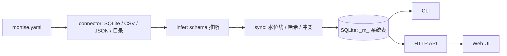

# 榫卯 MortiseDB

Airbyte/dbt 对个人太重，Metabase 只读不拼装——这是 NAS 玩家和小团队的本地数据拼装层。

榫卯是一块 Go 单二进制：纯 Go SQLite 驱动（modernc.org/sqlite，无 CGO），无需 Docker、无需 Python 环境、无需外接数据库。你写一份 YAML，把散落在 NAS 各处的 SQLite、CSV、JSON、本地目录声明成表，它负责推断 schema、统一类型、增量同步、按源优先级裁决冲突，再用类 SQL 视图把结果拼起来，Web 上直接看，也可以导出 CSV。所有数据落在本地一个 SQLite 文件里，能跟着 Git 走。

## 截图


首页总览：已声明表数量、上次同步时间、待处理冲突数、最近运行结果一览。


同步页：每个源的水位线位置、本次拉取行数、被哈希兜底捕获的变更记录。


数据浏览：按表查看已同步内容，类型已统一，主键去重后的最终态。


视图页：类 SQL 视图的运行结果，可保存、可定时、可一键导出 CSV。

## 3 步快速开始

```bash
# 1. 初始化：生成 mortise.yaml 骨架和本地数据文件
./mortisedb init

# 2. 按需编辑 mortise.yaml，声明你的数据源、主键、冲突策略
$EDITOR mortise.yaml

# 3. 同步一次，然后起服务（默认 :8421）
./mortisedb sync
./mortisedb serve
```

`serve` 启动后打开 `http://localhost:8421` 即是 Web UI。定时任务与运行历史在 UI 里配置，也可以用 `./mortisedb run --schedule` 挂后台。

## 为什么不用 Airbyte / dbt / Metabase

| 方案 | 定位 | 对个人的重 |
| --- | --- | --- |
| Airbyte | 企业级 ELT 平台，几百个 connector | 要 Docker Compose 一整套、要 Postgres 元数据库、要维护 worker，为一个 CSV 起一舰队 |
| dbt | 数仓内的 SQL 转换框架 | 假设你已经有数仓，转换逻辑绑在 warehouse 上，本地小文件不在它的视野里 |
| Metabase | BI 查询与可视化 | 只读不拼装，多源合并不归它管，且同样需要外接数据库 |

结论：这三件工具各自解决的是"团队已有数仓之后"的问题，而榫卯解决的是"还没有数仓、只有一堆本地文件"的问题——单二进制、单文件落盘、YAML 声明，正好够用。

## 架构



系统表说明：`_m_tables` 记录已声明表的元信息与 schema 版本；`_m_watermarks` 保存每个源的 `updated_at` 水位线；`_m_conflicts` 存放按策略挂起、等待手动裁决的冲突行；`_m_runs` 是每次同步/视图运行的执行历史；`_m_views` 保存视图定义与导出记录。

## 配置示例

```yaml
version: 1
database: ./mortise.db

sources:
  # 源 1：另一个 SQLite 文件，靠 updated_at 增量
  - name: notes_db
    type: sqlite
    path: /volume1/notes/notes.db
    table: notes
    primary_key: id
    incremental:
      column: updated_at
      fallback_hash: true
    conflict: priority

  # 源 2：CSV 导出，没有更新时间戳，纯哈希兜底
  - name: finance_csv
    type: csv
    path: /volume1/finance/ledger.csv
    table: ledger
    primary_key: entry_id
    infer:
      sample_rows: 500
      types:
        amount: decimal
        date: datetime

  # 源 3：本地目录，文件名与 mtime 映射成列
  - name: media_dir
    type: directory
    path: /volume1/media
    table: media_files
    primary_key: rel_path
    columns:
      rel_path: text
      size: integer
      mtime: datetime
    recursive: true

conflict:
  strategy: priority          # priority | manual | soft_delete
  priority: [notes_db, finance_csv, media_dir]
  soft_delete:
    mark_column: _m_deleted
    retention_days: 30

views:
  - name: recent_spend
    sql: |
      SELECT l.date, l.amount, n.title
      FROM ledger l
      LEFT JOIN notes n ON n.id = l.note_id
      WHERE l.date >= date('now', '-30 day')
```

## 可观测性

### `/metrics`

MortiseDB v1.1 起暴露 Prometheus text exposition 格式的 `/metrics` 端点：

```bash
curl -s http://localhost:8421/metrics | head -40
```

关键指标：

| 指标 | 类型 | 说明 |
| --- | --- | --- |
| `mortise_build_info{version}` | Gauge | 构建版本，值恒为 1 |
| `mortise_sync_rows_total{source,table,op}` | Counter | 同步行数，op ∈ inserted/updated/deleted/skipped/conflicts |
| `mortise_sync_runs_total{job,status}` | Counter | 同步运行次数，status ∈ ok/error |
| `mortise_sync_last_duration_seconds{source}` | Gauge | 最近一次同步耗时 |
| `mortise_view_duration_seconds_{count,sum}{view}` | Summary | 视图执行耗时 |
| `mortise_view_last_duration_seconds{view}` | Gauge | 最近一次视图耗时 |
| `mortise_watermark_lag_seconds{source,table}` | Gauge | 水位线滞后秒数（抓取时实时计算） |
| `mortise_conflicts_pending` | Gauge | 待处理冲突数（抓取时查询） |
| `mortise_conflicts_total` | Counter | 累计冲突数 |
| `mortise_http_requests_total{method,route,status}` | Counter | HTTP 请求总数 |
| `mortise_http_request_duration_seconds_{count,sum}{method,route}` | Summary | HTTP 请求耗时 |
| `mortise_db_size_bytes` | Gauge | 数据库文件大小 |
| `mortise_uptime_seconds` | Gauge | 进程运行秒数 |

示例输出（节选）：

```
# HELP mortise_sync_rows_total 同步行数（按源/表/操作分类）
# TYPE mortise_sync_rows_total counter
mortise_sync_rows_total{source="orders_csv",table="orders",op="inserted"} 5
mortise_sync_rows_total{source="orders_csv",table="orders",op="skipped"} 0
...
```

> `TBD(实测填)`：编排者可在目标机器上 `curl` 后把真实输出片段贴到此处。

## 备份与恢复

### 备份

```bash
mortisedb backup --config /etc/mortise/mortise.yaml \
  --output /var/backups/mortise-$(date -u +%Y%m%dT%H%M%SZ).db
```

输出文件、大小、SHA256、耗时，并生成 `<备份>.meta.json`。

### 恢复

```bash
# 目标不存在
mortisedb restore --config /etc/mortise/mortise.yaml --from /var/backups/mortise-xxx.db

# 目标存在且非空：需 --force，旧库改名 .bak-<时间戳> 留底
mortisedb restore --config /etc/mortise/mortise.yaml --from /var/backups/mortise-xxx.db --force
```

### 演练结论

`TBD(实测填)`：建议每季度在隔离机器上按 `docs/OPERATIONS.md` §3.4 执行一次恢复演练，记录恢复耗时与数据一致性抽查结果。

## 负载验证

`scripts/loadtest.sh` 生成三源各 10 万行数据（CSV / JSON / SQLite）与 `mortise-load.yaml`：

```bash
bash scripts/loadtest.sh ./loadtest-work
cd ./loadtest-work
/usr/bin/time -v mortisedb sync --config mortise-load.yaml
/usr/bin/time -v mortisedb query --config mortise-load.yaml "SELECT COUNT(*) FROM v_load_join"
```

结果（2026-10-13 实测，2 vCPU 弱 VM，详见 `docs/LOADTEST.md`）：

| 阶段 | 耗时 | 峰值内存 |
| --- | --- | --- |
| 三源全量同步（30 万行） | 265.89s（约 1128 行/秒） | 162 MB |
| 跨源 JOIN 视图查询（10 万行） | 452ms | — |

> 优化前后对比：逐行自动提交约 38 行/秒 → 批量事务（`sync.batch_size` 默认 5000）约 1128 行/秒，约 30 倍。

## 路线图

### v1.1（已交付）

- ✅ `/metrics` Prometheus 端点（13 个指标，手写 exposition，无新依赖）。
- ✅ `backup` / `restore` 子命令（`VACUUM INTO` 在线一致性快照 + 元信息）。
- ✅ 优雅关闭补强（HTTP 超时 + 在途等待 + WAL checkpoint）。
- ✅ 10 万行负载验证支撑（`scripts/loadtest.sh` + `docs/LOADTEST.md` 实测：30 万行 265.89s，跨源 JOIN 10 万行 452ms）。
- ✅ 同步批量事务（`sync.batch_size` 默认 5000：`dbtx` 接口 + 每批提交/出错回滚；约 38 行/秒 → 约 1128 行/秒）。
- ✅ `request_id` 与结构化日志维持通过。

### 后续版本

- ⬜ HTTP / WebDAV 数据源连接器。
- ⬜ 视图物化（物化视图 + 刷新策略）。
- ⬜ 冲突批量操作。
- ⬜ 单文件加密。

## License

MIT License

数据留在你自己的盘上，工具只做它该做的那一步。
