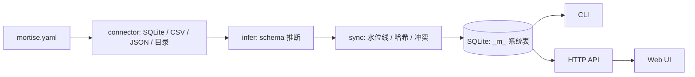

# 榫卯 MortiseDB

Airbyte/dbt 对个人太重，Metabase 只读不拼装——这是 NAS 玩家和小团队的本地数据拼装层。

榫卯是一块 Go 单二进制：纯 Go SQLite 驱动（modernc.org/sqlite，无 CGO），无需 Docker、无需 Python 环境、无需外接数据库。你写一份 YAML，把散落在 NAS 各处的 SQLite、CSV、JSON、本地目录声明成表，它负责推断 schema、统一类型、增量同步、按源优先级裁决冲突，再用类 SQL 视图把结果拼起来，Web 上直接看，也可以导出 CSV。所有数据落在本地一个 SQLite 文件里，能跟着 Git 走。

## 截图


首页总览：已声明表数量、上次同步时间、待处理冲突数、最近运行结果一览。


同步页：每个源的水位线位置、本次拉取行数、被哈希兜底捕获的变更记录。


数据浏览：按表查看已同步内容，类型已统一，主键去重后的最终态。


视图页：类 SQL 视图的运行结果，可保存、可定时、可一键导出 CSV。

## 3 步快速开始

```bash
# 1. 初始化：生成 mortise.yaml 骨架和本地数据文件
./mortisedb init

# 2. 按需编辑 mortise.yaml，声明你的数据源、主键、冲突策略
$EDITOR mortise.yaml

# 3. 同步一次，然后起服务（默认 :8421）
./mortisedb sync
./mortisedb serve
```

`serve` 启动后打开 `http://localhost:8421` 即是 Web UI。定时任务与运行历史在 UI 里配置，也可以用 `./mortisedb run --schedule` 挂后台。

## 为什么不用 Airbyte / dbt / Metabase

| 方案 | 定位 | 对个人的重 |
| --- | --- | --- |
| Airbyte | 企业级 ELT 平台，几百个 connector | 要 Docker Compose 一整套、要 Postgres 元数据库、要维护 worker，为一个 CSV 起一舰队 |
| dbt | 数仓内的 SQL 转换框架 | 假设你已经有数仓，转换逻辑绑在 warehouse 上，本地小文件不在它的视野里 |
| Metabase | BI 查询与可视化 | 只读不拼装，多源合并不归它管，且同样需要外接数据库 |

结论：这三件工具各自解决的是"团队已有数仓之后"的问题，而榫卯解决的是"还没有数仓、只有一堆本地文件"的问题——单二进制、单文件落盘、YAML 声明，正好够用。

## 架构



系统表说明：`_m_tables` 记录已声明表的元信息与 schema 版本；`_m_watermarks` 保存每个源的 `updated_at` 水位线；`_m_conflicts` 存放按策略挂起、等待手动裁决的冲突行；`_m_runs` 是每次同步/视图运行的执行历史；`_m_views` 保存视图定义与导出记录。

## 配置示例

```yaml
version: 1
database: ./mortise.db

sources:
  # 源 1：另一个 SQLite 文件，靠 updated_at 增量
  - name: notes_db
    type: sqlite
    path: /volume1/notes/notes.db
    table: notes
    primary_key: id
    incremental:
      column: updated_at
      fallback_hash: true
    conflict: priority

  # 源 2：CSV 导出，没有更新时间戳，纯哈希兜底
  - name: finance_csv
    type: csv
    path: /volume1/finance/ledger.csv
    table: ledger
    primary_key: entry_id
    infer:
      sample_rows: 500
      types:
        amount: decimal
        date: datetime

  # 源 3：本地目录，文件名与 mtime 映射成列
  - name: media_dir
    type: directory
    path: /volume1/media
    table: media_files
    primary_key: rel_path
    columns:
      rel_path: text
      size: integer
      mtime: datetime
    recursive: true

conflict:
  strategy: priority          # priority | manual | soft_delete
  priority: [notes_db, finance_csv, media_dir]
  soft_delete:
    mark_column: _m_deleted
    retention_days: 30

views:
  - name: recent_spend
    sql: |
      SELECT l.date, l.amount, n.title
      FROM ledger l
      LEFT JOIN notes n ON n.id = l.note_id
      WHERE l.date >= date('now', '-30 day')
```

## 路线图

- v1.1：新增 HTTP/WebDAV 源与增量拉取，覆盖 NAS 上常见的远端目录场景。
- v1.1：视图支持物化与定时刷新，导出 CSV 增加列筛选与编码选项。
- v1.1：冲突裁决界面加入批量操作与按规则自动匹配，减少手工点击。
- v1.1：提供单文件加密与只读模式，便于把 `mortise.db` 直接放进 Git 仓库共享。

## License

MIT License

数据留在你自己的盘上，工具只做它该做的那一步。
