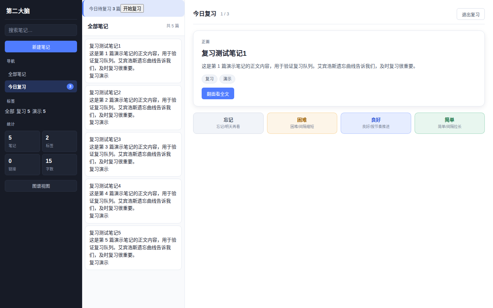
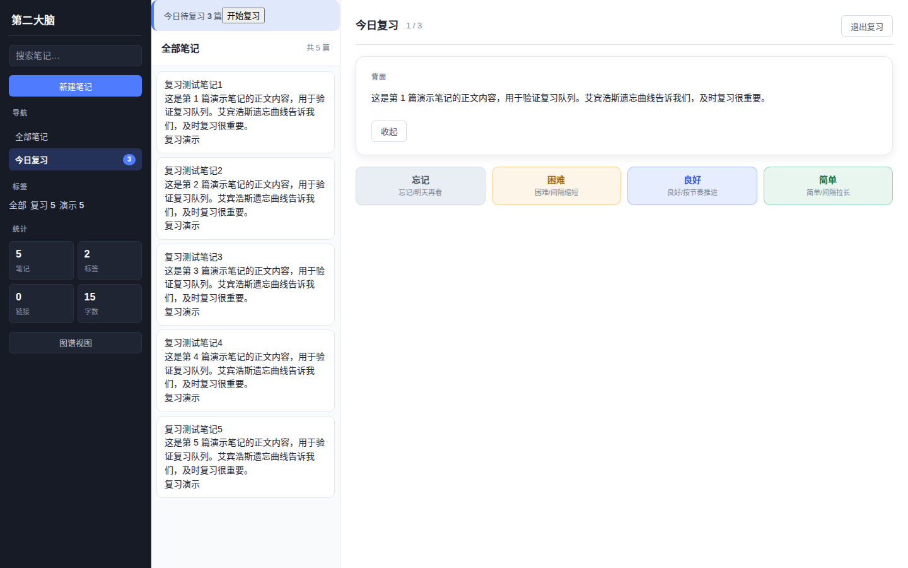
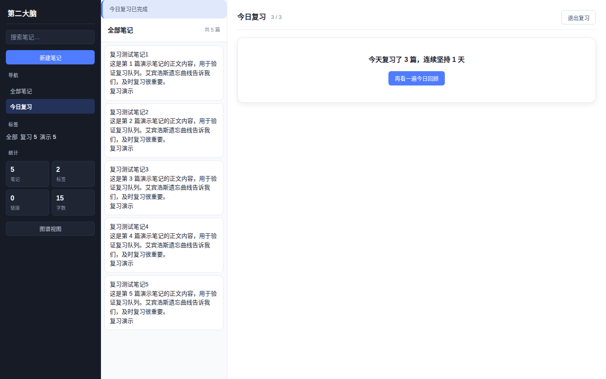
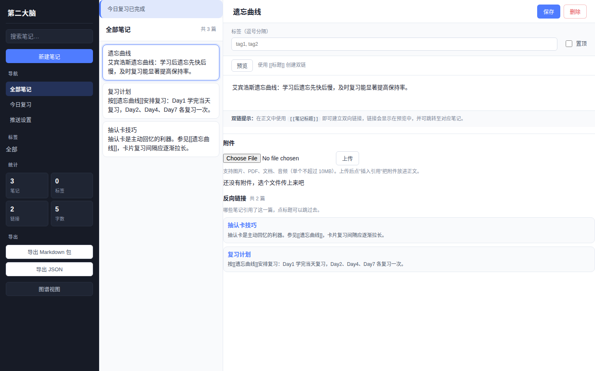
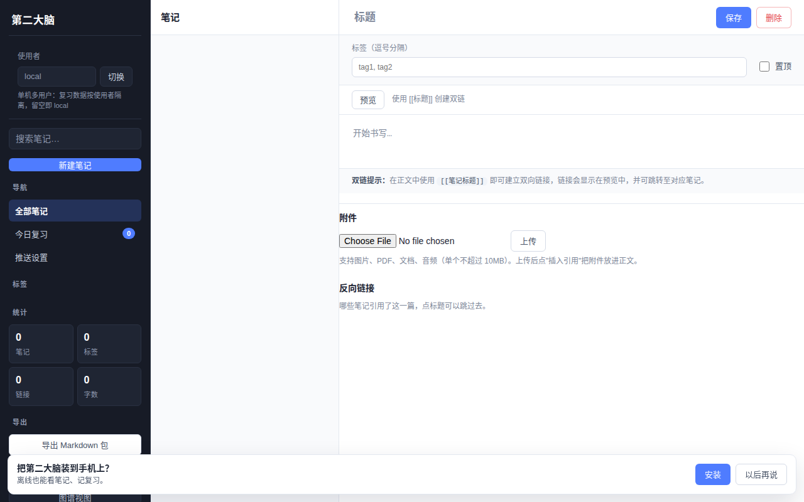
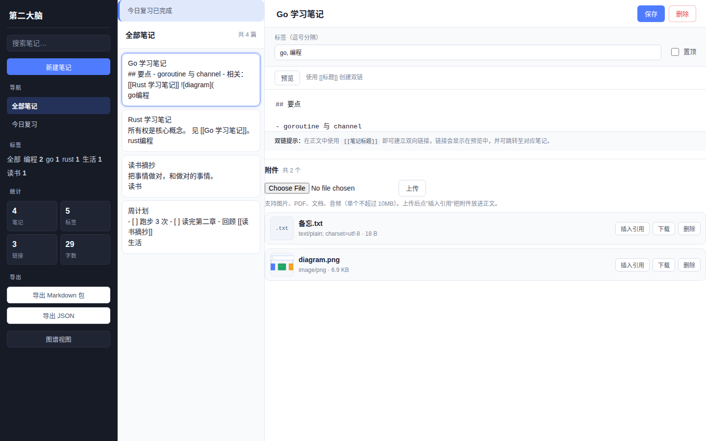
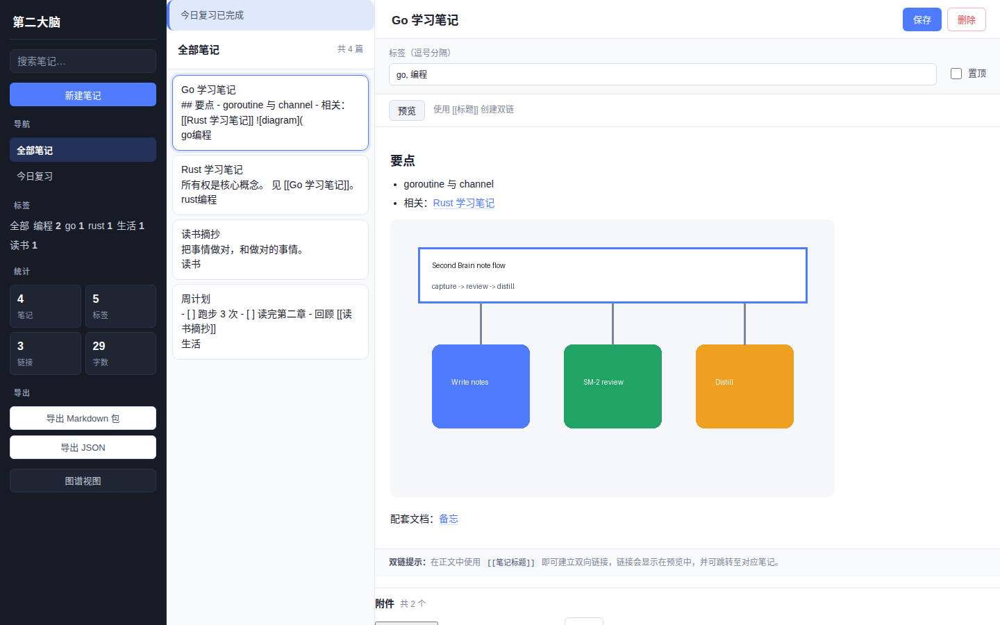
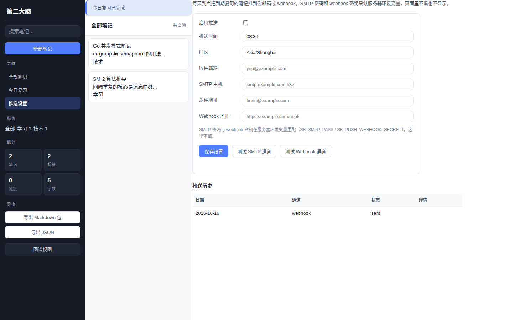
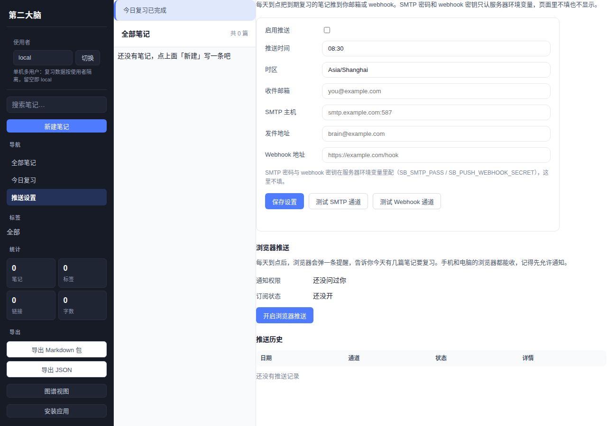
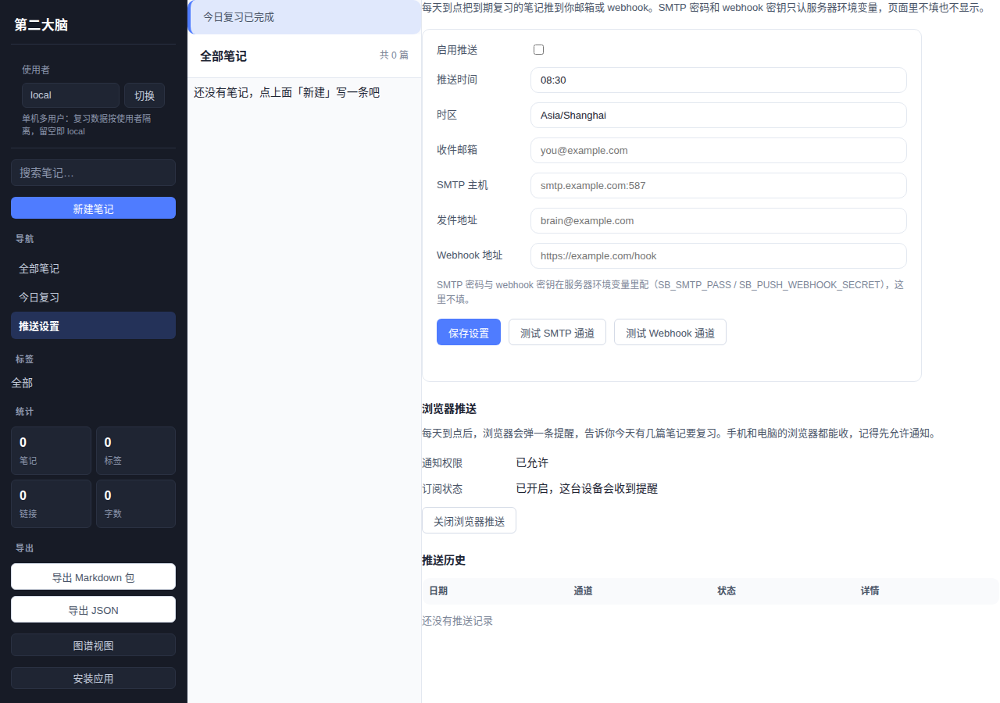

# 第二大脑 Second Brain

## 简介

第二大脑（Second Brain）是一套面向个人的知识库系统，用于记录、组织和检索长期积累的笔记与想法。系统以单个 Go 二进制文件交付，内嵌 Web UI 与纯 Go 实现的 SQLite 驱动，无需外部依赖即可运行，适合在个人电脑、家用服务器或容器中自托管。

设计目标：

- **简单**：一条命令启动，数据落在本地文件，随时可备份、可迁移。
- **快速**：单进程服务，全文搜索带相关性排序，交互无明显延迟。
- **结构化**：标签体系与 `[[双链]]` 并存，既能扁平检索，也能构建知识图谱。

## 功能

- **笔记 CRUD**：创建、读取、更新、删除笔记，支持 Markdown 正文。
- **标签体系**：为笔记打标签，按标签聚合与筛选。
- **全文搜索**（v0.8.0）：中文感知的相关性排序——查询词 AND 语义、标题/标签/正文加权（3/2/1）、二元词组与完全匹配加成，结果附命中字段可解释。
- **双向链接**：正文中书写 `[[笔记标题]]` 即建立链接，自动生成反向链接。
- **反向链接面板**（v0.5.0）：打开一篇笔记，下方直接列出所有引用它的笔记，带引用上下文，点击标题一键跳转。
- **知识图谱**：以图谱形式展示笔记之间的链接关系，识别孤立节点与核心节点。
- **Markdown 渲染预览**：编辑时实时预览渲染结果。
- **统计概览**：笔记总数、标签分布、链接密度等指标一览。
- **附件支持**（v0.3.0）：图片与文件随笔记上传、列表管理，正文中 `` 即可引用渲染。
- **导出**（v0.3.0）：一键把全库导出为 Markdown 包（含附件原文件）或 JSON，方便迁移与归档。
- **主动复习引擎**（v0.2.0）：SM-2 间隔重复算法，笔记写完第二天自动进入复习流，抽认卡复习 + 每日回顾，详见下文。

## 技术栈

| 组件 | 选型 |
| --- | --- |
| 语言 | Go（>= 1.23） |
| HTTP | 标准库 `net/http` |
| 数据库 | SQLite，驱动为 `modernc.org/sqlite`（纯 Go，无 CGO） |
| 前端 | 原生 HTML/CSS/JS，通过 `go:embed` 内嵌进二进制 |
| 构建 | Makefile + `go build` |

不引入 Web 框架与 ORM，路由与 SQL 均直接编写，降低依赖面与升级成本。

## 目录结构

```
.
├── cmd/
│   └── server/          # 程序入口
├── internal/
│   ├── config/          # 环境变量配置
│   ├── store/           # SQLite 访问层与双链/图谱
│   ├── search/          # 关键词切分与相关性排序
│   ├── markdown/        # Markdown 渲染
│   ├── api/             # HTTP 路由与处理器
│   └── web/             # 用 go:embed 内嵌 static 前端资源
│       └── static/      # index.html / style.css / app.js
├── Makefile
├── Dockerfile
├── go.mod
└── README.md
```

## 快速开始

要求：Go >= 1.23。

```bash
go mod tidy
make run
# 或
go run ./cmd/server
```

启动后打开 <http://localhost:8080> 即可使用。首次运行会在数据目录自动创建数据库并完成初始化。

## 配置

通过环境变量配置，均有合理默认值：

| 变量 | 说明 | 默认值 |
| --- | --- | --- |
| `SB_ADDR` | HTTP 监听地址 | `:8080` |
| `SB_DB` | SQLite 数据库文件路径 | `<SB_DATA_DIR>/second-brain.db` |
| `SB_DATA_DIR` | 数据目录，存放数据库与后续附件 | `./data` |
| `SB_ATTACH_MAX_MB` | 单个附件大小上限（MB） | `10` |
| 变量 | 说明 | 默认值 |
| --- | --- | --- |
| `SB_PUSH_ENABLED` | 是否开启主动复习外部推送。开启后启动时会校验推送相关配置，校验失败直接启动失败 | `false` |
| `SB_PUSH_TIME` | 每天推送时间，24 小时制 `HH:MM` | `08:30` |
| `SB_PUSH_TZ` | 推送使用的时区，决定“今天”的日期 key 和触发时刻 | `Asia/Shanghai` |
| `SB_SMTP_HOST` | SMTP 服务器地址。密钥类信息只走环境变量，页面不填 | 空 |
| `SB_SMTP_PORT` | SMTP 服务器端口 | `587` |
| `SB_SMTP_USER` | SMTP 登录用户名。密钥类信息只走环境变量，页面不填 | 空 |
| `SB_SMTP_PASS` | SMTP 登录密码。密钥类信息只走环境变量，页面不填 | 空 |
| `SB_SMTP_FROM` | 发件人地址 | 空 |
| `SB_SMTP_TLS` | SMTP 是否使用 STARTTLS。设为 `false` 时走明文，仅建议内网使用 | `true` |
| `SB_PUSH_MAX_RETRIES` | 推送失败后的最大重试次数（v0.11+）。每个通道独立计数 | `3` |
| `SB_PUSH_RETRY_BASE_MS` | 重试退避基数，单位毫秒（v0.11+）。实际等待为基数×2^次数再加 ±25% 抖动 | `1000` |
| `SB_MAIL_TO` | 复习提醒收件邮箱，多个地址可用逗号分隔 | 空 |
| `SB_WEBHOOK_URL` | Webhook 接收地址，POST JSON | 空 |
| `SB_WEBHOOK_SECRET` | Webhook 签名密钥，用于生成 `X-Signature`。密钥类信息只走环境变量，页面不填 | 空 |
| `SB_VAPID_PUBLIC_KEY` | Web Push 的 VAPID 公钥（base64url，65 字节 uncompressed 点）。密钥类信息只走环境变量 | 空 |
| `SB_VAPID_PRIVATE_KEY` | Web Push 的 VAPID 私钥（base64url，32 字节）。密钥类信息只走环境变量 | 空 |
| `SB_VAPID_SUBJECT` | VAPID 联系人，`mailto:你@邮箱` 或 `https://你的域名` | 空 |
| `SB_LOG_LEVEL` | 日志级别：`debug`/`info`/`warn`/`error`，大小写不敏感，非法值回退 `info` | `info` |

示例：

```bash
SB_ADDR=127.0.0.1:9000 SB_DATA_DIR=/var/lib/second-brain go run ./cmd/server
```

## 日志与可观测性

日志是 JSON 结构化输出（打到 stdout），用 `SB_LOG_LEVEL` 调级别（`debug`/`info`/`warn`/`error`，默认 `info`）。

每个请求都有一个 `request_id`（32 位随机串）：

- 自己带请求头 `X-Request-ID` 就透传你的，不带服务端就生成一个，响应头里原样返回。
- 每次请求结束记一条 `http.request` 日志，带 `request_id`、`method`、`path`、`status`、`latency_ms`；5xx 用 ERROR 级别。
- 出错时响应体长这样，拿着 `request_id` 直接定位：

```json
{"error": "note not found", "request_id": "9f3a1c..."}
```

查一条请求的完整链路（以 docker 为例）：

```bash
docker logs second-brain 2>&1 | grep '"request_id":"9f3a1c..."'
```

关键操作都会打日志：建笔记（`note.created`）、复习评分（`review.graded`）、推送（`push.tick_result`），字段里都有 `request_id`，从报错一路 grep 到根因。

## 构建与发布

```bash
make build
```

产物为单个可执行文件（默认输出到 `bin/`），前端资源已内嵌，可直接拷贝到目标机器运行，无需附带静态文件或运行时依赖。

交叉编译示例：

```bash
GOOS=linux GOARCH=amd64 make build
```

## 测试

```bash
go test ./...
go vet ./...
```

测试覆盖存储层、搜索排序与双链解析等核心逻辑。提交前建议同时运行 `go vet` 以捕获常见静态问题。

## Docker

```dockerfile
FROM golang:1.23 AS build
WORKDIR /src
COPY . .
RUN go mod tidy && make build

FROM gcr.io/distroless/static
COPY --from=build /src/bin/second-brain /second-brain
VOLUME ["/data"]
ENV SB_DATA_DIR=/data SB_ADDR=:8080
EXPOSE 8080
ENTRYPOINT ["/second-brain"]
```

```bash
docker build -t second-brain .
docker run -d -p 8080:8080 -v sb-data:/data second-brain
```

数据卷 `sb-data` 即全部持久化状态，删除容器不影响数据。

## API 概览

| 方法 | 路径 | 说明 |
| --- | --- | --- |
| GET | `/api/health` | 健康检查，返回服务与数据库状态 |
| GET/POST | `/api/notes` | 列出或创建笔记 |
| GET/PUT/DELETE | `/api/notes/{id}` | 读取、更新、删除单条笔记 |
| GET | `/api/search?q=` | 全文搜索，返回 `{"query","terms","notes","meta"}`（meta 含 score 与命中字段：标题/标签/正文），按相关性排序。v0.8.0 起响应体由数组改为对象 |
| GET | `/api/tags` | 标签列表及计数 |
| GET | `/api/stats` | 统计概览 |
| GET | `/api/graph` | 知识图谱节点与边 |
| GET | `/api/notes/{id}/backlinks` | 反向链接：哪些笔记引用了这篇（id 倒序，元素含 `id/title/targetTitle/snippet/createdAt`） |
| GET | `/api/review/queue?limit=` | 待复习队列（到期优先） |
| POST | `/api/review/{id}` | 提交复习评分（body `{"grade":4}`，0=忘记/3=困难/4=良好/5=简单） |
| GET | `/api/review/stats` | 复习统计（待复习数/连续天数/平均记忆强度） |
| GET | `/api/review/digest?n=` | 每日回顾（到期优先 + 最久未复习补足） |
| POST | `/api/preview` | Markdown 渲染预览 |
| POST | `/api/notes/{id}/attachments` | 上传附件（multipart，字段名 `file`，默认单个 ≤10MB） |
| GET | `/api/notes/{id}/attachments` | 列出某条笔记的附件 |
| GET | `/api/attachments/{id}` | 下载附件 |
| DELETE | `/api/attachments/{id}` | 删除附件 |
| GET | `/api/export/markdown` | 导出全库为 zip（笔记 Markdown + 附件原文件） |
| GET | `/api/export/json` | 导出全库为 JSON（含标签与附件元数据） |
| 方法 | 路径 | 说明 |
| --- | --- | --- |
| GET | `/api/push/settings` | 读取推送设置。返回环境变量默认值与数据库覆盖合并后的结果，绝不返回密码、secret 明文 |
| PUT | `/api/push/settings` | 修改推送设置。只接受白名单字段；请求体里出现 `password` 或 `secret` 直接返回 400 |
| POST | `/api/push/test` | 用 3 条假数据真实发送一次，用来验证 SMTP 或 Webhook 通不通，不写 `push_log` |
| GET | `/api/push/history` | 查看推送历史，来自 `push_log` |
| POST | `/api/push/subscriptions` | 新建/更新浏览器推送订阅。body `{endpoint,p256dh,auth}`，返回脱敏后的订阅。VAPID 未配置时 503 |
| DELETE | `/api/push/subscriptions` | 按 endpoint 删除当前用户的订阅。body 或 `?endpoint=` 传参，返回 `{deleted:true/false}`。VAPID 未配置时 503 |
| GET | `/api/push/subscriptions` | 列出当前用户的浏览器订阅，`p256dh`/`auth` 脱敏显示。VAPID 未配置时 503 |
| GET | `/api/push/vapid-public-key` | 返回 VAPID 公钥，前端订阅时用。VAPID 未配置时 503 |

请求与响应均为 JSON。错误响应统一为 `{"error": "..."}` 结构。

## 主动复习引擎（v0.2.0）

笔记写完第二天自动进入复习流，快要忘记时推回来。

### 工作原理

笔记保存后不会立刻要你复习，而是先排进队列，第二天开始出现在复习页。每次你给出一个评价（忘记 / 困难 / 良好 / 简单），系统就按 SM-2 算法算出下一次该在什么时候再问你。评价越差，间隔缩得越短；评价越好，间隔拉得越长。如果某条笔记一直答得不错，它会慢慢从几天变成几周、几个月，最后基本不再打扰你。

SM-2 四档说明：

| 档位 | 含义 | 间隔影响 |
| --- | --- | --- |
| 忘记 | 完全想不起来，或答错了 | 间隔重置为 1 天，重新开始 |
| 困难 | 想起来了，但很吃力、不牢靠 | 间隔小幅增长（约 ×1.2），下次很快再见 |
| 良好 | 正常想起来，没什么卡顿 | 按标准倍数增长（约 ×2.5） |
| 简单 | 太容易了，几乎不用想 | 间隔大幅增长（约 ×3.5），并略微提前进入长间隔 |

### API

| 接口 | 说明 | 返回 |
| --- | --- | --- |
| `GET /api/review/queue?limit=20` | 取当前待复习的笔记队列，`limit` 控制条数（默认 20，上限 200）（按 `X-User`/`?user=` 隔离） | JSON 数组，每项 `{id,title,body,snippet,tags,dueDate,overdueDays,ef,intervalDays,repetitions}` |
| `POST /api/review/{id}` | 提交某条笔记的复习评价，body 形如 `{"grade":4}`（按 `X-User`/`?user=` 隔离） | `{ef,intervalDays,repetitions,dueDate,reviewedCount}`；grade 非法 → 400；笔记不存在 → 404 |
| `GET /api/review/stats` | 复习统计（按 `X-User`/`?user=` 隔离） | `{dueToday,totalNotes,reviewed7d,avgEf,streakDays}` |
| `GET /api/review/digest?n=5` | 每日回顾：到期优先，不足时用最久未复习的补足（按 `X-User`/`?user=` 隔离） | `{notes:[{id,title,snippet,tags,dueDate}]}` |

`grade` 取值：0 = 忘记，3 = 困难，4 = 良好，5 = 简单。

### 多用户复习隔离（v0.6）

单机多用户简化方案：无注册、无鉴权，靠请求方声明身份。复习数据（到期队列、评分、统计、每日回顾）按使用者隔离，笔记本身全局共享。

身份声明方式（优先级从高到低）：

1. `X-User` 请求头（前端自动带上）
2. `?user=` 查询参数
3. 不声明 → 默认 `local`，行为与开放模式一致

服务端对身份做归一化：去首尾空格、转小写，超长截断 64 字符。前端侧边栏顶部有"使用者"切换器，输入名字点切换即生效（记在浏览器 localStorage），复习徽标、队列、统计、每日回顾都会按新身份刷新。

注意：定时推送（`SB_PUSH_*`）暂按默认 `local` 用户聚合推送，多用户推送见后续计划。老版本数据库升级时自动迁移：`reviews` 表加 `user_id` 列，历史数据全部归属 `local`。

### 复习页使用说明

1. 打开复习页，页面显示一张抽认卡，正面是笔记标题或提示问题。
2. 想一下答案，点一下卡片翻到背面，核对全文内容。
3. 根据刚才的实际感受，点「忘记 / 困难 / 良好 / 简单」其中一个，系统自动排下一次复习时间，然后进入下一张。全部复习完会显示完成态。

### 截图

抽认卡正面：



翻面全文：



完成态：



反向链接面板（v0.5.0）：



### 已知限制

- 外部推送（邮件 / 微信）还没做，留到 v0.3，目前只能自己打开复习页。
- 只支持单用户，没有多账号和权限区分。

## 装到手机上 / 离线用（v0.7.0）

第二大脑是个 PWA：Chrome/Edge 里打开用一阵子，地址栏会出现安装按钮，装完跟原生应用一样从桌面进；iPhone 上用 Safari 的"分享 → 添加到主屏幕"手动装（iOS 不弹自动安装提示）。

离线能力：
- 断网也能打开、看笔记列表和详情（应用壳 + 数据都缓存在本地）。
- 断网时新建/修改/删除笔记、给复习打分，会先排进本地队列，联网后自动同步（页面右上角能看到离线状态）。
- 冲突规则：以服务器为准，后写入的覆盖先写入的；离线新建的笔记同步后会换一个新 id。细则见 `docs/PWA_OFFLINE_DESIGN.md`。

安装步骤（含 iOS/Android/桌面/卸载/FAQ）见 `docs/PWA_INSTALL.md`。

安装提示横幅：



已知限制：推送通知这版还没做（后续计划）；局域网 `http://IP:8080` 这种不安全地址下浏览器不给装 PWA、离线功能也用不了，要完整体验请用 `https` 或 `localhost`。

## 附件与导出（v0.3.0）

### 附件

图片、PDF、文档、音频都可以随笔记一起存。上传入口在编辑区下方的"附件"区，传完后点"插入引用"，附件就会以 `` 的形式写进正文，预览时直接渲染出来。





几点说明：

- 单个附件默认不超过 10MB，可用环境变量 `SB_ATTACH_MAX_MB` 调整，超了会返回 413。
- 允许的扩展名：图片（png/jpg/jpeg/gif/webp）、文档（pdf/md/txt/csv）、音频（mp3/wav/m4a），其他的传了会返回 415。
- 文件名会经过消毒（防路径穿越），落盘用的是服务端生成的随机文件名；图片还会校验内容真是图片。
- 文件存在 `<数据目录>/attachments/<笔记id>/` 下，数据库里记了文件名、大小、sha256 等信息；删笔记时它的附件会一起清掉。

### 导出

侧边栏"导出"区有两个按钮：

- **导出 Markdown 包**：下载一个 zip，里面是 `index.md` 索引、`notes/` 下每篇笔记一个 `.md`（带标题/标签/时间的 front matter）、`attachments/` 下附件原文件。正文里的附件引用会自动改写成相对路径，解压开就能看。
- **导出 JSON**：全库一份 JSON，含每篇笔记的标签与附件元数据，方便写脚本迁移。

## （插入到「## 附件与导出（v0.3.0）」之后、「## 数据与备份」之前）

每天到点，把当天该复习的内容推到你自己的邮箱或 webhook 地址。你不用打开第二大脑，也能收到“今天有哪几篇要复习”。

通道说明：
- SMTP：把复习摘要发到 `SB_MAIL_TO` 指定的邮箱，支持 STARTTLS，也支持明文模式（仅建议内网）。
- Webhook：向 `SB_WEBHOOK_URL` POST JSON，带 `X-Event: review.digest`，并带 `X-Signature: sha256=<hex(hmac-sha256(secret, body))>` 供接收端验签。

幂等与密钥规则：
- 同一天、同一通道，成功推送只发生一次；靠 `push_log` 唯一索引加 `HasPushed` 检查保证。
- SMTP 密码和 webhook 密钥只走环境变量，页面不可配置，接口也不会返回明文。

**发送重试（v0.11+）**：SMTP、Webhook、浏览器推送三个通道发送失败会自动重试。网络抖动、对方 5xx、被限流（429）会按指数退避重发（1 秒、2 秒、4 秒起，带抖动，最多等 30 秒）；账号密码错了、地址写错了（4xx）这种重发也没用的错误不会重试。次数用完还没发出去，这条推送记为"死信"（`push_log` 里 `status='failed_permanent'`），第二天照常推送，不会把昨天的再补发。想调重试次数改 `SB_PUSH_MAX_RETRIES`，想调等待基数改 `SB_PUSH_RETRY_BASE_MS`。查死信：



**浏览器推送（v0.10+）**：每天到点后，浏览器弹一条提醒"今天有 N 篇笔记到期了"，点开直接跳到复习页。手机、电脑的浏览器都能收。

- 开启：推送设置页 → 「浏览器推送」区 → 「开启浏览器推送」，按提示允许通知。
- 服务器配置：三个环境变量 `SB_VAPID_PUBLIC_KEY` / `SB_VAPID_PRIVATE_KEY` / `SB_VAPID_SUBJECT` 必须同时配好；只配 VAPID 不配邮箱/webhook 也能用。
- 密钥生成（跑一次，把输出填进环境变量）：
  ```bash
  cat > /tmp/genvapid.go <<'EOF'
  package main

  import (
  	"crypto/ecdsa"
  	"crypto/elliptic"
  	"crypto/rand"
  	"encoding/base64"
  	"fmt"
  )

  func main() {
  	key, _ := ecdsa.GenerateKey(elliptic.P256(), rand.Reader)
  	priv := make([]byte, 32)
  	d := key.D.Bytes()
  	copy(priv[32-len(d):], d)
  	fmt.Println("SB_VAPID_PRIVATE_KEY=" + base64.RawURLEncoding.EncodeToString(priv))
  	fmt.Println("SB_VAPID_PUBLIC_KEY=" + base64.RawURLEncoding.EncodeToString(elliptic.Marshal(elliptic.P256(), key.X, key.Y)))
  }
  EOF
  go run /tmp/genvapid.go
  ```
  `SB_VAPID_SUBJECT` 填 `mailto:你的邮箱`。




已知限制：调度器按单实例假设工作，多实例部署会重复推送，需要外部保证只有一个实例在跑调度；iOS 需 16.4+ 且已安装到主屏幕；无到期复习时不推送。
## 数据与备份

所有数据保存在 `SB_DATA_DIR` 下的 SQLite 文件中。备份方式：

- 停止服务后直接复制数据库文件；
- 或在服务运行中执行 `sqlite3 <db> ".backup '<target>'"` 进行在线备份。

恢复时用备份文件替换原数据库即可。由于是单文件存储，也可以直接纳入 Git、rsync 或对象存储的定期同步流程。

## 路线图

- **账号**：多用户与登录鉴权，支持在共享服务器上安全使用。
- **反向链接面板**：在笔记页直接看到哪些笔记链向了当前笔记。
- **PWA**：离线可用、安装到桌面。
