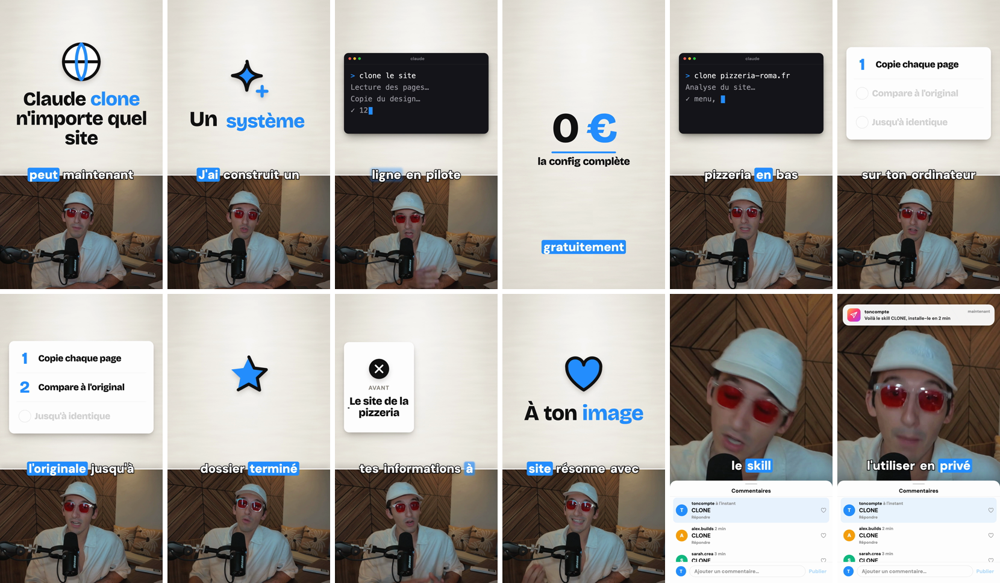

# video-agent-skills

Free Claude Code skills to script, edit, translate and publish your videos: short-form (YouTube Shorts, TikTok, Instagram Reels) and full YouTube videos.

No app, no server, no subscription. The skills tell Claude how to work, and `short-editing` ships its own render engine (Node + Chrome + ffmpeg, whisper.cpp for the words, all on your computer, macOS, Windows and Linux), with six real shorts made with it as examples. Optional: [Treg](https://treg.to) to audit your Instagram and publish on YouTube, Instagram and TikTok, an ElevenLabs key to translate, Codex to generate images.

## Start here

Three steps to your first edited video:

1. **Install** the skills (below), open Claude Code in your project folder.
2. **`/studio-setup`**: checks your tools, sets up the render engine, writes your `voice.md` and makes the default look yours (7 quick questions: look, color, fonts, captions, pace, Instagram CTA, the real logos of your tools, previewed on your own footage). About 15 minutes, once.
3. Record a take (phone, webcam, camera), drop it in `video-agent/takes/`, then **`/short-editing`**. You get `video-agent/edits/short-<slug>/output/short-<slug>.mp4`, opened for you, plus the .srt captions and the post text.

Not sure which skill to use next? Type `/editing <what you want>`: it picks the right one.

## What you get by default



Every short comes out in the same finished look, with no setting to touch:

- **Split screen**: a textured paper on top, the camera as a card under one fixed seam.
- **Hard cuts between views**: split, paper only for the big moments, full camera for the stories, a punch-in that alternates on every cut.
- **Boards on the exact word**: numbers that count up and get struck, a terminal that types, a folder tree, the tool's real logo, a tweet, a real screen with zooms and rings, bar charts, and HTML motion components captured into clips (see `skills/short-editing/examples/`).
- **Hook** already moving on frame 0, thuds and pops only on the payoffs (no whooshes), one of 8 calm music beds under the voice.
- **Captions** 1 to 3 words, the said word on your color, sitting on the seam.
- **Comment CTA**: the Instagram comment sheet with your word typed in, then the DM notification.
- Ultra cut: every pause over 0.3 s gone, the take at 1.15x, voice at -14 LUFS.

`/studio-setup style` changes the colors, paper (light, dark, cream), fonts, captions and sound to yours, never the layout.

## The skills

| Skill | What it does |
|---|---|
| `/editing` | The entry point. Say what you want ("edit my last take", "scripts for this week", "publish it"), it picks the right skill and continues the video in progress instead of starting over. |
| `/studio-setup` | Start here. Sets up video editing on your computer and in your project: checks the tools, creates `video-agent/`, prepares the editing studio, writes your `voice.md` from your own videos or a short interview, sets your default style (`/studio-setup style`: one question at a time on your color, paper, fonts, captions, sound, Instagram handle and comment word, the real logos of the tools you name, your logo and end card, previewed on your own footage), pre-approves the commands, and optionally connects Treg, ElevenLabs and Codex. |
| `/insta-audit` | Installs Treg if needed, connects your Instagram and audits it: your last reels with real stats (views, watch time, saves, shares), what over-performs against your own median, the first seconds of your best and worst reels, and the 3 changes to make, in `audit.md`. `/insta-audit @handle` adds up to 5 competitors and a sourced HTML report (paid calls, price said first). |
| `/studio-script` | A week of scripts from what really happened in your week, in your voice: 3 hooks per script from 22 formulas, scored, a re-hook, timing checked at your pace, visual notes, then a humanize pass (invisible characters, AI words in English and French, AI sentence shapes, facts checked). Also `viral` (what over-performs in your niche: recent Shorts of 10 to 12 accounts, outliers against each account's median, the first 3 seconds of each, saved to `swipe.md`), `hook <topic>` and `humanize <text>` for any caption or description. |
| `/outliers` | The reels and TikToks that blew up for your competitors, measured against each account's own median (3x or more, sponsored reels out), from a watchlist it builds and grows with you (70 % your main language, 30 % a second one), plus your own best reels. Repeated hits (a recipe) beat lucky ones; the 5 best become remake scripts in your voice. `/outliers @handle` (or `tiktok:handle`) digs one account. Treg, about $0.001 a page of reels. |
| `/short-editing` | A raw take into a finished video: a short (1080×1920, split-screen paper look, everything in the platforms' safe zone) or a full YouTube video (1920×1080, same look side by side). Silences and retakes cut, the take sped to 1.15x, boards on the exact word (titles, lists, numbers, before/after, terminal, screenshots, real tool logos), hard cuts between split, paper and full camera, hook with sound effects, captions, a comment CTA, your logo and end card, voice at -14 LUFS, an .srt for CapCut or Premiere, and the post copy. |
| `/steal` | Copies another creator's editing style from one of their reels: measures it with ffmpeg (cuts per second, layouts, captions, the beat and the sound effects on a spectrogram, the music level under the voice, the face size and the zooms), writes it to `video-agent/styles/<name>.md`, then edits a test video with `short-editing` and compares the two frame by frame. Then `/short-editing <take> style <name>` uses it. |
| `/broll` | Your own B-roll (clips, screen recordings, photos) as a library Claude searches in one grep: scanned once with ffmpeg (length, orientation, date, GPS, a contact sheet per clip), tagged by cheap Haiku sub-agents (title, mood, keywords, you on screen or not). `/broll add` for new clips, `/broll use` puts the right ones full screen on the short in progress, checked by eye first. |
| `/clips` | One long video (yours, a podcast, a live) into finished shorts: the moments that stand alone, each one edited with `short-editing` (hook, boards, captions), plus new scripts from the ideas too spread out to clip. |
| `/short-translate` | A take in another language with your own cloned voice, through ElevenLabs Dubbing and your key, then edited with captions in the new language. |
| `/vox` | One photo into a cinematic paper-collage animation in the style of Vox documentaries: your real photo cut out and printed as halftone, paper layers generated by Codex, stop-motion moves and a slow camera push-in in an HTML page, captured to an MP4. Then change anything with one more prompt ("do it with Napoleon"). |
| `/codex-images` | Thumbnails, covers and stills generated with Codex's image tool (your ChatGPT plan), several in parallel, with your photos as reference. |
| `/publish` | Publishes a finished video on YouTube (Shorts or long, scheduled or now), Instagram Reels and TikTok through Treg, with the light export, the cover, the caption and the title. Nothing goes out before your yes. Without Treg, a ready-to-post kit. |

## Install

In your project folder:

```bash
npx skills add Melvynx/video-agent-skills -a claude-code
```

Add `-g` to install them for every project. `npx skills update` gets the latest version.

Installed before October 2026, with the old `video-*` names? Remove them, then install again (add `-g` to both if you installed globally):

```bash
npx skills remove video-setup video-script video-viral video-audit video-edit video-steal video-translate video-publish long-to-short-videos -y
npx skills add Melvynx/video-agent-skills -a claude-code
```

`/video-setup` is now `/studio-setup`, `/video-script` `/studio-script`, `/video-viral` `/studio-script viral`, `/video-audit` `/insta-audit`, `/video-edit` `/short-editing`, `/video-steal` `/steal`, `/video-translate` `/short-translate`, `/video-publish` `/publish`, `/long-to-short-videos` `/clips`.

Or paste `https://github.com/Melvynx/video-agent-skills` into Claude Code and ask it to install these skills.

Or copy them by hand (into `~/.claude/skills/` instead for every project). macOS and Linux:

```bash
git clone https://github.com/Melvynx/video-agent-skills.git
mkdir -p .claude/skills
cp -r video-agent-skills/skills/* .claude/skills/
```

Windows (PowerShell):

```powershell
git clone https://github.com/Melvynx/video-agent-skills.git
New-Item -ItemType Directory -Force .claude\skills | Out-Null
Copy-Item -Recurse -Force video-agent-skills\skills\* .claude\skills\
```

To update a manual install: `git -C video-agent-skills pull`, then copy again.

Then, in Claude Code: `/studio-setup`.

On claude.ai: zip one skill folder and upload it in the Skills part of the settings. Only `studio-script` works there (scripts, hooks, humanize); the others need your computer's tools.

## The flow

```text
/studio-setup          once: tools, engine, voice.md, your style, permissions, accounts
/insta-audit           what works on your own Instagram → audit.md
/studio-script viral   what works in your niche → swipe.md
/outliers              what blew up for your competitors → 5 remake scripts
/studio-script         this week's scripts → video-agent/scripts/
                       record them (phone, camera, webcam) → video-agent/takes/
/short-editing         each take → video-agent/edits/short-<slug>/output/ (9:16, 1:1 or 16:9)
/broll                 your own clips → a library, placed on your edits
/steal                 a creator's reel → a second style short-editing can use
/clips                 a long video → finished shorts
/short-translate       a take → the same take in another language, your voice
/codex-images          thumbnails, covers, end cards
/vox                   a photo → a paper-collage animation
/publish               YouTube, Instagram, TikTok
```

Not sure which one? `/editing <what you want>` picks it for you.

Everything lives in one folder at the root of your project:

```text
video-agent/
├── voice.md      who you are and how you talk
├── swipe.md      hooks that worked in your niche
├── audit.md      what works on your own Instagram
├── audits/       full Instagram reports (insta-audit @handle)
├── log.md        one line per script, so nothing repeats
├── scripts/      one file per week
├── takes/        raw recordings
├── style.json    names your default style
├── styles/       default/ (your look: style.json + assets/logos of your tools), and styles copied with steal
├── competitors.json  the watchlist of /outliers
├── outliers/     the outlier rankings
├── edits/        one folder per edited video (source/spec.js, output/ with the mp4, .srt, post.md)
├── repurpose/    one plan per long video
├── images/       generated images not tied to a video
├── broll/        your B-roll library (index, frames, clips)
├── vox/          one folder per Vox animation
├── .env          your API keys (git-ignored)
└── .tmp/         scratch files
```

## Tools

| Tool | For | Cost |
|---|---|---|
| Node 20+, git | the render engine of short-editing | free |
| ffmpeg | cuts, audio, conversions | free |
| yt-dlp + deno | YouTube views, captions, transcripts | free |
| Chrome (or a headless Chromium) + whisper.cpp | the render and the word timings, installed by `engine/setup.mjs` on the first edit (about 0.6 GB, once) | free |
| Treg (optional) | your Instagram audit, publishing on YouTube, Instagram and TikTok, TikTok and Instagram numbers of other accounts (CLI with Python 3.12+ on macOS and Linux, or the MCP on any OS) | your own accounts free, other accounts about $0.001 a call, $1 free credit on signup |
| ElevenLabs (optional) | `short-translate`, with your API key | your ElevenLabs plan |
| Codex (optional) | `codex-images`, `vox` (`npm i -g @openai/codex`) | your ChatGPT plan |

`studio-setup` gives the install command for each, on macOS, Windows and Linux.

## Permissions

`studio-setup` merges a short allow list into `.claude/settings.json` (`yt-dlp`, `ffmpeg`, `ffprobe`, the engine `node .claude/skills/short-editing/engine/*`, and Treg's free read-only commands). Never `Bash(*)`. Paid Treg calls always ask first, and the skills say the price before. Publishing and dubbing wait for your explicit yes. Keys live in `video-agent/.env`, never in a chat or a commit.

## Honest limits

- One layout family on purpose (the split-screen paper look, with paper-only and full-camera views): you change its colors, fonts, captions, pace and sound. No review studio, no recorder, no B-roll database app: the paid course [Editing IA Pro](https://codelynx.dev/editing) adds them.
- Auto-captions mishear names and numbers. Check them.
- Without Treg, research is YouTube only and publishing is manual (the skill hands you a ready kit).
- Translation has no lip-sync: the image stays the original.
- Generated images need a check: text can come out misspelled.
- Only download and cut videos you own or have the rights to.

## Tell us how it went

Your first video is out? Leave a one-minute review at [codelynx.dev/editing/feedbacks](https://codelynx.dev/editing/feedbacks?utm_source=github&utm_medium=readme&utm_campaign=video-agent-skill): what worked, where you got stuck, what to add. Every answer is read and the pack gets fixed from them.

## Want the full version?

These skills are the free base of [Editing IA Pro](https://codelynx.dev/editing/vsl?utm_source=github&utm_medium=readme&utm_campaign=video-agent-skill). The free pack gets you set up and posting clean videos; the full version does the finishing: the full motion design engine (drawn objects, UI mockups, more layouts and board types), a library of styles, music beds and sound design, a review studio where you comment the video frame by frame, a teleprompter recorder, faceless avatars, covers, thumbnails and titles. Same skill names (`/editing`, `/studio-setup`, `/studio-script`, `/short-editing`, `/steal`, `/insta-audit`, `/publish`...), so moving up changes nothing in how you work.

## License

MIT
