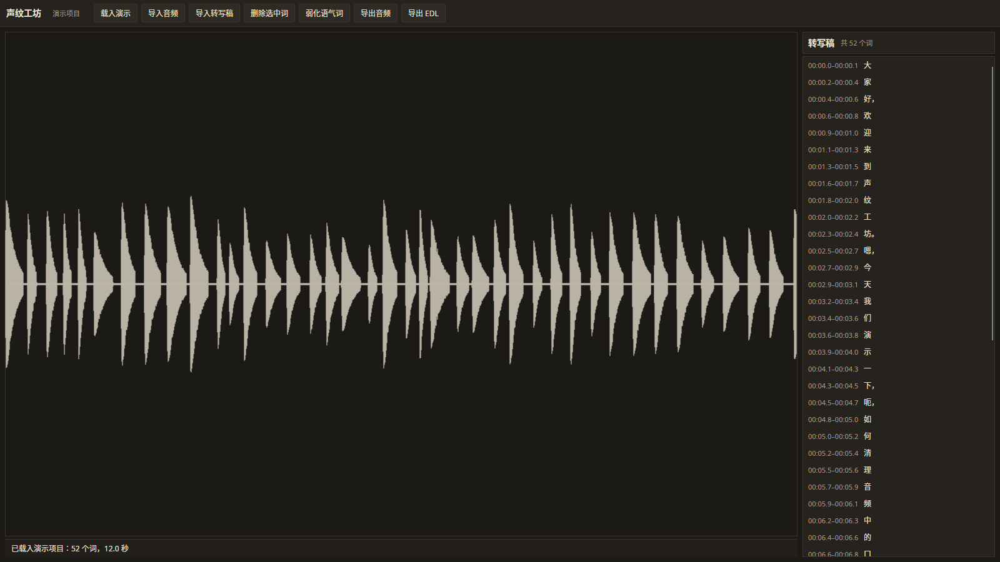
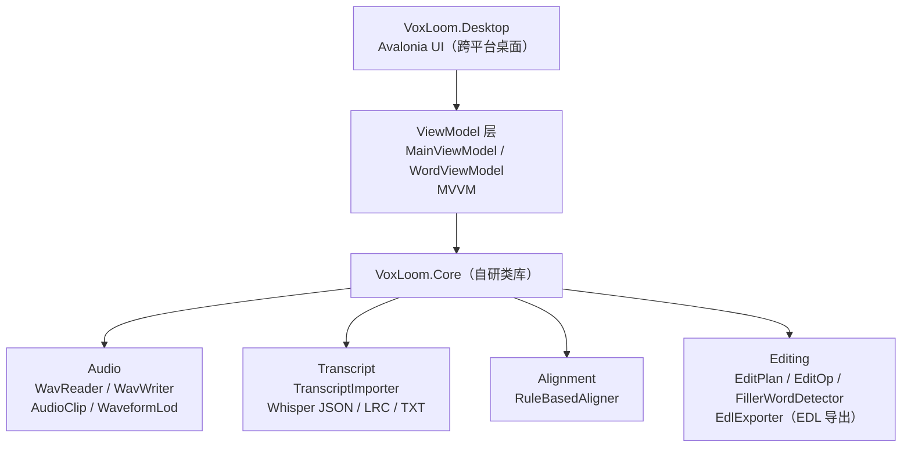

# VoxLoom（声纹工坊）

剪播客口误，现在要对着波形一帧一帧找位置，一期节目能剪掉一个下午。

VoxLoom 换个做法：把转写稿当成时间轴。你在文字上删掉一句话，它自动把对应的音频剪掉。删句子就是剪音频。

这是一个中文播客 / 有声书创作者的桌面剪辑工具。本地运行，开源，MIT 协议。



> 主界面。深色录音棚调音台配色，左侧波形、右侧转写稿，文字与音频双向联动。截图为 Xvfb 下真实渲染抓屏，不是设计稿。

---

## 快速开始

需要 [.NET 8 SDK](https://dotnet.microsoft.com/download/dotnet/8.0)。

```bash
# 1. 克隆
git clone https://github.com/Wanfeng1028/muse.git
cd muse/voxloom

# 2. 构建
dotnet build VoxLoom.sln

# 3. 运行桌面端
dotnet run --project src/VoxLoom.Desktop
```

启动后点界面上的「载入演示」按钮。内置演示工程（DemoProjectGenerator）会自动生成一段带转写稿的音频，不用自己准备素材就能走完整个流程：看波形、点文字跳音频、删句子、弱化语气词、导出 EDL。 导入 MP3 / FLAC / M4A 需要本机装有 ffmpeg（Ubuntu/Debian：`sudo apt install ffmpeg`；macOS：`brew install ffmpeg`），也可用环境变量 `VOXLOOM_FFMPEG_PATH` 指定路径；WAV 不需要。

命令行模式（不用开界面）：`--demo-wav <输出wav>` 生成演示音频与转写稿；`--screenshot <输出png>` 在 Xvfb 下离屏抓屏；`--metrics [--json] [--hours N]` 汇总近 N 小时操作指标（默认 24 小时）；`--probe-import/--probe-backup/--probe-restore` 是给运维脚本用的探针（成功输出 `OK` 开头，失败 `ERROR:` 开头，退出码 0/2/3）。配置走 `config.json` + `VOXLOOM_*` 环境变量覆盖（`VOXLOOM_LOG_DIR`、`VOXLOOM_BACKUP_DIR`、`VOXLOOM_FFMPEG_PATH` 等），配置文件里不许放密钥，启动时校验，违规退出码 2。

跑测试：

```bash
dotnet test VoxLoom.sln
```

93 个测试全绿（本地用 tests/VoxLoom.SmokeRunner 反射直跑全部 [Fact]；CI 走 vstest）。

---

## 为什么不用 Descript

Descript 是个成熟产品，它做得好的地方不用回避：转写质量高、支持多人协作、团队编辑流程完整。如果你要的是团队云端协作和英文内容，Descript 是对的。

VoxLoom 解决的是另一个问题。下面是实际差异：

| 维度 | VoxLoom | Descript |
| --- | --- | --- |
| 开源 / 闭源 | 开源（MIT） | 闭源 |
| 中文支持 | 面向中文，界面和剪辑流程按中文习惯设计 | 英文优先，中文支持较弱 |
| 运行方式 | 本地桌面应用，音频不出本机 | 云端为主 |
| 价格模式 | 免费，无订阅 | 订阅制 |
| EDL 导出 | 支持，可交给 Premiere / Reaper 精修 | 以自身编辑流程为中心 |
| 转写 | v1 靠外部导入转写稿 | 内置转写，质量成熟 |
| 协作 | 无 | 支持多人编辑 |

一句话：Descript 是「云端协作 + 内置转写」的一体化产品，VoxLoom 是「本地 + 文字驱动剪辑 + 可导出到专业 DAW / NLE」的轻量工具。前者要的是闭环，后者要的是可控和可衔接。

开源侧还有一个现实：文字驱动音频剪辑的工具本来就少，中文场景基本是空白。VoxLoom 想填的是这个位置。

---

## 架构



Core 与 UI 完全解耦，可以单独引用。如果你只想用剪辑逻辑，不想要界面，直接引 `VoxLoom.Core` 就行。

### Core 模块说明

**Audio**
- `WavReader` / `WavWriter`：WAV 读写。
- `AudioClip`：音频片段的内存表示。
- `WaveformLod`：多级波形金字塔。千万级采样点缩放不卡，靠的是按层级预计算峰值，不是每次重算。

**Transcript**
- `TranscriptImporter`：导入带时间戳的转写稿。支持 Whisper JSON、LRC、TXT 三种格式。

**Alignment**
- `RuleBasedAligner`：把转写稿的时间戳对齐到音频。v1 是规则 + 轻量对齐。

**Editing**
- `EditPlan` / `EditOp`：剪辑计划与操作。三种操作：`Delete`（删除）、`Replace`（替换）、`Attenuate`（弱化）。
- 剪辑时自动找过零点（ZeroCrossing）+ 短交叉淡化，避免爆音和跳帧感。
- `FillerWordDetector`：检测语气词（「嗯」「那个」）。
- `EdlExporter`：导出 EDL（CMX3600），交给 Premiere / Reaper 做精修。

---

## 功能（v1）

1. **音频导入 + 波形渲染** — 支持 WAV / MP3 / FLAC / M4A（压缩格式走 ffmpeg 真实解码），波形按多级金字塔渲染，缩放流畅。
2. **转写稿对齐 + 双向定位** — 点文字跳到对应音频位置，点波形反查对应文字。
3. **文字删除 → 音频剪辑** — 在文字上删掉句子，自动生成剪辑操作。剪辑点自动找过零点并加短交叉淡化，避免爆音。
4. **语气词一键弱化** — 检测「嗯」「那个」这类语气词，衰减 12dB 而不是直接静音。保留呼吸节奏，听感更自然。这是刻意设计的选择：静音会让语句之间出现生硬的断裂，弱化则保留了说话的呼吸感。
5. **导出 EDL** — 给 Premiere / Reaper 做精修。VoxLoom 不打算取代专业 DAW，它负责把粗剪做完。
6. **备份与恢复** — 删除/弱化前自动备份，工具栏可手动备份/恢复（zip + manifest + sha256 校验，保留最近 10 份）；备份可加密（PBKDF2-SHA256 派生 AES-256-GCM，密码只走环境变量 `VOXLOOM_BACKUP_PASSWORD`）；恢复前先看文件清单再确认。
7. **日志与指标** — 结构化 JSON 日志（op_id 全链路关联、敏感字段脱敏、5MB 轮转保留 10 份，控制台是人读格式）；操作指标落 `metrics-*.jsonl`（转写导入/对齐/剪辑/导出/备份的计数与延迟），`--metrics` 看汇总，`scripts/check-alerts.sh` 按 `docs/ALERTS.md` 判告警。

界面文案是中文人话，比如按钮写的是「把这句剪掉」，不是「Delete Segment」。

---

## 路线图

**v2**
- ONNX 本地语音模型做精对齐，替换 v1 的规则 / 轻量对齐。
- 内置转写，不再依赖外部导入。

---

## v1 的边界（说清楚）

这部分直说，免得你下载了才发现不对：

- **转写稿靠外部导入**。v1 不做内置转写。你需要先用 Whisper 或飞书妙记导出带时间戳的文本，再导入进来。内置转写是 v2 的事。
- **对齐是规则 + 轻量方案**，不是声学模型。转写稿时间戳质量差的时候，对齐结果会跟着差。v2 上 ONNX 本地声学模型做精对齐。
- **没有协作功能**。这是本地单机工具。
- **不做多轨混音**。它做的是单条人声的粗剪，精修交给 DAW。
- **备份加密是可选的**。默认备份 zip 不加密（见 docs/SECURITY_DATA.md 的敏感数据策略）；需要保密时备份传入密码即走 AES-256-GCM 加密，密码只走环境变量 `VOXLOOM_BACKUP_PASSWORD`，不落配置文件。

如果你需要的是内置转写 + 云端协作，v1 不适合你，等 v2 或直接用 Descript。

---

## 命名由来

Vox（声音）+ Loom（织布机）。把声音像织布一样精细编织。

中文名「声纹工坊」：工坊是手艺人的地方，讲的是精修和匠气，不是流水线。

---

## 贡献

欢迎提 Issue 和 PR。开工前建议先开个 Issue 聊一下方向，避免白做。

适合上手的方向：
- 转写格式的导入支持（目前三种，可以加）。
- 语气词词表扩充。
- 平台相关的 UI 细节。

提交 PR 前请确保 `dotnet test VoxLoom.sln` 全绿。

---

## License

MIT。见 [LICENSE](LICENSE)。

